# Event storm - fleetd: the horch fleet control plane

## In plain words

This step lists, in time order, everything that happens to 1 idea in fleetd: from 'horch idea add' to the feature merged in the primary branch, with the people and programs that cause each step.

**Decided:** The flow has 5 phases cut at 4 moments: the operator approves the assumptions, the plan commits, the verifier marks a task done, and every task of the idea lands on its feature branch.

**Assumed:** The daemon restart and adapter checks fit at the end of task execution, and a feature is opened only when the first assumptions exist. Both are open for the operator.

**Riskiest:** The words 'ready', 'landed' and 'done' each mean 2 or 3 different states. If later steps merge them, a status can say work is safe when it has not reached the primary branch.

---

_Step 2 (discover) - produced by `ddd-discover` - mode `auto` - depth `standard` - 2026-11-12T17:20:05Z_
_Inputs: `ddd/01-understand/understand.json`, `ddd/manifest.json`, `ddd/glossary.md`, `docs/specs/fleetd/design.md`, `docs/architecture.md`, `docs/specs/fleetd/preservation-04-behavior.md`, `docs/specs/fleetd/preservation-05-contracts-and-values.md`, `docs/specs/fleetd/preservation-06-wiring-and-platform.md`, `ai_docs/plans/fleetd-design/ddd-context.md`_

> Rendered from `discover.json` by `ddd discover render`. The JSON is the chain: edit it (or re-run `/ddd-discover`) and re-render rather than editing this file by hand.

## How to read this board

| Sticky | Meaning |
|---|---|
| Domain event (orange) | A business fact that happened, past tense: *Order Placed*. The spine of the board. |
| Command (blue) | The decision or intent that caused an event, imperative: *Place Order*. Issued by an actor or a policy. |
| Actor (yellow) | A person, role or team issuing commands. |
| External system (pink) | A system outside our control that we call or that calls us (payment provider, courier). |
| Policy (lilac) | "Whenever *event* then *command*" - an automatic or manual reaction. Business rules live here. |
| Read model (green) | What the actor needs to see to decide on a command. |
| Hotspot (magenta; shown as [H1] next to the event) | A disagreement, unknown, risk or gap. A finding, not a failure. |
| Pivotal event (marked *(pivotal)*; bold border in the diagram) | Marks a phase change; a boundary candidate for ddd-decompose. |

## Summary

- **82 events** in **5 phases** (depth `standard` expects roughly 25-60); **4 pivotal**: Assumptions Approved (assumptions-approved), Plan Committed (plan-committed), Task Done (task-done), Idea Tasks Landed (idea-tasks-landed)
- 64 commands, 62 policies, 9 read models, 4 actors, 7 external systems, 10 aggregate candidates
- 15 hotspots, 4 scenarios, 20 glossary terms, 10 assumptions, 5 open questions (0 blocking)

## Timeline

1. Clarifying an idea -> 2. Planning -> 3. Executing and verifying tasks -> 4. Landing task branches -> 5. Integrating the feature

### Phase 1 - Clarifying an idea

_12 events - id `clarifying`_

| # | Event | Triggered by | Actor | Read model | Whenever this, then | Notes |
|---|---|---|---|---|---|---|
| 10 | **Idea Captured** [H7] `idea-captured` | Add Idea `add-idea` | Operator |  | Start Sub-Orchestrator | horch idea add writes 1 immutable idea file and 1 ledger row in state captured. --to joins an open feature. - data: ideaId, text, featureId? |
| 20 | **Sub-Orchestrator Started** [H3] `sub-orchestrator-started` | Start Sub-Orchestrator `start-sub-orchestrator` |  |  |  | fleetd opens pane idea-NNNN with a fresh sub-orchestrator process for the phase. The idea moves to clarifying. - data: ideaId, featureId, pane, phase |
| 30 | **Interview Question Asked** `interview-question-asked` | Ask Operator `ask-operator` | Sub-orchestrator |  |  | The sub-orchestrator asks the operator 1 question in its pane, after it reads the code and docs the idea touches. - data: ideaId, question |
| 40 | **Interview Answer Recorded** `interview-answer-recorded` | Answer Interview Question `answer-interview-question` | Operator |  |  | horch idea note appends the question and the answer to interview.md. - data: ideaId, question, answer |
| 50 | **Idea Amended** `idea-amended` | Amend Idea `amend-idea` | Operator |  |  | horch idea amend adds 1 amendment file. Before approval it joins the interview. After approval it becomes a revise. - data: ideaId, amendment |
| 60 | **Assumptions Written** `assumptions-written` | Write Assumptions `write-assumptions` | Sub-orchestrator | Idea folder (idea.md, amendments, interview.md) | Open Feature | assumptions.md validates with no item marked [open]. - data: ideaId, assumptions[] |
| 70 | **Feature Opened** [H2] `feature-opened` | Open Feature `open-feature` |  |  | Request Approval | fleetd checks the kebab-case name, writes the features row, then creates the feature branch. For a --direct idea with no --to it happens at acceptance. - data: featureId, name, branch, primaryBranch |
| 80 | **Approval Requested** `approval-requested` | Request Approval `request-approval` |  |  | Park Idea | The idea moves to awaiting_approval. fleetd posts a herdr notification and lists the idea under Needs you. The idea lease is paused. - data: ideaId, assumptionsHash |
| 90 | **Idea Parked** `idea-parked` | Park Idea `park-idea` |  |  |  | The idea leaves the queue: 7 days with no answer, an escalation, or horch idea park. Worktrees are rescued first. - data: ideaId, reason |
| 100 | **Idea Cancelled** `idea-cancelled` | Cancel Idea `cancel-idea` | Operator |  |  | horch idea cancel. Worktrees are rescued first. - data: ideaId |
| 110 | **Assumptions Revised** `assumptions-revised` | Revise Assumptions `revise-assumptions` | Operator |  | Start Sub-Orchestrator | horch idea revise sends the idea back to clarifying. - data: ideaId, text |
| 120 | **Assumptions Approved** (pivotal) `assumptions-approved` | Approve Assumptions `approve-assumptions` | Operator | Idea board and assumptions (horch ideas, horch idea show) | Start Sub-Orchestrator | horch idea approve, run outside any fleet attempt. fleetd writes approval.json with the hash of the assumptions the operator saw. - data: ideaId, assumptionsHash |

Hotspots in this phase:

- **H7** (unclear, near `idea-captured`): The idea row records its feature (ideas.feature_id), but the feature row and branch are written when the sub-orchestrator first writes assumptions. Which feature does an idea with no --to point at between capture and assumptions, and what does horch ideas show for it?
- **H3** (conflict, near `sub-orchestrator-started`): 'Orchestrator' today is 1 long-lived LLM conversation that receives ideas, creates tasks and reads mail. In fleetd it does not exist: a deterministic idea dispatcher and 1 sub-orchestrator per feature replace it. Today's mail contract still names [orchestrator re #<id>] answers (understand N3).
- **H2** (conflict, near `feature-opened`): 'Feature' is also a task kind (kind: feature, a code kind) and a word for any change. In fleetd a Feature is 1 sub-orchestrator, 1 feature branch and 1 pull request holding 1 main idea and its follow-on ideas. Which meaning does each document use (understand N2)?

```mermaid
flowchart LR
  classDef event fill:#F6A623,stroke:#8A5A00,color:#000
  classDef pivotal fill:#F6A623,stroke:#000,stroke-width:3px,color:#000
  classDef command fill:#8FB8FF,stroke:#1F4E9C,color:#000
  classDef policy fill:#C9A7EB,stroke:#5B2D8E,color:#000
  classDef readmodel fill:#9EDF9C,stroke:#2E7D32,color:#000
  classDef hotspot fill:#FF3B8D,stroke:#8B0040,color:#fff
  classDef external fill:#F8C6DF,stroke:#A3325F,color:#000
  subgraph ph_clarifying["1 - Clarifying an idea"]
    direction LR
    e_idea_captured["Idea Captured"]:::event
    c_add_idea["Operator<br/>Add Idea"]:::command
    h_H7>"H7: The idea row records its feature ideas.feature_id, but the..."]:::hotspot
    p_start_lead_on_capture{{"Whenever an idea is captured, start a sub-orchestrator for its feature"}}:::policy
    e_sub_orchestrator_started["Sub-Orchestrator Started"]:::event
    c_start_sub_orchestrator["Start Sub-Orchestrator"]:::command
    h_H3>"H3: 'Orchestrator' today is 1 long-lived LLM conversation that..."]:::hotspot
    e_interview_question_asked["Interview Question Asked"]:::event
    c_ask_operator["Sub-orchestrator<br/>Ask Operator"]:::command
    e_interview_answer_recorded["Interview Answer Recorded"]:::event
    c_answer_interview_question["Operator<br/>Answer Interview Question"]:::command
    e_idea_amended["Idea Amended"]:::event
    c_amend_idea["Operator<br/>Amend Idea"]:::command
    e_assumptions_written["Assumptions Written"]:::event
    c_write_assumptions["Sub-orchestrator<br/>Write Assumptions"]:::command
    r_interview_record(["Idea folder idea.md, amendments, interview.md"]):::readmodel
    p_open_feature_on_assumptions{{"Whenever assumptions are written for an idea with no feature branch,..."}}:::policy
    e_feature_opened["Feature Opened"]:::event
    c_open_feature["Open Feature"]:::command
    h_H2>"H2: 'Feature' is also a task kind kind: feature, a code kind an..."]:::hotspot
    p_request_approval_on_feature{{"Whenever the feature of an idea with valid assumptions is open, reque..."}}:::policy
    e_approval_requested["Approval Requested"]:::event
    c_request_approval["Request Approval"]:::command
    p_park_on_unanswered_approval{{"Whenever approval is requested and 7 days pass with no answer, park t..."}}:::policy
    e_idea_parked["Idea Parked"]:::event
    c_park_idea["Park Idea"]:::command
    e_idea_cancelled["Idea Cancelled"]:::event
    c_cancel_idea["Operator<br/>Cancel Idea"]:::command
    e_assumptions_revised["Assumptions Revised"]:::event
    c_revise_assumptions["Operator<br/>Revise Assumptions"]:::command
    p_restart_lead_on_revise{{"Whenever assumptions are revised, start a fresh sub-orchestrator in c..."}}:::policy
    e_assumptions_approved["Assumptions Approved"]:::pivotal
    c_approve_assumptions["Operator<br/>Approve Assumptions"]:::command
    r_idea_board(["Idea board and assumptions horch ideas, horch idea show"]):::readmodel
    p_specify_on_approval{{"Whenever assumptions are approved, start a fresh sub-orchestrator in..."}}:::policy
  end
  c_add_idea --> e_idea_captured
  e_idea_captured -.- h_H7
  e_idea_captured --> p_start_lead_on_capture
  p_start_lead_on_capture --> c_start_sub_orchestrator
  e_idea_captured ~~~ e_sub_orchestrator_started
  c_start_sub_orchestrator --> e_sub_orchestrator_started
  e_sub_orchestrator_started -.- h_H3
  e_sub_orchestrator_started ~~~ e_interview_question_asked
  c_ask_operator --> e_interview_question_asked
  e_interview_question_asked ~~~ e_interview_answer_recorded
  c_answer_interview_question --> e_interview_answer_recorded
  e_interview_answer_recorded ~~~ e_idea_amended
  c_amend_idea --> e_idea_amended
  e_idea_amended ~~~ e_assumptions_written
  r_interview_record -.-> c_write_assumptions
  c_write_assumptions --> e_assumptions_written
  e_assumptions_written --> p_open_feature_on_assumptions
  p_open_feature_on_assumptions --> c_open_feature
  e_assumptions_written ~~~ e_feature_opened
  c_open_feature --> e_feature_opened
  e_feature_opened -.- h_H2
  e_feature_opened --> p_request_approval_on_feature
  p_request_approval_on_feature --> c_request_approval
  e_feature_opened ~~~ e_approval_requested
  c_request_approval --> e_approval_requested
  e_approval_requested --> p_park_on_unanswered_approval
  p_park_on_unanswered_approval --> c_park_idea
  e_approval_requested ~~~ e_idea_parked
  c_park_idea --> e_idea_parked
  e_idea_parked ~~~ e_idea_cancelled
  c_cancel_idea --> e_idea_cancelled
  e_idea_cancelled ~~~ e_assumptions_revised
  c_revise_assumptions --> e_assumptions_revised
  e_assumptions_revised --> p_restart_lead_on_revise
  p_restart_lead_on_revise --> c_start_sub_orchestrator
  e_assumptions_revised ~~~ e_assumptions_approved
  r_idea_board -.-> c_approve_assumptions
  c_approve_assumptions --> e_assumptions_approved
  e_assumptions_approved --> p_specify_on_approval
  p_specify_on_approval --> c_start_sub_orchestrator
```



### Phase 2 - Planning

_5 events - id `planning`_

| # | Event | Triggered by | Actor | Read model | Whenever this, then | Notes |
|---|---|---|---|---|---|---|
| 130 | **Direct Idea Accepted** `direct-idea-accepted` | Add Direct Idea `add-direct-idea` | Operator |  | Open Feature | horch idea add --direct: no research and no interview. The idea goes from captured to ticketing. The ticket stands for the approval. - data: ideaId, ticketFile, featureId |
| 140 | **Spec Written** `spec-written` | Write Spec `write-spec` | Sub-orchestrator |  |  | spec.md and requirements.yaml validate, and every requirement cites an approved assumption or an operator answer. The idea moves to ticketing. - data: ideaId, requirements[] |
| 150 | **Plan Submitted** `plan-submitted` | Submit Plan `submit-plan` | Sub-orchestrator | Diffs of in-flight features | Validate Plan | The tickets and plan.yaml are on disk for validation. - data: ideaId, tasks[], dependencies |
| 160 | **Plan Refused** `plan-refused` | Validate Plan `validate-plan` |  |  | Escalate Task | The plan validator refuses the plan, for example a judgment task with no paired judge, or a project with no declared fast and full gate. A refused --direct plan goes to needs-you/. - data: ideaId, reasons[] |
| 170 | **Plan Committed** (pivotal) `plan-committed` | Validate Plan `validate-plan` |  |  | Promote Task | The plan passes validation and its tasks commit in 1 transaction. The idea moves to in_progress. No task exists outside a committed plan. - data: ideaId, taskIds[] |

```mermaid
flowchart LR
  classDef event fill:#F6A623,stroke:#8A5A00,color:#000
  classDef pivotal fill:#F6A623,stroke:#000,stroke-width:3px,color:#000
  classDef command fill:#8FB8FF,stroke:#1F4E9C,color:#000
  classDef policy fill:#C9A7EB,stroke:#5B2D8E,color:#000
  classDef readmodel fill:#9EDF9C,stroke:#2E7D32,color:#000
  classDef hotspot fill:#FF3B8D,stroke:#8B0040,color:#fff
  classDef external fill:#F8C6DF,stroke:#A3325F,color:#000
  subgraph ph_planning["2 - Planning"]
    direction LR
    e_direct_idea_accepted["Direct Idea Accepted"]:::event
    c_add_direct_idea["Operator<br/>Add Direct Idea"]:::command
    p_open_feature_on_direct{{"Whenever a direct idea with no --to is accepted, open a feature named..."}}:::policy
    stub_open_feature["Open Feature -> Clarifying an idea"]:::command
    e_spec_written["Spec Written"]:::event
    c_write_spec["Sub-orchestrator<br/>Write Spec"]:::command
    e_plan_submitted["Plan Submitted"]:::event
    c_submit_plan["Sub-orchestrator<br/>Submit Plan"]:::command
    r_in_flight_diffs(["Diffs of in-flight features"]):::readmodel
    p_validate_on_plan_submitted{{"Whenever a plan is submitted, validate it"}}:::policy
    e_plan_refused["Plan Refused"]:::event
    c_validate_plan["Validate Plan"]:::command
    p_escalate_on_plan_refused{{"Whenever a direct plan is refused, escalate it to needs-you"}}:::policy
    stub_escalate_task["Escalate Task -> Executing and verifying tasks"]:::command
    e_plan_committed["Plan Committed"]:::pivotal
    p_promote_on_plan_committed{{"Whenever a plan is committed, promote the tasks with no dependencies"}}:::policy
    stub_promote_task["Promote Task -> Executing and verifying tasks"]:::command
  end
  c_add_direct_idea --> e_direct_idea_accepted
  e_direct_idea_accepted --> p_open_feature_on_direct
  p_open_feature_on_direct --> stub_open_feature
  e_direct_idea_accepted ~~~ e_spec_written
  c_write_spec --> e_spec_written
  e_spec_written ~~~ e_plan_submitted
  r_in_flight_diffs -.-> c_submit_plan
  c_submit_plan --> e_plan_submitted
  e_plan_submitted --> p_validate_on_plan_submitted
  p_validate_on_plan_submitted --> c_validate_plan
  e_plan_submitted ~~~ e_plan_refused
  c_validate_plan --> e_plan_refused
  e_plan_refused --> p_escalate_on_plan_refused
  p_escalate_on_plan_refused --> stub_escalate_task
  e_plan_refused ~~~ e_plan_committed
  c_validate_plan --> e_plan_committed
  e_plan_committed --> p_promote_on_plan_committed
  p_promote_on_plan_committed --> stub_promote_task
```



### Phase 3 - Executing and verifying tasks

_40 events - id `executing`_

| # | Event | Triggered by | Actor | Read model | Whenever this, then | Notes |
|---|---|---|---|---|---|---|
| 200 | **Task Promoted** `task-promoted` | Promote Task `promote-task` |  |  | Dispatch Task | Every dependency of the task is done, or its quota pool reset, or the operator requeued it. - data: taskId |
| 210 | **Task Leased** [H9] `task-leased` | Dispatch Task `dispatch-task` |  |  | Create Worktree | fleetd binds the task to a new attempt. In the same transaction it writes the worktree row (reserved) and the task branch row (building). - data: taskId, attemptId, leaseExpires, worktreeId, branch |
| 220 | **Worktree Created** `worktree-created` | Create Worktree `create-worktree` |  |  | Launch Attempt | fleetd runs git worktree add. A retried attempt reuses the existing worktree. - data: worktreeId, path, branch |
| 230 | **Attempt Launched** [H1] `attempt-launched` | Launch Attempt `launch-attempt` |  |  |  | fleetd writes task.yaml and inbox/START.md, then starts the CLI through the fleet-run wrapper with START.md as its argument. - data: taskId, attemptId, profile, startFile |
| 240 | **Lease Renewed** `lease-renewed` | Renew Lease `renew-lease` | Clock |  |  | The process is alive, the heartbeat is under 30 s old, and there was activity within stall_after. - data: attemptId, expires |
| 250 | **Lease Expired** [H13] `lease-expired` | Renew Lease `renew-lease` | Clock |  | End Attempt | No earned renewal: the lease expires within 120 s of the stall threshold. - data: attemptId |
| 260 | **Attempt Stalled** `attempt-stalled` | Apply Stall Ladder `apply-stall-ladder` | Clock |  | End Attempt | The stall ladder reached its last rung: idle with no result after 2 doorbells, hung, no first signal in 90 s, or blocked on a permission dialog. - data: attemptId, agentState |
| 270 | **Usage Limit Reported** `usage-limit-reported` | external: Provider pool | Provider pool |  | Move To Fallback | The worker shows a usage limit or a provider outage. This is not a stall and burns no attempt. - data: attemptId, pool, resetAt |
| 280 | **Fallback Persona Assigned** `fallback-assigned` | Move To Fallback `move-to-fallback` |  |  | Launch Attempt | The fallback persona is on another provider: the task restarts at once on a new worker of the fallback, on the same worktree. - data: taskId, fallbackProfile |
| 290 | **Quota Wait Started** `quota-wait-started` | Move To Fallback `move-to-fallback` |  |  |  | No fallback on another provider: the task waits in waiting_quota with its lease paused. fleetd does not go to a third persona. - data: taskId, pool |
| 300 | **Quota Window Reset** `quota-window-reset` | external: Provider pool | Provider pool |  | Promote Task | The usage window of the pool resets. - data: pool |
| 310 | **Worker Question Asked** `worker-question-asked` | Ask Question `ask-question` | Worker |  | Start Sub-Orchestrator | The worker writes 1 question file, commits its work in progress and exits. The task parks with no process. The question is a ledger row with an owner and a time limit. - data: taskId, questionId, text |
| 320 | **Question Answered** `question-answered` | Answer Question `answer-question` | Sub-orchestrator | Approved assumptions, spec and decision log | Launch Attempt | The approved assumptions or the spec cover the question; fleetd checks that the cited line exists. Or the sub-orchestrator replans the task. - data: questionId, answer, citation? |
| 330 | **Own Assumption Recorded** `own-assumption-recorded` | Answer Question `answer-question` | Sub-orchestrator | Approved assumptions, spec and decision log | Launch Attempt | Nothing approved covers the question and it changes no assumption: the sub-orchestrator decides and records a reversible assumption marked as its own decision (D13). - data: questionId, assumption |
| 340 | **Revise Requested** `revise-requested` | Answer Question `answer-question` | Sub-orchestrator | Approved assumptions, spec and decision log | Approve Assumptions, Revise Assumptions (manual) | The answer changes an approved assumption. It goes to the operator as a revise. Only the affected tasks pause. - data: questionId, ideaId, affectedTasks[] |
| 350 | **Question Escalated** [H10] `question-escalated` | Escalate Question `escalate-question` | Clock |  |  | The question passed its time limit. It goes to needs-you/ with a herdr notification. - data: questionId |
| 360 | **Result Written** `result-written` | Write Result `write-result` | Worker | Task file and START.md |  | outbox/result.json lands. A stop hook, or the wrapper repair pass, refuses to end the attempt without it. - data: taskId, attemptId, status, commits[] |
| 370 | **Attempt Exited** `attempt-exited` | external: Agent CLI process | Agent CLI process |  | Run Check; Write Result | The CLI process group exited. The wrapper writes exit.json. Exec mode turns 'stopped' into 'process exited'. - data: attemptId, exitStatus, hasResult |
| 380 | **Check Passed** `check-passed` | Run Check `run-check` |  |  | Run Review; Mark Task Done | The verifier ran the acceptance commands (or the structural check for a judgment or judge kind) in the worktree, in the sandbox of the worker, within the check timeout. - data: taskId, verdict |
| 390 | **Check Failed** `check-failed` | Run Check `run-check` |  |  | End Attempt | An acceptance command failed. The claim of the worker does not count. - data: taskId, verdict |
| 400 | **Review Passed** `review-passed` | Run Review `run-review` |  |  | Mark Task Done | Code kind only: today's review scripts pass unchanged (code-sweep rounds, findings F<n>, answers file, waivers). - data: taskId, rounds |
| 410 | **Review Failed** `review-failed` | Run Review `run-review` |  |  | End Attempt | The review scripts requeue the task (at most 2 requeues). - data: taskId, findings[] |
| 420 | **Judge Verdict Written** [H5] `judge-verdict-written` | Write Judge Verdict `write-judge-verdict` | Worker |  | Mark Task Done, Open Critical Fix; Settle High Finding (manual) | The paired judge task, in another session and on another provider when the roster has one, ranks each miss CRITICAL, HIGH, MEDIUM or LOW. - data: judgeTaskId, judgedTaskId, findings[rank] |
| 430 | **Critical Fix Opened** `critical-fix-opened` | Open Critical Fix `open-critical-fix` |  |  | Escalate Task | A CRITICAL miss blocks. A fresh session fixes it, then a fresh judge checks only the earlier CRITICAL items and the change. - data: judgedTaskId, round |
| 440 | **High Finding Settled** `high-finding-settled` | Settle High Finding `settle-high-finding` | Sub-orchestrator | Judge findings |  | A HIGH miss does not block alone. The sub-orchestrator fixes it or dismisses it with a written reason. - data: findingId, fixedOrReason |
| 450 | **Attempt Failed** `attempt-failed` | End Attempt `end-attempt` |  |  | Schedule Retry | 1 state for every non-verified outcome: stalled, no_result, lease expired, check failed. fleetd stops the process group and requeues in 1 transaction before any signal. - data: attemptId, outcome |
| 460 | **Retry Scheduled** `retry-scheduled` | Schedule Retry `schedule-retry` |  |  | Launch Attempt | Attempts remain: a new attempt starts after backoff (30 s, 2 min, 8 min) in the same worktree with a handoff file. - data: taskId, nextAttempt, backoff |
| 470 | **Replan Requested** `replan-requested` | Schedule Retry `schedule-retry` |  |  | Replan Task (manual) | No attempts remain: the task goes to the sub-orchestrator of its idea to replan once. - data: taskId |
| 480 | **Task Replanned** `task-replanned` | Replan Task `replan-task` | Sub-orchestrator |  | Promote Task | The sub-orchestrator changes the failed task. The changed plan validates again. - data: taskId, planChange |
| 490 | **Task Escalated** `task-escalated` | Escalate Task `escalate-task` |  |  | Requeue Task, Abandon Task Branch (manual) | The replan failed too, or 2 fix rounds left a CRITICAL item, or a rescue failed verification. The task goes to needs-you/. - data: taskId, reason |
| 500 | **Task Requeued** [H12] `task-requeued` | Requeue Task `requeue-task` | Operator | Needs-you queue | Promote Task | An operator requeue resets the attempt count (04 L8) and resumes on the same worktree (04 L5). - data: taskId, attemptFloor |
| 510 | **Worktree Orphaned** `worktree-orphaned` | Reconcile Worktrees `reconcile-worktrees` | Clock |  | Rescue Worktree | The reconciler finds a tree with no live owner, or a directory with no row. A tree that vanished without fleetd is escalated. - data: worktreeId, path |
| 520 | **Worktree Rescued** `worktree-rescued` | Rescue Worktree `rescue-worktree` |  |  |  | fleetd commits the full tree to refs/horch/rescue/<task>/<n> with a private index and verifies it byte for byte before any removal. - data: worktreeId, rescueRef, fileCount |
| 530 | **Rescue Failed** `rescue-failed` | Rescue Worktree `rescue-worktree` |  |  | Escalate Task | The rescue commit does not match the tree. The tree stays in place. - data: worktreeId |
| 540 | **Fleetd Hang Detected** `fleetd-hang-detected` | Check Fleetd `check-fleetd` | Clock |  | Restart Fleetd | horch fleetd check (launchd timer, Windows scheduled task, every horch command) or the systemd watchdog sees no full pass for 30 s of awake time. - data: lastPassAt |
| 550 | **New Horch Version Installed** `horch-version-installed` | Self Update `self-update` | Friend |  | Restart Fleetd | horch self-update replaces the binary. - data: version |
| 560 | **Fleetd Restarted** `fleetd-restarted` | Restart Fleetd `restart-fleetd` | OS service manager |  |  | fleetd starts again and recovers from the ledger and the files. It exits only between passes (04 S7). - data: version |
| 570 | **Adapter Conformance Failed** [H14] `adapter-conformance-failed` | Run Conformance Tests `run-conformance-tests` | Clock |  | Mark Profile Unhealthy | Docs sync (daily, plus on a CLI version change) ran the conformance test of an adapter and it failed. - data: cli, version |
| 580 | **Profile Marked Unhealthy** `profile-marked-unhealthy` | Mark Profile Unhealthy `mark-profile-unhealthy` |  |  |  | The profile gets no new dispatch until a conformance test passes. A permission dialog in an attempt does the same. - data: profile, reason |
| 590 | **Task Done** (pivotal) [H4] `task-done` | Mark Task Done `mark-task-done` |  |  | Mark Branch Ready, Promote Task | Only the verifier moves a task to done: the check passed, then the review (code kind), or the judge with no CRITICAL item (judgment kind). - data: taskId, verdict |

Hotspots in this phase:

- **H9** (unclear, near `task-leased`): What number counts as 'full use' of the subscription usage that pacing aims for? Pacing holds dispatch per pool window, but the design gives no target (understand Q1).
- **H1** (conflict, near `attempt-launched`): Today a worker 'claims' a task and the 'task' row carries the run; fleetd splits this into task (planned unit from plan.yaml), attempt (1 run of 1 worker: A1, A2) and lease (the time-limited hold that renews only on earned activity). Readers of today's ledger and code will read 'task' where fleetd means 'attempt' (understand N1).
- **H13** (risk, near `lease-expired`): Lease and stall time count only while the machine is awake. If the platform layer reports sleep and wake wrongly on 1 OS, leases expire during a sleep and every worker burns an attempt at wake.
- **H10** (unclear, near `question-escalated`): A worker question has 'a time limit' before it escalates, but the design gives no value for it, and it does not say if the limit pauses while the operator is outside working hours.
- **H5** (conflict, near `judge-verdict-written`): 'Judgment kind' (research, design, docs, report, creative) and the kind 'judge' sound alike. A judgment task needs a paired judge task; a judge task needs no judge. A resolver task has a code kind. Mixing them breaks plan validation (understand N12).
- **H12** (unclear, near `task-requeued`): A task gets max_attempts attempts, then 1 replan, then goes to the operator. A requeue resets attempt_floor (04 L8). Does a requeued task also get a new replan, and how does the 2-requeue limit of the review scripts count against attempts?
- **H14** (missing, near `adapter-conformance-failed`): Docs sync and adapter conformance are collapsed to 2 events here. The flow that turns a drift into a task (who owns it, how a profile becomes healthy again) is not stormed.
- **H4** (conflict, near `task-done`): 'Done' today is a model action (horch ledger done / horch done). In fleetd only the verifier moves a task to done, and 'landed' (on the feature branch) and 'merged' (in the primary branch by content) are later, separate facts. A reader can take 'done' to mean the work reached the primary branch (understand N4).

```mermaid
flowchart LR
  classDef event fill:#F6A623,stroke:#8A5A00,color:#000
  classDef pivotal fill:#F6A623,stroke:#000,stroke-width:3px,color:#000
  classDef command fill:#8FB8FF,stroke:#1F4E9C,color:#000
  classDef policy fill:#C9A7EB,stroke:#5B2D8E,color:#000
  classDef readmodel fill:#9EDF9C,stroke:#2E7D32,color:#000
  classDef hotspot fill:#FF3B8D,stroke:#8B0040,color:#fff
  classDef external fill:#F8C6DF,stroke:#A3325F,color:#000
  subgraph ph_executing["3 - Executing and verifying tasks"]
    direction LR
    e_task_promoted["Task Promoted"]:::event
    c_promote_task["Promote Task"]:::command
    p_dispatch_on_ready{{"Whenever a task is ready, dispatch it unless a health guard or pacing..."}}:::policy
    e_task_leased["Task Leased"]:::event
    c_dispatch_task["Dispatch Task"]:::command
    h_H9>"H9: What number counts as 'full use' of the subscription usage..."]:::hotspot
    p_create_worktree_on_lease{{"Whenever a task is leased, create its worktree unless one exists"}}:::policy
    e_worktree_created["Worktree Created"]:::event
    c_create_worktree["Create Worktree"]:::command
    p_launch_on_worktree{{"Whenever a worktree is created for a leased task, launch the attempt"}}:::policy
    e_attempt_launched["Attempt Launched"]:::event
    c_launch_attempt["Launch Attempt"]:::command
    h_H1>"H1: Today a worker 'claims' a task and the 'task' row carries t..."]:::hotspot
    e_lease_renewed["Lease Renewed"]:::event
    c_renew_lease["Clock<br/>Renew Lease"]:::command
    e_lease_expired["Lease Expired"]:::event
    h_H13>"H13: Lease and stall time count only while the machine is awake...."]:::hotspot
    p_end_on_lease_expired{{"Whenever a lease expires, end the attempt"}}:::policy
    e_attempt_stalled["Attempt Stalled"]:::event
    c_apply_stall_ladder["Clock<br/>Apply Stall Ladder"]:::command
    p_end_on_stall{{"Whenever an attempt stalls, end the attempt"}}:::policy
    e_usage_limit_reported["Usage Limit Reported"]:::event
    x_provider_pool[["Provider pool"]]:::external
    p_fallback_on_usage_limit{{"Whenever a usage limit is reported, move the task to its fallback or..."}}:::policy
    e_fallback_assigned["Fallback Persona Assigned"]:::event
    c_move_to_fallback["Move To Fallback"]:::command
    p_launch_on_fallback{{"Whenever a task moves to its fallback, launch a new attempt on the sa..."}}:::policy
    e_quota_wait_started["Quota Wait Started"]:::event
    e_quota_window_reset["Quota Window Reset"]:::event
    p_promote_on_quota_reset{{"Whenever a quota window resets, promote the tasks waiting on that pool"}}:::policy
    e_worker_question_asked["Worker Question Asked"]:::event
    c_ask_question["Worker<br/>Ask Question"]:::command
    p_start_owner_on_question{{"Whenever a worker asks a question, start its owner sub-orchestrator u..."}}:::policy
    stub_start_sub_orchestrator["Start Sub-Orchestrator -> Clarifying an idea"]:::command
    e_question_answered["Question Answered"]:::event
    c_answer_question["Sub-orchestrator<br/>Answer Question"]:::command
    r_approved_assumptions_and_spec(["Approved assumptions, spec and decision log"]):::readmodel
    p_resume_on_answer{{"Whenever a question is answered, resume the worker session with the a..."}}:::policy
    e_own_assumption_recorded["Own Assumption Recorded"]:::event
    p_resume_on_own_assumption{{"Whenever the sub-orchestrator records its own assumption, resume the..."}}:::policy
    e_revise_requested["Revise Requested"]:::event
    p_operator_decides_revise{{"Whenever a revise is requested, the operator approves or revises the..."}}:::policy
    stub_approve_assumptions["Approve Assumptions -> Clarifying an idea"]:::command
    stub_revise_assumptions["Revise Assumptions -> Clarifying an idea"]:::command
    e_question_escalated["Question Escalated"]:::event
    c_escalate_question["Clock<br/>Escalate Question"]:::command
    h_H10>"H10: A worker question has 'a time limit' before it escalates, b..."]:::hotspot
    e_result_written["Result Written"]:::event
    c_write_result["Worker<br/>Write Result"]:::command
    r_start_file(["Task file and START.md"]):::readmodel
    e_attempt_exited["Attempt Exited"]:::event
    x_agent_cli[["Agent CLI process"]]:::external
    p_verify_on_exit{{"Whenever an attempt exits with a result, run its check"}}:::policy
    p_repair_on_exit_without_result{{"Whenever an attempt exits with commits and no result, resume once to..."}}:::policy
    e_check_passed["Check Passed"]:::event
    c_run_check["Run Check"]:::command
    p_review_on_check_passed{{"Whenever the check of a code-kind task passes, run the review scripts"}}:::policy
    p_done_on_judge_check{{"Whenever the structural check of a judge task passes, mark it done"}}:::policy
    e_check_failed["Check Failed"]:::event
    p_end_on_check_failed{{"Whenever a check fails, end the attempt as failed"}}:::policy
    e_review_passed["Review Passed"]:::event
    c_run_review["Run Review"]:::command
    p_done_on_review_passed{{"Whenever the review passes, mark the task done"}}:::policy
    e_review_failed["Review Failed"]:::event
    p_end_on_review_failed{{"Whenever the review fails, end the attempt as failed"}}:::policy
    e_judge_verdict_written["Judge Verdict Written"]:::event
    c_write_judge_verdict["Worker<br/>Write Judge Verdict"]:::command
    h_H5>"H5: 'Judgment kind' research, design, docs, report, creative an..."]:::hotspot
    p_settle_judge_verdict{{"Whenever a judge verdict is written, mark the judged task done with n..."}}:::policy
    p_lead_settles_high{{"Whenever a judge verdict has a HIGH finding, the sub-orchestrator fix..."}}:::policy
    e_critical_fix_opened["Critical Fix Opened"]:::event
    c_open_critical_fix["Open Critical Fix"]:::command
    p_escalate_after_two_fixes{{"Whenever a second critical fix still leaves a CRITICAL item, escalate..."}}:::policy
    e_high_finding_settled["High Finding Settled"]:::event
    c_settle_high_finding["Sub-orchestrator<br/>Settle High Finding"]:::command
    r_judge_findings(["Judge findings"]):::readmodel
    e_attempt_failed["Attempt Failed"]:::event
    c_end_attempt["End Attempt"]:::command
    p_retry_on_attempt_failed{{"Whenever an attempt fails, retry after backoff or request a replan"}}:::policy
    e_retry_scheduled["Retry Scheduled"]:::event
    c_schedule_retry["Schedule Retry"]:::command
    p_launch_on_retry{{"Whenever a retry is scheduled, launch the next attempt in the same wo..."}}:::policy
    e_replan_requested["Replan Requested"]:::event
    p_lead_replans_on_request{{"Whenever a replan is requested, the sub-orchestrator replans the task..."}}:::policy
    e_task_replanned["Task Replanned"]:::event
    c_replan_task["Sub-orchestrator<br/>Replan Task"]:::command
    p_promote_on_replan{{"Whenever a task is replanned, promote it"}}:::policy
    e_task_escalated["Task Escalated"]:::event
    c_escalate_task["Escalate Task"]:::command
    p_operator_decides_escalation{{"Whenever a task is escalated, the operator requeues or abandons it"}}:::policy
    stub_abandon_task_branch["Abandon Task Branch -> Landing task branches"]:::command
    e_task_requeued["Task Requeued"]:::event
    c_requeue_task["Operator<br/>Requeue Task"]:::command
    r_needs_you_queue(["Needs-you queue"]):::readmodel
    h_H12>"H12: A task gets max_attempts attempts, then 1 replan, then goes..."]:::hotspot
    p_promote_on_requeue{{"Whenever the operator requeues a task, promote it"}}:::policy
    e_worktree_orphaned["Worktree Orphaned"]:::event
    c_reconcile_worktrees["Clock<br/>Reconcile Worktrees"]:::command
    p_rescue_on_orphan{{"Whenever a worktree is orphaned, rescue it before any cleanup"}}:::policy
    e_worktree_rescued["Worktree Rescued"]:::event
    c_rescue_worktree["Rescue Worktree"]:::command
    e_rescue_failed["Rescue Failed"]:::event
    p_escalate_on_rescue_failed{{"Whenever a rescue fails verification, escalate"}}:::policy
    e_fleetd_hang_detected["Fleetd Hang Detected"]:::event
    c_check_fleetd["Clock<br/>Check Fleetd"]:::command
    p_restart_on_stale_heartbeat{{"Whenever the fleetd heartbeat goes stale, restart fleetd"}}:::policy
    e_horch_version_installed["New Horch Version Installed"]:::event
    c_self_update["Friend<br/>Self Update"]:::command
    p_restart_on_binary_change{{"Whenever the horch binary is updated, restart fleetd on the new binary"}}:::policy
    e_fleetd_restarted["Fleetd Restarted"]:::event
    c_restart_fleetd["OS service manager<br/>Restart Fleetd"]:::command
    e_adapter_conformance_failed["Adapter Conformance Failed"]:::event
    c_run_conformance_tests["Clock<br/>Run Conformance Tests"]:::command
    h_H14>"H14: Docs sync and adapter conformance are collapsed to 2 events..."]:::hotspot
    p_block_profile_on_conformance{{"Whenever adapter conformance fails, mark the profile unhealthy"}}:::policy
    e_profile_marked_unhealthy["Profile Marked Unhealthy"]:::event
    c_mark_profile_unhealthy["Mark Profile Unhealthy"]:::command
    e_task_done["Task Done"]:::pivotal
    c_mark_task_done["Mark Task Done"]:::command
    h_H4>"H4: 'Done' today is a model action horch ledger done / horch do..."]:::hotspot
    p_ready_branch_on_done{{"Whenever a task is done, mark its task branch ready"}}:::policy
    stub_mark_branch_ready["Mark Branch Ready -> Landing task branches"]:::command
  end
  c_promote_task --> e_task_promoted
  e_task_promoted --> p_dispatch_on_ready
  p_dispatch_on_ready --> c_dispatch_task
  e_task_promoted ~~~ e_task_leased
  c_dispatch_task --> e_task_leased
  e_task_leased -.- h_H9
  e_task_leased --> p_create_worktree_on_lease
  p_create_worktree_on_lease --> c_create_worktree
  e_task_leased ~~~ e_worktree_created
  c_create_worktree --> e_worktree_created
  e_worktree_created --> p_launch_on_worktree
  p_launch_on_worktree --> c_launch_attempt
  e_worktree_created ~~~ e_attempt_launched
  c_launch_attempt --> e_attempt_launched
  e_attempt_launched -.- h_H1
  e_attempt_launched ~~~ e_lease_renewed
  c_renew_lease --> e_lease_renewed
  e_lease_renewed ~~~ e_lease_expired
  c_renew_lease --> e_lease_expired
  e_lease_expired -.- h_H13
  e_lease_expired --> p_end_on_lease_expired
  p_end_on_lease_expired --> c_end_attempt
  e_lease_expired ~~~ e_attempt_stalled
  c_apply_stall_ladder --> e_attempt_stalled
  e_attempt_stalled --> p_end_on_stall
  p_end_on_stall --> c_end_attempt
  e_attempt_stalled ~~~ e_usage_limit_reported
  x_provider_pool --> e_usage_limit_reported
  e_usage_limit_reported --> p_fallback_on_usage_limit
  p_fallback_on_usage_limit --> c_move_to_fallback
  e_usage_limit_reported ~~~ e_fallback_assigned
  c_move_to_fallback --> e_fallback_assigned
  e_fallback_assigned --> p_launch_on_fallback
  p_launch_on_fallback --> c_launch_attempt
  e_fallback_assigned ~~~ e_quota_wait_started
  c_move_to_fallback --> e_quota_wait_started
  e_quota_wait_started ~~~ e_quota_window_reset
  x_provider_pool --> e_quota_window_reset
  e_quota_window_reset --> p_promote_on_quota_reset
  p_promote_on_quota_reset --> c_promote_task
  e_quota_window_reset ~~~ e_worker_question_asked
  c_ask_question --> e_worker_question_asked
  e_worker_question_asked --> p_start_owner_on_question
  p_start_owner_on_question --> stub_start_sub_orchestrator
  e_worker_question_asked ~~~ e_question_answered
  r_approved_assumptions_and_spec -.-> c_answer_question
  c_answer_question --> e_question_answered
  e_question_answered --> p_resume_on_answer
  p_resume_on_answer --> c_launch_attempt
  e_question_answered ~~~ e_own_assumption_recorded
  c_answer_question --> e_own_assumption_recorded
  e_own_assumption_recorded --> p_resume_on_own_assumption
  p_resume_on_own_assumption --> c_launch_attempt
  e_own_assumption_recorded ~~~ e_revise_requested
  c_answer_question --> e_revise_requested
  e_revise_requested --> p_operator_decides_revise
  p_operator_decides_revise --> stub_approve_assumptions
  p_operator_decides_revise --> stub_revise_assumptions
  e_revise_requested ~~~ e_question_escalated
  c_escalate_question --> e_question_escalated
  e_question_escalated -.- h_H10
  e_question_escalated ~~~ e_result_written
  r_start_file -.-> c_write_result
  c_write_result --> e_result_written
  e_result_written ~~~ e_attempt_exited
  x_agent_cli --> e_attempt_exited
  e_attempt_exited --> p_verify_on_exit
  p_verify_on_exit --> c_run_check
  e_attempt_exited --> p_repair_on_exit_without_result
  p_repair_on_exit_without_result --> c_write_result
  e_attempt_exited ~~~ e_check_passed
  c_run_check --> e_check_passed
  e_check_passed --> p_review_on_check_passed
  p_review_on_check_passed --> c_run_review
  e_check_passed --> p_done_on_judge_check
  p_done_on_judge_check --> c_mark_task_done
  e_check_passed ~~~ e_check_failed
  c_run_check --> e_check_failed
  e_check_failed --> p_end_on_check_failed
  p_end_on_check_failed --> c_end_attempt
  e_check_failed ~~~ e_review_passed
  c_run_review --> e_review_passed
  e_review_passed --> p_done_on_review_passed
  p_done_on_review_passed --> c_mark_task_done
  e_review_passed ~~~ e_review_failed
  c_run_review --> e_review_failed
  e_review_failed --> p_end_on_review_failed
  p_end_on_review_failed --> c_end_attempt
  e_review_failed ~~~ e_judge_verdict_written
  c_write_judge_verdict --> e_judge_verdict_written
  e_judge_verdict_written -.- h_H5
  e_judge_verdict_written --> p_settle_judge_verdict
  p_settle_judge_verdict --> c_mark_task_done
  p_settle_judge_verdict --> c_open_critical_fix
  e_judge_verdict_written --> p_lead_settles_high
  p_lead_settles_high --> c_settle_high_finding
  e_judge_verdict_written ~~~ e_critical_fix_opened
  c_open_critical_fix --> e_critical_fix_opened
  e_critical_fix_opened --> p_escalate_after_two_fixes
  p_escalate_after_two_fixes --> c_escalate_task
  e_critical_fix_opened ~~~ e_high_finding_settled
  r_judge_findings -.-> c_settle_high_finding
  c_settle_high_finding --> e_high_finding_settled
  e_high_finding_settled ~~~ e_attempt_failed
  c_end_attempt --> e_attempt_failed
  e_attempt_failed --> p_retry_on_attempt_failed
  p_retry_on_attempt_failed --> c_schedule_retry
  e_attempt_failed ~~~ e_retry_scheduled
  c_schedule_retry --> e_retry_scheduled
  e_retry_scheduled --> p_launch_on_retry
  p_launch_on_retry --> c_launch_attempt
  e_retry_scheduled ~~~ e_replan_requested
  c_schedule_retry --> e_replan_requested
  e_replan_requested --> p_lead_replans_on_request
  p_lead_replans_on_request --> c_replan_task
  e_replan_requested ~~~ e_task_replanned
  c_replan_task --> e_task_replanned
  e_task_replanned --> p_promote_on_replan
  p_promote_on_replan --> c_promote_task
  e_task_replanned ~~~ e_task_escalated
  c_escalate_task --> e_task_escalated
  e_task_escalated --> p_operator_decides_escalation
  p_operator_decides_escalation --> c_requeue_task
  p_operator_decides_escalation --> stub_abandon_task_branch
  e_task_escalated ~~~ e_task_requeued
  r_needs_you_queue -.-> c_requeue_task
  c_requeue_task --> e_task_requeued
  e_task_requeued -.- h_H12
  e_task_requeued --> p_promote_on_requeue
  p_promote_on_requeue --> c_promote_task
  e_task_requeued ~~~ e_worktree_orphaned
  c_reconcile_worktrees --> e_worktree_orphaned
  e_worktree_orphaned --> p_rescue_on_orphan
  p_rescue_on_orphan --> c_rescue_worktree
  e_worktree_orphaned ~~~ e_worktree_rescued
  c_rescue_worktree --> e_worktree_rescued
  e_worktree_rescued ~~~ e_rescue_failed
  c_rescue_worktree --> e_rescue_failed
  e_rescue_failed --> p_escalate_on_rescue_failed
  p_escalate_on_rescue_failed --> c_escalate_task
  e_rescue_failed ~~~ e_fleetd_hang_detected
  c_check_fleetd --> e_fleetd_hang_detected
  e_fleetd_hang_detected --> p_restart_on_stale_heartbeat
  p_restart_on_stale_heartbeat --> c_restart_fleetd
  e_fleetd_hang_detected ~~~ e_horch_version_installed
  c_self_update --> e_horch_version_installed
  e_horch_version_installed --> p_restart_on_binary_change
  p_restart_on_binary_change --> c_restart_fleetd
  e_horch_version_installed ~~~ e_fleetd_restarted
  c_restart_fleetd --> e_fleetd_restarted
  e_fleetd_restarted ~~~ e_adapter_conformance_failed
  c_run_conformance_tests --> e_adapter_conformance_failed
  e_adapter_conformance_failed -.- h_H14
  e_adapter_conformance_failed --> p_block_profile_on_conformance
  p_block_profile_on_conformance --> c_mark_profile_unhealthy
  e_adapter_conformance_failed ~~~ e_profile_marked_unhealthy
  c_mark_profile_unhealthy --> e_profile_marked_unhealthy
  e_profile_marked_unhealthy ~~~ e_task_done
  c_mark_task_done --> e_task_done
  e_task_done -.- h_H4
  e_task_done --> p_ready_branch_on_done
  p_ready_branch_on_done --> stub_mark_branch_ready
  p_ready_branch_on_done --> c_promote_task
```

### Phase 4 - Landing task branches

_11 events - id `landing`_

| # | Event | Triggered by | Actor | Read model | Whenever this, then | Notes |
|---|---|---|---|---|---|---|
| 600 | **Task Branch Verified** [H6] `task-branch-verified` | Mark Branch Ready `mark-branch-ready` |  |  | Build Bundle | The task branch leaves verifying and waits for the next bundle. - data: branch, taskId |
| 610 | **Bundle Built** `bundle-built` | Build Bundle `build-bundle` |  |  | Run Fast Gate | 1 candidate from the feature branch tip plus each ready task branch in queue order. Each task keeps its commits. - data: featureId, candidate, branches[] |
| 620 | **Task Branch Conflicted** `task-branch-conflicted` | Build Bundle `build-bundle` |  |  | Launch Attempt | The rebase of the task branch conflicts. The same worker resolves it (today's behavior). - data: branch |
| 630 | **Fast Gate Passed** [H11] `fast-gate-passed` | Run Fast Gate `run-fast-gate` |  |  | Fast-Forward Feature Branch | The unit tests of the project pass once on the candidate. - data: candidate |
| 640 | **Fast Gate Failed** `fast-gate-failed` | Run Fast Gate `run-fast-gate` |  |  | Bisect Bundle | The fast gate fails on the candidate. - data: candidate |
| 650 | **Task Branch Landed** [H8] `task-branch-landed` | Fast-Forward Feature Branch `fast-forward-feature-branch` |  |  | Remove Worktree, Roll Up Idea, Run Trial Merges | Under the land lock, after the check that the task is still held (04 F9), the feature branch fast-forwards to the candidate. - data: branch, featureId, tip |
| 660 | **Task Branch Gate Failed** `task-branch-gate-failed` | Bisect Bundle `bisect-bundle` |  |  | Open Triage Task | fleetd bisects the bundle. The failing branch goes to gate_failed; the others go on. - data: branch |
| 670 | **Triage Task Opened** `triage-task-opened` | Open Triage Task `open-triage-task` |  |  |  | A gate failure becomes a triage task of the feature, owned by its sub-orchestrator. - data: featureId, failure |
| 680 | **Task Branch Abandoned** `task-branch-abandoned` | Abandon Task Branch `abandon-task-branch` | Operator | Worktree list (horch worktrees) |  | Only the operator abandons a task branch. A rescue ref is kept. - data: branch, rescueRef |
| 690 | **Worktree Removed** `worktree-removed` | Remove Worktree `remove-worktree` |  |  |  | Nothing in the tree is unique any more. fleetd removes it, and deletes the branch only when it is merged and no git stash entry names it (04 W6). - data: worktreeId |
| 700 | **Idea Tasks Landed** (pivotal) `idea-tasks-landed` | Roll Up Idea `roll-up-idea` |  |  | Run Full Gate | Every task of the idea is landed on its feature branch. The idea moves to integrating. - data: ideaId, featureId |

Hotspots in this phase:

- **H6** (conflict, near `task-branch-verified`): 'Ready' names 3 states: a task is ready when its dependencies are done (not yet dispatched); a task branch is ready when it is verified and waits for a bundle; a feature is ready when its full gate passed. 'Landed' is both a task branch state and a worktree state. Which one does a status line mean?
- **H11** (external, near `fast-gate-passed`): Plan validation refuses a project that has not declared a fast gate and a full gate, and this repository has no unit-only command today (research-03 F10, understand Q8). Until one is declared, no plan of this repository can commit.
- **H8** (risk, near `task-branch-landed`): The Preservation analysis rows (04 W6, F9, F7, F5, L5, L9, W8, W9, F11, S7, L6, L8, S8, S10, M5, 05 E-10, 06 S1 to S15) are hard inputs. Each must have exactly 1 owner in the model; a row that falls between 2 owners is a behavior fleetd silently drops (understand N15).

```mermaid
flowchart LR
  classDef event fill:#F6A623,stroke:#8A5A00,color:#000
  classDef pivotal fill:#F6A623,stroke:#000,stroke-width:3px,color:#000
  classDef command fill:#8FB8FF,stroke:#1F4E9C,color:#000
  classDef policy fill:#C9A7EB,stroke:#5B2D8E,color:#000
  classDef readmodel fill:#9EDF9C,stroke:#2E7D32,color:#000
  classDef hotspot fill:#FF3B8D,stroke:#8B0040,color:#fff
  classDef external fill:#F8C6DF,stroke:#A3325F,color:#000
  subgraph ph_landing["4 - Landing task branches"]
    direction LR
    e_task_branch_verified["Task Branch Verified"]:::event
    c_mark_branch_ready["Mark Branch Ready"]:::command
    h_H6>"H6: 'Ready' names 3 states: a task is ready when its dependenci..."]:::hotspot
    p_bundle_on_ready{{"Whenever a task branch is ready, add it to the next bundle of its fea..."}}:::policy
    e_bundle_built["Bundle Built"]:::event
    c_build_bundle["Build Bundle"]:::command
    p_gate_on_bundle{{"Whenever a bundle is built, run the fast gate on it"}}:::policy
    e_task_branch_conflicted["Task Branch Conflicted"]:::event
    p_relaunch_on_conflict{{"Whenever a task branch conflicts, the same worker resolves the rebase"}}:::policy
    stub_launch_attempt["Launch Attempt -> Executing and verifying tasks"]:::command
    e_fast_gate_passed["Fast Gate Passed"]:::event
    c_run_fast_gate["Run Fast Gate"]:::command
    h_H11>"H11: Plan validation refuses a project that has not declared a f..."]:::hotspot
    p_land_on_fast_gate_pass{{"Whenever the fast gate passes, fast-forward the feature branch"}}:::policy
    e_fast_gate_failed["Fast Gate Failed"]:::event
    p_bisect_on_fast_gate_fail{{"Whenever the fast gate fails, bisect the bundle"}}:::policy
    e_task_branch_landed["Task Branch Landed"]:::event
    c_fast_forward_feature_branch["Fast-Forward Feature Branch"]:::command
    h_H8>"H8: The Preservation analysis rows 04 W6, F9, F7, F5, L5, L9, W..."]:::hotspot
    p_after_landing{{"Whenever a task branch lands, remove its worktree, roll up the idea a..."}}:::policy
    stub_run_trial_merges["Run Trial Merges -> Integrating the feature"]:::command
    e_task_branch_gate_failed["Task Branch Gate Failed"]:::event
    c_bisect_bundle["Bisect Bundle"]:::command
    p_triage_on_gate_failed{{"Whenever a task branch fails the gate, open a triage task"}}:::policy
    e_triage_task_opened["Triage Task Opened"]:::event
    c_open_triage_task["Open Triage Task"]:::command
    e_task_branch_abandoned["Task Branch Abandoned"]:::event
    c_abandon_task_branch["Operator<br/>Abandon Task Branch"]:::command
    r_worktree_list(["Worktree list horch worktrees"]):::readmodel
    e_worktree_removed["Worktree Removed"]:::event
    c_remove_worktree["Remove Worktree"]:::command
    e_idea_tasks_landed["Idea Tasks Landed"]:::pivotal
    c_roll_up_idea["Roll Up Idea"]:::command
    p_full_gate_on_landed{{"Whenever every task of an idea is landed, run the full gate of its fe..."}}:::policy
    stub_run_full_gate["Run Full Gate -> Integrating the feature"]:::command
  end
  c_mark_branch_ready --> e_task_branch_verified
  e_task_branch_verified -.- h_H6
  e_task_branch_verified --> p_bundle_on_ready
  p_bundle_on_ready --> c_build_bundle
  e_task_branch_verified ~~~ e_bundle_built
  c_build_bundle --> e_bundle_built
  e_bundle_built --> p_gate_on_bundle
  p_gate_on_bundle --> c_run_fast_gate
  e_bundle_built ~~~ e_task_branch_conflicted
  c_build_bundle --> e_task_branch_conflicted
  e_task_branch_conflicted --> p_relaunch_on_conflict
  p_relaunch_on_conflict --> stub_launch_attempt
  e_task_branch_conflicted ~~~ e_fast_gate_passed
  c_run_fast_gate --> e_fast_gate_passed
  e_fast_gate_passed -.- h_H11
  e_fast_gate_passed --> p_land_on_fast_gate_pass
  p_land_on_fast_gate_pass --> c_fast_forward_feature_branch
  e_fast_gate_passed ~~~ e_fast_gate_failed
  c_run_fast_gate --> e_fast_gate_failed
  e_fast_gate_failed --> p_bisect_on_fast_gate_fail
  p_bisect_on_fast_gate_fail --> c_bisect_bundle
  e_fast_gate_failed ~~~ e_task_branch_landed
  c_fast_forward_feature_branch --> e_task_branch_landed
  e_task_branch_landed -.- h_H8
  e_task_branch_landed --> p_after_landing
  p_after_landing --> c_remove_worktree
  p_after_landing --> c_roll_up_idea
  p_after_landing --> stub_run_trial_merges
  e_task_branch_landed ~~~ e_task_branch_gate_failed
  c_bisect_bundle --> e_task_branch_gate_failed
  e_task_branch_gate_failed --> p_triage_on_gate_failed
  p_triage_on_gate_failed --> c_open_triage_task
  e_task_branch_gate_failed ~~~ e_triage_task_opened
  c_open_triage_task --> e_triage_task_opened
  e_triage_task_opened ~~~ e_task_branch_abandoned
  r_worktree_list -.-> c_abandon_task_branch
  c_abandon_task_branch --> e_task_branch_abandoned
  e_task_branch_abandoned ~~~ e_worktree_removed
  c_remove_worktree --> e_worktree_removed
  e_worktree_removed ~~~ e_idea_tasks_landed
  c_roll_up_idea --> e_idea_tasks_landed
  e_idea_tasks_landed --> p_full_gate_on_landed
  p_full_gate_on_landed --> stub_run_full_gate
```



### Phase 5 - Integrating the feature

_14 events - id `integrating`_

| # | Event | Triggered by | Actor | Read model | Whenever this, then | Notes |
|---|---|---|---|---|---|---|
| 710 | **Primary Branch Moved** `primary-branch-moved` | external: git | git |  | Rebase Feature Branch, Run Trial Merges | The base branch of the project moved. - data: primaryBranch, tip |
| 720 | **Trial Merge Passed** `trial-merge-passed` | Run Trial Merges `run-trial-merges` |  |  |  | git merge-tree --write-tree with no checkout. The result is a ledger fact. - data: featureA, featureB\|primary |
| 730 | **Trial Merge Conflicted** `trial-merge-conflicted` | Run Trial Merges `run-trial-merges` |  |  | Stack Feature | 2 in-flight features, or a feature and the primary branch, conflict. - data: featureA, featureB\|primary, paths[] |
| 740 | **Feature Stacked** `feature-stacked` | Stack Feature `stack-feature` |  |  | Open Resolver Task | The younger feature is put on top of the older one. - data: youngerFeature, olderFeature |
| 750 | **Resolver Task Opened** `resolver-task-opened` | Open Resolver Task `open-resolver-task` |  |  |  | 1 code-kind task for a fresh agent with the conflict in zdiff3 form and the requirements and unit tests of both features. It lands on the younger feature branch. - data: featureId, conflict, requirements |
| 760 | **Feature Branch Rebased** `feature-branch-rebased` | Rebase Feature Branch `rebase-feature-branch` |  |  | Run Fast Gate | Bottom of a stack first. A rescue ref of the old tip is written before the rebase. The fast gate runs again. - data: featureId, oldTipRescueRef, newTip |
| 770 | **Feature Rebase Conflicted** `feature-rebase-conflicted` | Rebase Feature Branch `rebase-feature-branch` |  |  | Open Resolver Task | The rebase conflicts. The conflict becomes a resolver task. - data: featureId, paths[] |
| 780 | **Full Gate Passed** `full-gate-passed` | Run Full Gate `run-full-gate` |  |  | Mark Feature Ready | The fast gate plus the end-to-end tests pass on the feature tip over the current primary branch. The pass is stale once either tip moves. - data: featureId, tip, primaryTip |
| 790 | **Full Gate Failed** `full-gate-failed` | Run Full Gate `run-full-gate` |  |  | Open Triage Task | Failures become triage tasks of the feature. - data: featureId, failures[] |
| 800 | **Feature Marked Ready** `feature-marked-ready` | Mark Feature Ready `mark-feature-ready` |  |  | Open Pull Request | The feature has a fresh full gate pass. - data: featureId |
| 810 | **Pull Request Opened** `pull-request-opened` | Open Pull Request `open-pull-request` |  |  | Merge Pull Request (manual) | fleetd pushes the feature branch. pr gh opens the pull request, pr manual shows the compare URL. A stacked feature's pull request has the lower feature branch as its base. - data: featureId, prUrl |
| 820 | **Pull Request Merged** [H15] `pull-request-merged` | Merge Pull Request `merge-pull-request` | GitHub | Pull request or compare view |  | By default the operator merges. A project setting can say otherwise. - data: prUrl |
| 830 | **Feature Merged** `feature-merged` | Check Merged `check-merged` | Clock |  | Close Idea | fleetd reads from git, by content, that the feature changes are in the primary branch. This holds for a squash merge. - data: featureId |
| 840 | **Idea Merged** `idea-merged` | Close Idea `close-idea` |  |  |  | Terminal. Every worktree of the idea is removed. The closing note lists any rescue ref that never landed. - data: ideaId, unlandedRescueRefs[] |

Hotspots in this phase:

- **H15** (external, near `pull-request-merged`): A project setting says who merges a feature; the default is the operator. When the setting lets fleetd merge, which gate and which actor stands for the merge decision?

```mermaid
flowchart LR
  classDef event fill:#F6A623,stroke:#8A5A00,color:#000
  classDef pivotal fill:#F6A623,stroke:#000,stroke-width:3px,color:#000
  classDef command fill:#8FB8FF,stroke:#1F4E9C,color:#000
  classDef policy fill:#C9A7EB,stroke:#5B2D8E,color:#000
  classDef readmodel fill:#9EDF9C,stroke:#2E7D32,color:#000
  classDef hotspot fill:#FF3B8D,stroke:#8B0040,color:#fff
  classDef external fill:#F8C6DF,stroke:#A3325F,color:#000
  subgraph ph_integrating["5 - Integrating the feature"]
    direction LR
    e_primary_branch_moved["Primary Branch Moved"]:::event
    x_git[["git"]]:::external
    p_on_primary_moved{{"Whenever the primary branch moves, rebase each feature branch and run..."}}:::policy
    e_trial_merge_passed["Trial Merge Passed"]:::event
    c_run_trial_merges["Run Trial Merges"]:::command
    e_trial_merge_conflicted["Trial Merge Conflicted"]:::event
    p_stack_on_conflict{{"Whenever a trial merge of 2 features conflicts, stack the younger fea..."}}:::policy
    e_feature_stacked["Feature Stacked"]:::event
    c_stack_feature["Stack Feature"]:::command
    p_resolve_on_stack{{"Whenever a feature is stacked, open 1 resolver task"}}:::policy
    e_resolver_task_opened["Resolver Task Opened"]:::event
    c_open_resolver_task["Open Resolver Task"]:::command
    e_feature_branch_rebased["Feature Branch Rebased"]:::event
    c_rebase_feature_branch["Rebase Feature Branch"]:::command
    p_gate_on_rebase{{"Whenever a feature branch is rebased, run the fast gate again"}}:::policy
    stub_run_fast_gate["Run Fast Gate -> Landing task branches"]:::command
    e_feature_rebase_conflicted["Feature Rebase Conflicted"]:::event
    p_resolve_on_rebase_conflict{{"Whenever a feature rebase conflicts, open a resolver task"}}:::policy
    e_full_gate_passed["Full Gate Passed"]:::event
    c_run_full_gate["Run Full Gate"]:::command
    p_ready_on_full_gate{{"Whenever the full gate passes, mark the feature ready"}}:::policy
    e_full_gate_failed["Full Gate Failed"]:::event
    p_triage_on_full_gate_failed{{"Whenever the full gate fails, open triage tasks of the feature"}}:::policy
    stub_open_triage_task["Open Triage Task -> Landing task branches"]:::command
    e_feature_marked_ready["Feature Marked Ready"]:::event
    c_mark_feature_ready["Mark Feature Ready"]:::command
    p_pr_on_ready{{"Whenever a feature is ready, push it and open its pull request"}}:::policy
    e_pull_request_opened["Pull Request Opened"]:::event
    c_open_pull_request["Open Pull Request"]:::command
    p_operator_merges{{"Whenever a pull request is opened, the operator reviews and merges it"}}:::policy
    e_pull_request_merged["Pull Request Merged"]:::event
    c_merge_pull_request["Operator<br/>Merge Pull Request"]:::command
    r_pull_request_view(["Pull request or compare view"]):::readmodel
    h_H15>"H15: A project setting says who merges a feature the default is..."]:::hotspot
    e_feature_merged["Feature Merged"]:::event
    c_check_merged["Clock<br/>Check Merged"]:::command
    p_close_on_feature_merged{{"Whenever a feature is merged, close each of its ideas once their work..."}}:::policy
    e_idea_merged["Idea Merged"]:::event
    c_close_idea["Close Idea"]:::command
  end
  x_git --> e_primary_branch_moved
  e_primary_branch_moved --> p_on_primary_moved
  p_on_primary_moved --> c_rebase_feature_branch
  p_on_primary_moved --> c_run_trial_merges
  e_primary_branch_moved ~~~ e_trial_merge_passed
  c_run_trial_merges --> e_trial_merge_passed
  e_trial_merge_passed ~~~ e_trial_merge_conflicted
  c_run_trial_merges --> e_trial_merge_conflicted
  e_trial_merge_conflicted --> p_stack_on_conflict
  p_stack_on_conflict --> c_stack_feature
  e_trial_merge_conflicted ~~~ e_feature_stacked
  c_stack_feature --> e_feature_stacked
  e_feature_stacked --> p_resolve_on_stack
  p_resolve_on_stack --> c_open_resolver_task
  e_feature_stacked ~~~ e_resolver_task_opened
  c_open_resolver_task --> e_resolver_task_opened
  e_resolver_task_opened ~~~ e_feature_branch_rebased
  c_rebase_feature_branch --> e_feature_branch_rebased
  e_feature_branch_rebased --> p_gate_on_rebase
  p_gate_on_rebase --> stub_run_fast_gate
  e_feature_branch_rebased ~~~ e_feature_rebase_conflicted
  c_rebase_feature_branch --> e_feature_rebase_conflicted
  e_feature_rebase_conflicted --> p_resolve_on_rebase_conflict
  p_resolve_on_rebase_conflict --> c_open_resolver_task
  e_feature_rebase_conflicted ~~~ e_full_gate_passed
  c_run_full_gate --> e_full_gate_passed
  e_full_gate_passed --> p_ready_on_full_gate
  p_ready_on_full_gate --> c_mark_feature_ready
  e_full_gate_passed ~~~ e_full_gate_failed
  c_run_full_gate --> e_full_gate_failed
  e_full_gate_failed --> p_triage_on_full_gate_failed
  p_triage_on_full_gate_failed --> stub_open_triage_task
  e_full_gate_failed ~~~ e_feature_marked_ready
  c_mark_feature_ready --> e_feature_marked_ready
  e_feature_marked_ready --> p_pr_on_ready
  p_pr_on_ready --> c_open_pull_request
  e_feature_marked_ready ~~~ e_pull_request_opened
  c_open_pull_request --> e_pull_request_opened
  e_pull_request_opened --> p_operator_merges
  p_operator_merges --> c_merge_pull_request
  e_pull_request_opened ~~~ e_pull_request_merged
  r_pull_request_view -.-> c_merge_pull_request
  c_merge_pull_request --> e_pull_request_merged
  e_pull_request_merged -.- h_H15
  e_pull_request_merged ~~~ e_feature_merged
  c_check_merged --> e_feature_merged
  e_feature_merged --> p_close_on_feature_merged
  p_close_on_feature_merged --> c_close_idea
  e_feature_merged ~~~ e_idea_merged
  c_close_idea --> e_idea_merged
```



## Actors

| Actor | id | From understand |
|---|---|---|
| Operator | `operator` | `operator` |
| Sub-orchestrator | `sub-orchestrator` | `sub-orchestrator` |
| Worker | `worker` | `worker` |
| Friend | `friend` | `friend` |

## External systems

| System | id | Description |
|---|---|---|
| Clock | `clock` | The fleetd reconcile pass (every 5 s) and the fixed timers it reads. It fires every time-triggered command. Time counts only while the machine is awake. |
| Agent CLI process | `agent-cli` | The Claude Code, Codex, Antigravity, OpenCode, pi or Prime process of 1 attempt. Its exit is a process fact that the wrapper and the platform layer report. |
| git | `git` | Worktrees, branches, refs and merge-tree trial merges. The source of truth for 'in the primary branch by content'. |
| GitHub | `github` | Hosts the pull request of a feature (pr setting gh) or the compare URL (pr setting manual). |
| OS service manager | `os-service-manager` | launchd, systemd, or a Windows service and Task Scheduler. Keeps fleetd and herdr running and restarts them. |
| Provider pool | `provider-pool` | A usage pool of 1 provider (understand actor provider-pool). It reports usage limits, outages and window resets. |
| herdr | `herdr` | The pane runtime in session 'fleet'. Shows panes, agent status and notifications. Holds no state that fleetd depends on. |

## Commands

| Command | id | Actor | Produces | Description |
|---|---|---|---|---|
| Add Idea | `add-idea` | Operator | `idea-captured` | horch idea add "..." or -f notes.md, optional --to <feature>. |
| Start Sub-Orchestrator | `start-sub-orchestrator` | (policy / system) | `sub-orchestrator-started` | fleetd starts 1 fresh process per phase in the pane of the feature, and restarts a dead or missing one on the next pass. |
| Ask Operator | `ask-operator` | Sub-orchestrator | `interview-question-asked` | 1 question at a time: what done looks like, scope edges, constraints, affected areas, priority. |
| Answer Interview Question | `answer-interview-question` | Operator | `interview-answer-recorded` | The operator answers in the pane. horch idea note records it. |
| Amend Idea | `amend-idea` | Operator | `idea-amended` | horch idea amend <id> "...". |
| Write Assumptions | `write-assumptions` | Sub-orchestrator | `assumptions-written` | Writes assumptions.md: [confirmed] and [assumed] items, none [open]. |
| Open Feature | `open-feature` | (policy / system) | `feature-opened` | Writes the features row, then creates the feature branch. |
| Request Approval | `request-approval` | (policy / system) | `approval-requested` | Moves the idea to awaiting_approval and notifies the operator. Reminds once an hour in working hours. |
| Park Idea | `park-idea` | (policy / system) | `idea-parked` | Issued by policy after 7 days of waiting or an escalation. The operator also runs horch idea park. |
| Cancel Idea | `cancel-idea` | Operator | `idea-cancelled` | horch idea cancel. |
| Revise Assumptions | `revise-assumptions` | Operator | `assumptions-revised` | horch idea revise <id> "...". |
| Approve Assumptions | `approve-assumptions` | Operator | `assumptions-approved` | horch idea approve <id>. Refused inside any fleet attempt; profiles deny it. |
| Add Direct Idea | `add-direct-idea` | Operator | `direct-idea-accepted` | horch idea add --direct <ticket file>, optional --to. Refused inside a fleet attempt. |
| Write Spec | `write-spec` | Sub-orchestrator | `spec-written` | Writes spec.md and requirements.yaml after approval. |
| Submit Plan | `submit-plan` | Sub-orchestrator | `plan-submitted` | Writes tickets and plan.yaml. |
| Validate Plan | `validate-plan` | (policy / system) | `plan-refused`, `plan-committed` | The plan validator: paired judges, declared gates, model guide, overlapping paths. Commits tasks in 1 transaction. |
| Promote Task | `promote-task` | (policy / system) | `task-promoted` | pending to ready when every dependency is done, or waiting_quota to ready when the pool resets. |
| Dispatch Task | `dispatch-task` | (policy / system) | `task-leased` | No cap. Only the health guards (free disk, load) and the pacing of the pool hold dispatch. |
| Create Worktree | `create-worktree` | (policy / system) | `worktree-created` | git worktree add on the task branch. Only fleetd creates worktrees. |
| Launch Attempt | `launch-attempt` | (policy / system) | `attempt-launched` | Starts the wrapper and the CLI in its own process group. A resume after an answer also launches. |
| Renew Lease | `renew-lease` | Clock | `lease-renewed`, `lease-expired` | Every reconcile pass (5 s). Lease time counts only while the machine is awake. |
| Apply Stall Ladder | `apply-stall-ladder` | Clock | `attempt-stalled` | Every pass: doorbell, doorbell after 2 min, then end. stall_after default 5 min; start timeout 90 s. |
| Move To Fallback | `move-to-fallback` | (policy / system) | `fallback-assigned`, `quota-wait-started` | Fallback persona on another provider, else waiting_quota with the lease paused. |
| Ask Question | `ask-question` | Worker | `worker-question-asked` | Writes 1 question file, commits work in progress, exits. |
| Answer Question | `answer-question` | Sub-orchestrator | `question-answered`, `own-assumption-recorded`, `revise-requested` | fleetd starts the owner on each pass until an answer is recorded. 4 cases (design, Ideas, How a worker's question is resolved). |
| Escalate Question | `escalate-question` | Clock | `question-escalated` | Fires when the time limit of the question row passes. |
| Write Result | `write-result` | Worker | `result-written` | horch result writes outbox/result.json. |
| Run Check | `run-check` | (policy / system) | `check-passed`, `check-failed` | The verifier, with today's check timeout (20 min, max 24 h). |
| Run Review | `run-review` | (policy / system) | `review-passed`, `review-failed` | Today's review scripts, unchanged. Rounds: light 1, full 3. |
| Write Judge Verdict | `write-judge-verdict` | Worker | `judge-verdict-written` | The worker of a judge task writes its verdict file. |
| Open Critical Fix | `open-critical-fix` | (policy / system) | `critical-fix-opened` | At most 2 fix rounds. |
| Settle High Finding | `settle-high-finding` | Sub-orchestrator | `high-finding-settled` | Fix or dismiss with a written reason. |
| End Attempt | `end-attempt` | (policy / system) | `attempt-failed` | Stops the process group through the platform layer (Linux: SIGINT, 20 s, SIGKILL). |
| Schedule Retry | `schedule-retry` | (policy / system) | `retry-scheduled`, `replan-requested` | Reads max_attempts and backoff from the profile. |
| Replan Task | `replan-task` | Sub-orchestrator | `task-replanned` | Once per task. |
| Escalate Task | `escalate-task` | (policy / system) | `task-escalated` | Writes to needs-you/ and posts a herdr notification. |
| Requeue Task | `requeue-task` | Operator | `task-requeued` | Resets attempt_floor. |
| Reconcile Worktrees | `reconcile-worktrees` | Clock | `worktree-orphaned` | Every pass reads rows and /fleet/work; every 60 s also git worktree list --porcelain. |
| Rescue Worktree | `rescue-worktree` | (policy / system) | `worktree-rescued`, `rescue-failed` | Private index, commit-tree, update-ref, then verify. |
| Mark Task Done | `mark-task-done` | (policy / system) | `task-done` | The verifier writes verdict.json. |
| Check Fleetd | `check-fleetd` | Clock | `fleetd-hang-detected` | Every 30 s on macOS and Windows; WatchdogSec=30 on Linux; before each horch command. |
| Self Update | `self-update` | Friend | `horch-version-installed` | horch self-update. The operator runs it too. |
| Restart Fleetd | `restart-fleetd` | OS service manager | `fleetd-restarted` | Restart always, through the platform layer. |
| Run Conformance Tests | `run-conformance-tests` | Clock | `adapter-conformance-failed` | Daily plus on any CLI version change. |
| Mark Profile Unhealthy | `mark-profile-unhealthy` | (policy / system) | `profile-marked-unhealthy` | Blocks new dispatch on the profile. |
| Mark Branch Ready | `mark-branch-ready` | (policy / system) | `task-branch-verified` | verifying to ready. |
| Build Bundle | `build-bundle` | (policy / system) | `bundle-built`, `task-branch-conflicted` | 1 bundle per feature from the ready task branches in queue order. |
| Run Fast Gate | `run-fast-gate` | (policy / system) | `fast-gate-passed`, `fast-gate-failed` | The declared fast gate of the project. |
| Fast-Forward Feature Branch | `fast-forward-feature-branch` | (policy / system) | `task-branch-landed` | Land lock 1 h, 5 tries. A red land resets to the tip before the rebase (04 F7). |
| Bisect Bundle | `bisect-bundle` | (policy / system) | `task-branch-gate-failed` | Finds the failing task branch. |
| Open Triage Task | `open-triage-task` | (policy / system) | `triage-task-opened` | A task of the feature for a gate failure. |
| Abandon Task Branch | `abandon-task-branch` | Operator | `task-branch-abandoned` | Operator only. |
| Remove Worktree | `remove-worktree` | (policy / system) | `worktree-removed` | Only after landed or a verified rescue. |
| Roll Up Idea | `roll-up-idea` | (policy / system) | `idea-tasks-landed` | in_progress to integrating. |
| Run Trial Merges | `run-trial-merges` | (policy / system) | `trial-merge-passed`, `trial-merge-conflicted` | Each in-flight feature against the primary branch and against each other in-flight feature. |
| Stack Feature | `stack-feature` | (policy / system) | `feature-stacked` | Sets stacked_on to the older feature. |
| Open Resolver Task | `open-resolver-task` | (policy / system) | `resolver-task-opened` | At most 100 changed lines or 2 files, else split by file. rerere is on. |
| Rebase Feature Branch | `rebase-feature-branch` | (policy / system) | `feature-branch-rebased`, `feature-rebase-conflicted` | Writes a rescue ref of the old tip first. |
| Run Full Gate | `run-full-gate` | (policy / system) | `full-gate-passed`, `full-gate-failed` | Once for a feature when its tasks are landed, again when a pass goes stale. |
| Mark Feature Ready | `mark-feature-ready` | (policy / system) | `feature-marked-ready` | features.state open to ready. |
| Open Pull Request | `open-pull-request` | (policy / system) | `pull-request-opened` | pr setting gh or manual. |
| Merge Pull Request | `merge-pull-request` | Operator | `pull-request-merged` | On GitHub, or a plain git merge. The default merger is the operator. |
| Check Merged | `check-merged` | Clock | `feature-merged` | Every pass reads git, not the GitHub API. |
| Close Idea | `close-idea` | (policy / system) | `idea-merged` | Needs every worktree of the idea removed. |

## Policies

| Policy | Whenever | Then | Kind |
|---|---|---|---|
| Whenever an idea is captured, start a sub-orchestrator for its feature `start-lead-on-capture` | `idea-captured` | `start-sub-orchestrator` | automatic |
| Whenever assumptions are written for an idea with no feature branch, open the feature `open-feature-on-assumptions` | `assumptions-written` | `open-feature` | automatic |
| Whenever the feature of an idea with valid assumptions is open, request approval `request-approval-on-feature` | `feature-opened` | `request-approval` | automatic |
| Whenever assumptions are revised, start a fresh sub-orchestrator in clarifying `restart-lead-on-revise` | `assumptions-revised` | `start-sub-orchestrator` | automatic |
| Whenever approval is requested and 7 days pass with no answer, park the idea `park-on-unanswered-approval` | `approval-requested` | `park-idea` | automatic |
| Whenever assumptions are approved, start a fresh sub-orchestrator in specifying `specify-on-approval` | `assumptions-approved` | `start-sub-orchestrator` | automatic |
| Whenever a direct idea with no --to is accepted, open a feature named from the ticket title `open-feature-on-direct` | `direct-idea-accepted` | `open-feature` | automatic |
| Whenever a plan is submitted, validate it `validate-on-plan-submitted` | `plan-submitted` | `validate-plan` | automatic |
| Whenever a direct plan is refused, escalate it to needs-you `escalate-on-plan-refused` | `plan-refused` | `escalate-task` | automatic |
| Whenever a plan is committed, promote the tasks with no dependencies `promote-on-plan-committed` | `plan-committed` | `promote-task` | automatic |
| Whenever a task is ready, dispatch it unless a health guard or pacing holds it `dispatch-on-ready` | `task-promoted` | `dispatch-task` | automatic |
| Whenever a task is leased, create its worktree unless one exists `create-worktree-on-lease` | `task-leased` | `create-worktree` | automatic |
| Whenever a worktree is created for a leased task, launch the attempt `launch-on-worktree` | `worktree-created` | `launch-attempt` | automatic |
| Whenever an attempt stalls, end the attempt `end-on-stall` | `attempt-stalled` | `end-attempt` | automatic |
| Whenever a lease expires, end the attempt `end-on-lease-expired` | `lease-expired` | `end-attempt` | automatic |
| Whenever a usage limit is reported, move the task to its fallback or to waiting_quota `fallback-on-usage-limit` | `usage-limit-reported` | `move-to-fallback` | automatic |
| Whenever a task moves to its fallback, launch a new attempt on the same worktree `launch-on-fallback` | `fallback-assigned` | `launch-attempt` | automatic |
| Whenever a quota window resets, promote the tasks waiting on that pool `promote-on-quota-reset` | `quota-window-reset` | `promote-task` | automatic |
| Whenever a worker asks a question, start its owner sub-orchestrator until an answer is recorded `start-owner-on-question` | `worker-question-asked` | `start-sub-orchestrator` | automatic |
| Whenever a question is answered, resume the worker session with the answer `resume-on-answer` | `question-answered` | `launch-attempt` | automatic |
| Whenever the sub-orchestrator records its own assumption, resume the worker session `resume-on-own-assumption` | `own-assumption-recorded` | `launch-attempt` | automatic |
| Whenever a revise is requested, the operator approves or revises the changed assumption `operator-decides-revise` | `revise-requested` | `approve-assumptions`, `revise-assumptions` | manual |
| Whenever an attempt exits with a result, run its check `verify-on-exit` | `attempt-exited` | `run-check` | automatic |
| Whenever an attempt exits with commits and no result, resume once to write the result `repair-on-exit-without-result` | `attempt-exited` | `write-result` | automatic |
| Whenever the check of a code-kind task passes, run the review scripts `review-on-check-passed` | `check-passed` | `run-review` | automatic |
| Whenever the structural check of a judge task passes, mark it done `done-on-judge-check` | `check-passed` | `mark-task-done` | automatic |
| Whenever a check fails, end the attempt as failed `end-on-check-failed` | `check-failed` | `end-attempt` | automatic |
| Whenever the review passes, mark the task done `done-on-review-passed` | `review-passed` | `mark-task-done` | automatic |
| Whenever the review fails, end the attempt as failed `end-on-review-failed` | `review-failed` | `end-attempt` | automatic |
| Whenever a judge verdict is written, mark the judged task done with no CRITICAL, else open a fix `settle-judge-verdict` | `judge-verdict-written` | `mark-task-done`, `open-critical-fix` | automatic |
| Whenever a judge verdict has a HIGH finding, the sub-orchestrator fixes or dismisses it `lead-settles-high` | `judge-verdict-written` | `settle-high-finding` | manual |
| Whenever a second critical fix still leaves a CRITICAL item, escalate the task `escalate-after-two-fixes` | `critical-fix-opened` | `escalate-task` | automatic |
| Whenever an attempt fails, retry after backoff or request a replan `retry-on-attempt-failed` | `attempt-failed` | `schedule-retry` | automatic |
| Whenever a retry is scheduled, launch the next attempt in the same worktree after backoff `launch-on-retry` | `retry-scheduled` | `launch-attempt` | automatic |
| Whenever a replan is requested, the sub-orchestrator replans the task once `lead-replans-on-request` | `replan-requested` | `replan-task` | manual |
| Whenever a task is replanned, promote it `promote-on-replan` | `task-replanned` | `promote-task` | automatic |
| Whenever the operator requeues a task, promote it `promote-on-requeue` | `task-requeued` | `promote-task` | automatic |
| Whenever a worktree is orphaned, rescue it before any cleanup `rescue-on-orphan` | `worktree-orphaned` | `rescue-worktree` | automatic |
| Whenever a rescue fails verification, escalate `escalate-on-rescue-failed` | `rescue-failed` | `escalate-task` | automatic |
| Whenever a task is done, mark its task branch ready `ready-branch-on-done` | `task-done` | `mark-branch-ready`, `promote-task` | automatic |
| Whenever the fleetd heartbeat goes stale, restart fleetd `restart-on-stale-heartbeat` | `fleetd-hang-detected` | `restart-fleetd` | automatic |
| Whenever the horch binary is updated, restart fleetd on the new binary `restart-on-binary-change` | `horch-version-installed` | `restart-fleetd` | automatic |
| Whenever adapter conformance fails, mark the profile unhealthy `block-profile-on-conformance` | `adapter-conformance-failed` | `mark-profile-unhealthy` | automatic |
| Whenever a task branch is ready, add it to the next bundle of its feature `bundle-on-ready` | `task-branch-verified` | `build-bundle` | automatic |
| Whenever a bundle is built, run the fast gate on it `gate-on-bundle` | `bundle-built` | `run-fast-gate` | automatic |
| Whenever a task branch conflicts, the same worker resolves the rebase `relaunch-on-conflict` | `task-branch-conflicted` | `launch-attempt` | automatic |
| Whenever the fast gate passes, fast-forward the feature branch `land-on-fast-gate-pass` | `fast-gate-passed` | `fast-forward-feature-branch` | automatic |
| Whenever the fast gate fails, bisect the bundle `bisect-on-fast-gate-fail` | `fast-gate-failed` | `bisect-bundle` | automatic |
| Whenever a task branch fails the gate, open a triage task `triage-on-gate-failed` | `task-branch-gate-failed` | `open-triage-task` | automatic |
| Whenever a task branch lands, remove its worktree, roll up the idea and run trial merges `after-landing` | `task-branch-landed` | `remove-worktree`, `roll-up-idea`, `run-trial-merges` | automatic |
| Whenever every task of an idea is landed, run the full gate of its feature `full-gate-on-landed` | `idea-tasks-landed` | `run-full-gate` | automatic |
| Whenever the primary branch moves, rebase each feature branch and run trial merges `on-primary-moved` | `primary-branch-moved` | `rebase-feature-branch`, `run-trial-merges` | automatic |
| Whenever a trial merge of 2 features conflicts, stack the younger feature on the older one `stack-on-conflict` | `trial-merge-conflicted` | `stack-feature` | automatic |
| Whenever a feature is stacked, open 1 resolver task `resolve-on-stack` | `feature-stacked` | `open-resolver-task` | automatic |
| Whenever a feature rebase conflicts, open a resolver task `resolve-on-rebase-conflict` | `feature-rebase-conflicted` | `open-resolver-task` | automatic |
| Whenever a feature branch is rebased, run the fast gate again `gate-on-rebase` | `feature-branch-rebased` | `run-fast-gate` | automatic |
| Whenever the full gate passes, mark the feature ready `ready-on-full-gate` | `full-gate-passed` | `mark-feature-ready` | automatic |
| Whenever the full gate fails, open triage tasks of the feature `triage-on-full-gate-failed` | `full-gate-failed` | `open-triage-task` | automatic |
| Whenever a feature is ready, push it and open its pull request `pr-on-ready` | `feature-marked-ready` | `open-pull-request` | automatic |
| Whenever a pull request is opened, the operator reviews and merges it `operator-merges` | `pull-request-opened` | `merge-pull-request` | manual |
| Whenever a feature is merged, close each of its ideas once their worktrees are removed `close-on-feature-merged` | `feature-merged` | `close-idea` | automatic |
| Whenever a task is escalated, the operator requeues or abandons it `operator-decides-escalation` | `task-escalated` | `requeue-task`, `abandon-task-branch` | manual |

## Read models

| Read model | id | Informs | Used by |
|---|---|---|---|
| Idea board and assumptions (horch ideas, horch idea show) | `idea-board` | `approve-assumptions` | Operator |
| Idea folder (idea.md, amendments, interview.md) | `interview-record` | `write-assumptions` | Sub-orchestrator |
| Diffs of in-flight features | `in-flight-diffs` | `submit-plan` | Sub-orchestrator |
| Approved assumptions, spec and decision log | `approved-assumptions-and-spec` | `answer-question` | Sub-orchestrator |
| Task file and START.md | `start-file` | `write-result` | Worker |
| Judge findings | `judge-findings` | `settle-high-finding` | Sub-orchestrator |
| Needs-you queue | `needs-you-queue` | `requeue-task` | Operator |
| Worktree list (horch worktrees) | `worktree-list` | `abandon-task-branch` | Operator |
| Pull request or compare view | `pull-request-view` | `merge-pull-request` | Operator |

## Aggregate candidates

_Outside-in: the thing that receives these commands and decides, then emits these events. Candidates only - ddd-code designs them._

| Aggregate | id | Handles | Emits |
|---|---|---|---|
| Idea | `idea` | `add-idea`, `add-direct-idea`, `amend-idea`, `write-assumptions`, `request-approval`, `approve-assumptions`, `revise-assumptions`, `park-idea`, `cancel-idea`, `write-spec`, `roll-up-idea`, `close-idea` | `idea-captured`, `direct-idea-accepted`, `idea-amended`, `assumptions-written`, `approval-requested`, `assumptions-approved`, `assumptions-revised`, `idea-parked`, `idea-cancelled`, `spec-written`, `idea-tasks-landed`, `idea-merged` |
| Plan | `plan` | `submit-plan`, `validate-plan`, `replan-task` | `plan-submitted`, `plan-refused`, `plan-committed`, `task-replanned` |
| Feature | `feature` | `open-feature`, `stack-feature`, `rebase-feature-branch`, `run-full-gate`, `mark-feature-ready`, `open-pull-request`, `check-merged` | `feature-opened`, `feature-stacked`, `feature-branch-rebased`, `feature-rebase-conflicted`, `full-gate-passed`, `full-gate-failed`, `feature-marked-ready`, `pull-request-opened`, `feature-merged` |
| Task | `task` | `promote-task`, `dispatch-task`, `schedule-retry`, `mark-task-done`, `escalate-task`, `requeue-task`, `move-to-fallback` | `task-promoted`, `task-leased`, `retry-scheduled`, `replan-requested`, `task-done`, `task-escalated`, `task-requeued`, `fallback-assigned`, `quota-wait-started` |
| Attempt | `attempt` | `launch-attempt`, `renew-lease`, `apply-stall-ladder`, `end-attempt` | `attempt-launched`, `lease-renewed`, `lease-expired`, `attempt-stalled`, `attempt-failed` |
| Verification | `verification` | `run-check`, `run-review`, `open-critical-fix` | `check-passed`, `check-failed`, `review-passed`, `review-failed`, `critical-fix-opened` |
| Question | `question` | `ask-question`, `answer-question`, `escalate-question` | `worker-question-asked`, `question-answered`, `own-assumption-recorded`, `revise-requested`, `question-escalated` |
| Worktree | `worktree` | `create-worktree`, `reconcile-worktrees`, `rescue-worktree`, `remove-worktree` | `worktree-created`, `worktree-orphaned`, `worktree-rescued`, `rescue-failed`, `worktree-removed` |
| Task branch | `task-branch` | `mark-branch-ready`, `build-bundle`, `run-fast-gate`, `fast-forward-feature-branch`, `bisect-bundle`, `abandon-task-branch` | `task-branch-verified`, `bundle-built`, `task-branch-conflicted`, `fast-gate-passed`, `fast-gate-failed`, `task-branch-landed`, `task-branch-gate-failed`, `task-branch-abandoned` |
| Worker profile | `worker-profile` | `run-conformance-tests`, `mark-profile-unhealthy` | `adapter-conformance-failed`, `profile-marked-unhealthy` |

## Pivotal events

- **Assumptions Approved** `assumptions-approved` - seq 120, phase Clarifying an idea
- **Plan Committed** `plan-committed` - seq 170, phase Planning
- **Task Done** `task-done` - seq 590, phase Executing and verifying tasks
- **Idea Tasks Landed** `idea-tasks-landed` - seq 700, phase Landing task branches

## Hotspots

| id | Kind | Near | Finding |
|---|---|---|---|
| H1 | conflict | `attempt-launched` | Today a worker 'claims' a task and the 'task' row carries the run; fleetd splits this into task (planned unit from plan.yaml), attempt (1 run of 1 worker: A1, A2) and lease (the time-limited hold that renews only on earned activity). Readers of today's ledger and code will read 'task' where fleetd means 'attempt' (understand N1). |
| H2 | conflict | `feature-opened` | 'Feature' is also a task kind (kind: feature, a code kind) and a word for any change. In fleetd a Feature is 1 sub-orchestrator, 1 feature branch and 1 pull request holding 1 main idea and its follow-on ideas. Which meaning does each document use (understand N2)? |
| H3 | conflict | `sub-orchestrator-started` | 'Orchestrator' today is 1 long-lived LLM conversation that receives ideas, creates tasks and reads mail. In fleetd it does not exist: a deterministic idea dispatcher and 1 sub-orchestrator per feature replace it. Today's mail contract still names [orchestrator re #<id>] answers (understand N3). |
| H4 | conflict | `task-done` | 'Done' today is a model action (horch ledger done / horch done). In fleetd only the verifier moves a task to done, and 'landed' (on the feature branch) and 'merged' (in the primary branch by content) are later, separate facts. A reader can take 'done' to mean the work reached the primary branch (understand N4). |
| H5 | conflict | `judge-verdict-written` | 'Judgment kind' (research, design, docs, report, creative) and the kind 'judge' sound alike. A judgment task needs a paired judge task; a judge task needs no judge. A resolver task has a code kind. Mixing them breaks plan validation (understand N12). |
| H6 | conflict | `task-branch-verified` | 'Ready' names 3 states: a task is ready when its dependencies are done (not yet dispatched); a task branch is ready when it is verified and waits for a bundle; a feature is ready when its full gate passed. 'Landed' is both a task branch state and a worktree state. Which one does a status line mean? |
| H7 | unclear | `idea-captured` | The idea row records its feature (ideas.feature_id), but the feature row and branch are written when the sub-orchestrator first writes assumptions. Which feature does an idea with no --to point at between capture and assumptions, and what does horch ideas show for it? |
| H8 | risk | `task-branch-landed` | The Preservation analysis rows (04 W6, F9, F7, F5, L5, L9, W8, W9, F11, S7, L6, L8, S8, S10, M5, 05 E-10, 06 S1 to S15) are hard inputs. Each must have exactly 1 owner in the model; a row that falls between 2 owners is a behavior fleetd silently drops (understand N15). |
| H9 | unclear | `task-leased` | What number counts as 'full use' of the subscription usage that pacing aims for? Pacing holds dispatch per pool window, but the design gives no target (understand Q1). |
| H10 | unclear | `question-escalated` | A worker question has 'a time limit' before it escalates, but the design gives no value for it, and it does not say if the limit pauses while the operator is outside working hours. |
| H11 | external | `fast-gate-passed` | Plan validation refuses a project that has not declared a fast gate and a full gate, and this repository has no unit-only command today (research-03 F10, understand Q8). Until one is declared, no plan of this repository can commit. |
| H12 | unclear | `task-requeued` | A task gets max_attempts attempts, then 1 replan, then goes to the operator. A requeue resets attempt_floor (04 L8). Does a requeued task also get a new replan, and how does the 2-requeue limit of the review scripts count against attempts? |
| H13 | risk | `lease-expired` | Lease and stall time count only while the machine is awake. If the platform layer reports sleep and wake wrongly on 1 OS, leases expire during a sleep and every worker burns an attempt at wake. |
| H14 | missing | `adapter-conformance-failed` | Docs sync and adapter conformance are collapsed to 2 events here. The flow that turns a drift into a task (who owns it, how a profile becomes healthy again) is not stormed. |
| H15 | external | `pull-request-merged` | A project setting says who merges a feature; the default is the operator. When the setting lets fleetd merge, which gate and which actor stands for the merge decision? |

## Scenarios

**S1 - Happy path: 1 rough idea becomes 1 merged feature** (Operator, Sub-orchestrator, Worker, Clock, Agent CLI process, GitHub)

Idea Captured -> Sub-Orchestrator Started -> Interview Question Asked -> Interview Answer Recorded -> Assumptions Written -> Feature Opened -> Approval Requested -> Assumptions Approved -> Spec Written -> Plan Submitted -> Plan Committed -> Task Promoted -> Task Leased -> Worktree Created -> Attempt Launched -> Lease Renewed -> Result Written -> Attempt Exited -> Check Passed -> Review Passed -> Task Done -> Task Branch Verified -> Bundle Built -> Fast Gate Passed -> Task Branch Landed -> Worktree Removed -> Idea Tasks Landed -> Trial Merge Passed -> Full Gate Passed -> Feature Marked Ready -> Pull Request Opened -> Pull Request Merged -> Feature Merged -> Idea Merged

**S2 - A usage limit moves the task to its fallback persona with no burned attempt** (Worker, Provider pool, Clock) _(loops)_

Task Leased -> Worktree Created -> Attempt Launched -> Usage Limit Reported -> Fallback Persona Assigned -> Attempt Launched -> Result Written -> Attempt Exited -> Check Passed -> Review Passed -> Task Done

**S3 - A worker stalls, its tree is kept, and the retry continues the same work** (Worker, Clock, Agent CLI process, Sub-orchestrator) _(loops)_

Attempt Launched -> Attempt Stalled -> Attempt Failed -> Retry Scheduled -> Attempt Launched -> Worker Question Asked -> Own Assumption Recorded -> Attempt Launched -> Result Written -> Attempt Exited -> Check Passed -> Review Passed -> Task Done

**S4 - 2 in-flight features conflict and are stacked with 1 resolver task** (git, Clock, Worker, Operator, GitHub) _(loops)_

Task Branch Landed -> Idea Tasks Landed -> Trial Merge Conflicted -> Feature Stacked -> Resolver Task Opened -> Task Promoted -> Task Done -> Task Branch Landed -> Full Gate Passed -> Feature Marked Ready -> Pull Request Opened

## Glossary seed (system-wide, context: null)

| Term | Definition | Avoid |
|---|---|---|
| **Idea** | A rough request from the operator that 1 fixed state machine moves from captured to merged; only code advances it. | ticket (a ticket enters as a --direct idea), request |
| **Feature** | 1 sub-orchestrator, 1 feature branch and 1 pull request to the primary branch, holding 1 main idea and its follow-on ideas. The task kind 'feature' is a different thing (H2). | project, epic |
| **Sub-Orchestrator** | The interactive Opus 5.5 agent of 1 feature that clarifies, specifies and plans 1 idea at a time, with a fresh process per phase. | orchestrator, lead |
| **Assumption** | 1 line in assumptions.md, [confirmed] or [assumed], that the operator approves or revises; the sub-orchestrator can also record its own reversible one. | requirement |
| **Plan** | The validated plan.yaml of 1 idea: tasks, dependencies, checks, paired judges. No task exists outside a committed plan. | ticket list |
| **Task** | A planned unit of work from plan.yaml with a kind, a check and an owner path set; it survives many attempts (H1). | job, claim |
| **Attempt** | 1 run of 1 worker on 1 task (A1, A2, ...), launched through the wrapper and ended by fleetd. | run, session |
| **Lease** | The time-limited hold of an attempt on its task that renews only on earned activity and pauses during sleep and waiting_quota. | claim, lock |
| **Worktree** | The git working tree that fleetd leases to 1 task before it exists and never removes before its work is landed or rescued. | checkout, workspace |
| **Rescue Ref** | A verified commit under refs/horch/rescue/ that saves the full state of a tree or an old branch tip before cleanup or rebase. | backup, archive ref (a different ref family) |
| **Task Branch** | The branch of 1 task that lands on its feature branch through the landing state machine. | worker branch |
| **Feature Branch** | The branch of 1 feature that collects its landed task branches and reaches the primary branch through 1 pull request. | integration branch |
| **Primary Branch** | The base branch of a project; main in this repository, not in every project. | main, master, trunk |
| **Bundle** | 1 candidate made from the feature branch tip plus every ready task branch of that feature, tested once by the fast gate. | batch, merge train |
| **Fast Gate** | The declared unit-test command of a project that every bundle and every rebased feature branch must pass. | CI, check |
| **Full Gate** | The fast gate plus the end-to-end tests, run on a feature tip over the current primary branch; a pass goes stale when either tip moves. | CI, e2e run |
| **Trial Merge** | A merge-tree result between 2 in-flight features, or a feature and the primary branch, recorded in the ledger with no checkout. | dry run |
| **Resolver Task** | A code-kind task that resolves 1 conflict between stacked features, at most 100 changed lines or 2 files. | merge task |
| **Judge Task** | A task of kind judge that ranks the misses of 1 judgment-kind task CRITICAL, HIGH, MEDIUM or LOW; it needs no judge itself (H5). | review task, judgment task |
| **Fallback** | The persona that a worker persona names for use when its provider pool shows a usage limit or an outage. | backup model |

## Assumptions

- **A1** (high): The board is to-be: it models fleetd as design.md describes it, not today's horch. Today's differences appear as conflict hotspots H1 to H4 (design.md wins over the other sources, per the run context).
- **A2** (medium): The 5 phases and 4 pivotal events are a hypothesis drawn from the idea state machine (captured to merged) and the landing state machine. Decision D1 records the alternatives.
- **A3** (medium): Daemon supervision (stale heartbeat, restart, self-update) and adapter conformance are cross-cutting. They sit at the end of the executing phase (sequence 540 to 580, before Task Done) because they act on running attempts. Decision D2 records the alternatives.
- **A4** (high): fleetd components (idea dispatcher, verifier, landing, wrapper, reconciler) are our own system, not actors. Their commands have actor null and are issued by policies, or have the clock as actor when the reconcile pass fires them. No 'orchestrator' actor exists (understand N3).
- **A5** (medium): The judge, resolver and triage workers are the 'worker' actor running a task of a given kind (understand A5).
- **A6** (high): The event order follows understand N7 (idea states), N8 (task branch states building, verifying, ready, in_bundle, landed with side states conflicted, gate_failed, abandoned) and N9 (worktree states reserved, created, active, landing, landed, orphaned, rescued, removed).
- **A7** (medium): 'Worktree landed' (nothing unique left) is folded into Task Branch Landed and Worktree Removed; it is not a separate event.
- **A8** (low): Feature Opened happens after Assumptions Written for an idea with no --to, as the Features section says; the idea row records its feature at capture only for --to (H7).
- **A9** (medium): The fleetd command channel, request files while fleetd is down, and the herdr pane mapping are design-level transport; they are not on the board.
- **A10** (high): Event count 82 is above the standard band (25 to 60). The design has 4 state machines (idea, task, task branch, worktree) plus feature integration; merging them further hides the language conflicts H4 and H6.

## Open questions

- **Q1**: Which feature does an idea with no --to belong to between capture and the first assumptions (H7)? - owner: operator
- **Q2**: What is the time limit of a worker question before it escalates, and does it pause outside working hours (H10)? - owner: operator
- **Q3**: Does an operator requeue also restore the single replan, and how do the 2 review requeues count against max_attempts (H12)? - owner: operator
- **Q4**: Where on the timeline does daemon supervision and adapter conformance belong: in executing, in its own phase, or off the idea timeline (D2)? - owner: operator
- **Q5**: Are the 5 phases and 4 pivotal events the right cut of the flow (D1)? - owner: operator

## Notes for downstream

_Findings addressed to later steps (contract section 3). Only the JSON reaches them; this list is the human view._

- **N1** (language -> decompose, define): H1 sharpens understand N1: the board gives task and attempt their own aggregate candidates, and the lease events (lease-renewed, lease-expired) belong to the attempt, not the task.
- **N2** (language -> decompose, define): H2 sharpens understand N2: the feature aggregate owns feature-opened to feature-merged; the task kind 'feature' (a code kind) is a different meaning of the same word.
- **N3** (language -> decompose, define): H3 sharpens understand N3: every dispatcher command on the board has actor null (policy) or clock; today's mail contract (05 C-1) still names [orchestrator re #<id>] answers, so the word survives in a preserved contract.
- **N4** (language -> decompose, define): H4 sharpens understand N4: done (verifier), landed (on the feature branch) and merged (in the primary branch by content) are 3 facts at 3 pivotal moments: task-done, idea-tasks-landed, feature-merged.
- **N5** (language -> decompose, define): H5 sharpens understand N12: on the board the judge verdict, critical fix and high finding events belong to the verification of the judged task, not to the judge task.
- **N6** (language -> decompose, define): H6: 'ready' is a task state, a task branch state and a feature state; 'landed' is a task branch state and a worktree state. Each context that owns one state machine owns its own meaning.
- **N7** (boundary -> decompose): The actor changes on the board: operator and sub-orchestrator own clarifying and planning; workers and the clock-driven reconcile pass own executing; fleetd code alone owns landing and integrating, with the operator back only at the pull request merge. The 4 pivotal events sit on those changes.
- **N8** (risk -> decompose, define): H8 sharpens understand N15: the Worktree and Task branch aggregates own most no-loss preservation rows (04 W6, W8, W9, F5, F7, F9, F11, L5, L9); Task and Attempt own S7, S8, L6, L8; the daemon owns S10. Each row needs exactly 1 owning context.
