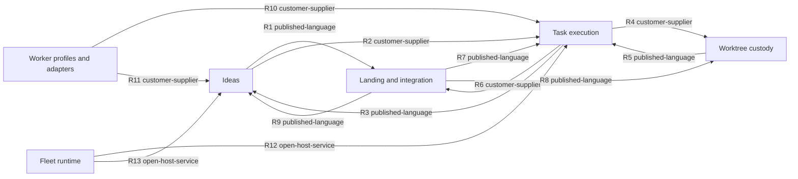

# Subdomains and bounded contexts - fleetd

_Step 3 of 9 (decompose) · mode: auto · depth: standard · produced: 2026-11-12T17:30:35Z_
_Inputs: ddd/02-discover/discover.json, ddd/01-understand/understand.json, ddd/glossary.md, ddd/manifest.json, docs/specs/fleetd/design.md, ai_docs/plans/fleetd-design/ddd-context.md_

## In plain words

This step cut fleetd into 6 parts, each with its own words and its own data: ideas, task execution, worktree custody, landing and integration, worker profiles, and the fleet runtime.

**Decided:** 6 parts, all modules inside the 1 horch binary, joined by 13 named links. Each of the 82 events and 64 commands has exactly 1 owner.

**Assumed:** The verifier lives inside task execution, and worker questions live inside ideas. Both are open decisions for the operator (D1, D2).

**Riskiest:** If worker profiles is not its own part, the rule that strips ANTHROPIC_API_KEY from every launch has no single owner, and 1 missed launch path bills the API key.

---

## 1. Summary

6 subdomains -> 6 bounded contexts, 13 relationships. Scale target 1-1 deployables (2-6 contexts aimed for). The count is within the band. All 6 contexts are modules inside horch-core in the 1 horch binary (A1).

| Bounded context | Subdomains | Owns (events / commands) | ISH verdict | One-line purpose |
|---|---|---|---|---|
| `ideas` | ideas | 24 / 21 | candidate | Takes a rough idea from capture to a committed plan, answers worker questions, and closes the idea when its feature is merged. |
| `task-execution` | task-execution | 25 / 17 | candidate | Dispatches each task of a committed plan to a worker, supervises each attempt with an earned lease and the stall ladder, paces dispatch to each usage pool, and decides done from facts on disk. |
| `worktree-custody` | worktree-custody | 5 / 4 | unsure | Records each worktree before it exists, reconciles the ledger rows, the directories and git, and saves the work of each worktree on a verified rescue ref before any removal. |
| `integration` | integration | 23 / 17 | candidate | Lands verified task branches on their feature branch in gated bundles, finds conflicts between features by trial merges, rebases and gates each feature branch, and opens its pull request to the primary branch. |
| `worker-profiles` | worker-profiles | 2 / 2 | candidate | Turns 1 worker profile into the exact flags, environment and files for each agent CLI, keeps logins and environment scrubs, mirrors CLI docs and runs adapter conformance tests. |
| `fleet-runtime` | fleet-runtime | 3 / 3 | merge | Keeps fleetd alive under the OS service manager, restarts it on a hang or a new binary, owns the platform layer, the command channel, the file protocol permissions and the single ledger writer, and adapts herdr. |

Boundaries decided mainly by: the 4 pivotal events (assumptions-approved, plan-committed, task-done, idea-tasks-landed), the actor change from operator and sub-orchestrator to fleetd code (discover N7), and the words that change meaning across contexts: lease, ready, landed, check and feature.

## 2. Subdomains (problem space)

| Id | Name | Capabilities | Events | Commands | Heuristics | Rationale |
|---|---|---|---|---|---|---|
| `ideas` | Ideas | cap-idea-intake, cap-idea-planning, cap-operator-attention | idea-captured, sub-orchestrator-started, interview-question-asked, interview-answer-recorded, idea-amended, assumptions-written, approval-requested, idea-parked, idea-cancelled, assumptions-revised, assumptions-approved, direct-idea-accepted, spec-written, plan-submitted, plan-refused, plan-committed, worker-question-asked, question-answered, own-assumption-recorded, revise-requested, question-escalated, task-replanned, idea-tasks-landed, idea-merged | add-idea, start-sub-orchestrator, ask-operator, answer-interview-question, amend-idea, write-assumptions, request-approval, park-idea, cancel-idea, revise-assumptions, approve-assumptions, add-direct-idea, write-spec, submit-plan, validate-plan, ask-question, answer-question, escalate-question, replan-task, roll-up-idea, close-idea | pivotal-event, actor, language-boundary, data-ownership | The clarifying and planning phases end at the pivotal events assumptions-approved and plan-committed. The operator and the sub-orchestrator drive almost every command here, and nowhere else (discover N7). |
| `task-execution` | Task execution | cap-task-supervision, cap-task-verification, cap-usage-pacing | task-promoted, task-leased, attempt-launched, lease-renewed, lease-expired, attempt-stalled, usage-limit-reported, fallback-assigned, quota-wait-started, quota-window-reset, result-written, attempt-exited, check-passed, check-failed, review-passed, review-failed, judge-verdict-written, critical-fix-opened, high-finding-settled, attempt-failed, retry-scheduled, replan-requested, task-escalated, task-requeued, task-done | promote-task, dispatch-task, launch-attempt, renew-lease, apply-stall-ladder, move-to-fallback, write-result, run-check, run-review, write-judge-verdict, open-critical-fix, settle-high-finding, end-attempt, schedule-retry, escalate-task, requeue-task, mark-task-done | pivotal-event, language-boundary, data-ownership, actor | The executing phase runs from plan-committed to the pivotal event task-done. Workers, the agent CLI process and the clock act here; the operator acts only on an escalated task. |
| `worktree-custody` | Worktree custody | cap-worktree-custody | worktree-created, worktree-orphaned, worktree-rescued, rescue-failed, worktree-removed | create-worktree, reconcile-worktrees, rescue-worktree, remove-worktree | language-boundary, data-ownership, rate-of-change | The worktree lifecycle (reserved, created, active, landing, landed, orphaned, rescued, removed) crosses the executing and landing phases. Its no-loss rules change rarely and must not change with the landing or dispatch rules. |
| `integration` | Landing and integration | cap-feature-integration | feature-opened, task-branch-verified, bundle-built, task-branch-conflicted, fast-gate-passed, fast-gate-failed, task-branch-landed, task-branch-gate-failed, triage-task-opened, task-branch-abandoned, primary-branch-moved, trial-merge-passed, trial-merge-conflicted, feature-stacked, resolver-task-opened, feature-branch-rebased, feature-rebase-conflicted, full-gate-passed, full-gate-failed, feature-marked-ready, pull-request-opened, pull-request-merged, feature-merged | open-feature, mark-branch-ready, build-bundle, run-fast-gate, fast-forward-feature-branch, bisect-bundle, open-triage-task, abandon-task-branch, run-trial-merges, stack-feature, open-resolver-task, rebase-feature-branch, run-full-gate, mark-feature-ready, open-pull-request, merge-pull-request, check-merged | pivotal-event, language-boundary, actor, data-ownership | The landing and integrating phases run from task-done through idea-tasks-landed to feature-merged. Only fleetd code acts here, until the operator merges the pull request (discover N7). |
| `worker-profiles` | Worker profiles and adapters | cap-agent-cli-adaption | adapter-conformance-failed, profile-marked-unhealthy | run-conformance-tests, mark-profile-unhealthy | rate-of-change, language-boundary, regulatory | Agent CLIs change every week, much faster than the fleet rules. The credential rules (ANTHROPIC_API_KEY scrub, logins, sandbox) need 1 owner. |
| `fleet-runtime` | Fleet runtime | cap-fleet-record, cap-host-services, cap-pane-hosting | fleetd-hang-detected, horch-version-installed, fleetd-restarted | check-fleetd, self-update, restart-fleetd | external-system, rate-of-change, actor | The friend who installs horch and the OS service manager act here, and no domain phase does. Each OS module changes with the OS, not with the fleet rules (understand N13). |

## 3. Bounded contexts (solution space)

### `ideas` - Ideas
- **Purpose:** Takes a rough idea from capture to a committed plan, answers worker questions, and closes the idea when its feature is merged. The idea dispatcher (code) moves each idea; the sub-orchestrator does the judgment work.
- **Subdomains:** ideas  **Aggregates:** idea, plan, question
- **Owns events:** idea-captured, sub-orchestrator-started, interview-question-asked, interview-answer-recorded, idea-amended, assumptions-written, approval-requested, idea-parked, idea-cancelled, assumptions-revised, assumptions-approved, direct-idea-accepted, spec-written, plan-submitted, plan-refused, plan-committed, worker-question-asked, question-answered, own-assumption-recorded, revise-requested, question-escalated, task-replanned, idea-tasks-landed, idea-merged
- **Owns commands:** add-idea, start-sub-orchestrator, ask-operator, answer-interview-question, amend-idea, write-assumptions, request-approval, park-idea, cancel-idea, revise-assumptions, approve-assumptions, add-direct-idea, write-spec, submit-plan, validate-plan, ask-question, answer-question, escalate-question, replan-task, roll-up-idea, close-idea
- **Boundary rationale:** Cut at the pivotal events assumptions-approved and plan-committed (pivotal-event) and by the actor change: operator and sub-orchestrator own clarifying and planning (discover N7). The idea, plan and question aggregates live here because the sub-orchestrator answers worker questions against the idea's assumptions (own-assumption-recorded, revise-requested). Closest alternative: put question in task-execution, where the worker asks it (decision D2). The idea dispatcher is code, not an actor; no 'orchestrator' actor exists (understand N3).
- **Independent Service Heuristics:** sense-check yes · brand probably · revenue no · cost tracking probably · data yes · personas yes · cognitive load yes → **verdict: candidate**.
- **Language here:** `Assumption` - 1 line in assumptions.md, [confirmed] or [assumed], that the operator approves or revises; also a reversible assumption that the sub-orchestrator records to answer a worker question (understand N11).
- **Language here:** `Question` - A worker question to the sub-orchestrator of its feature. It ends as an answer, an own assumption, a revise request, or an escalation to the operator.
- **Language here:** `Orchestrator` - Not a role in fleetd. The word survives only in the preserved mail contract tag [orchestrator re #<id>] (discover N3).

### `task-execution` - Task execution
- **Purpose:** Dispatches each task of a committed plan to a worker, supervises each attempt with an earned lease and the stall ladder, paces dispatch to each usage pool, and decides done from facts on disk.
- **Subdomains:** task-execution  **Aggregates:** task, attempt, verification
- **Owns events:** task-promoted, task-leased, attempt-launched, lease-renewed, lease-expired, attempt-stalled, usage-limit-reported, fallback-assigned, quota-wait-started, quota-window-reset, result-written, attempt-exited, check-passed, check-failed, review-passed, review-failed, judge-verdict-written, critical-fix-opened, high-finding-settled, attempt-failed, retry-scheduled, replan-requested, task-escalated, task-requeued, task-done
- **Owns commands:** promote-task, dispatch-task, launch-attempt, renew-lease, apply-stall-ladder, move-to-fallback, write-result, run-check, run-review, write-judge-verdict, open-critical-fix, settle-high-finding, end-attempt, schedule-retry, escalate-task, requeue-task, mark-task-done
- **Boundary rationale:** Cut between plan-committed and task-done (pivotal-event). Task, attempt and verification are 3 aggregate candidates with 1 shared language (task, attempt, lease, done) and 1 transaction rule: a reap ends the attempt and requeues the task in 1 transaction (04 S7). The verifier is a separate component in the design, but it reads and writes the same task states, so it stays a module here (decision D1). The context adapts the agent CLI process (attempt-exited, through the fleet-run wrapper) and the provider pools (usage-limit-reported, quota-window-reset); both adapters are internal.
- **Wraps:** agent-cli, provider-pool - this context holds the adapter for the external system; the system itself is not on the map.
- **Independent Service Heuristics:** sense-check yes · brand probably · revenue no · cost tracking probably · data yes · personas partial · cognitive load partial → **verdict: candidate**.
- **Language here:** `Lease` - The time-limited hold of 1 attempt on its task. It renews only on earned activity and pauses during sleep and waiting_quota (discover N1).
- **Language here:** `Ready` - A task state: every dependency is done and the task waits for dispatch (discover N6).
- **Language here:** `Done` - A task state that only the verifier sets, from facts on disk. It does not mean landed or merged (understand N4).
- **Language here:** `Check` - The acceptance command of a task. The verifier runs it in the worktree, in the sandbox profile of the worker.
- **Language here:** `Feature` - A code kind of a task (with quality, refactor and security). It is not the feature of the integration context (discover N2).

### `worktree-custody` - Worktree custody
- **Purpose:** Records each worktree before it exists, reconciles the ledger rows, the directories and git, and saves the work of each worktree on a verified rescue ref before any removal.
- **Subdomains:** worktree-custody  **Aggregates:** worktree
- **Owns events:** worktree-created, worktree-orphaned, worktree-rescued, rescue-failed, worktree-removed
- **Owns commands:** create-worktree, reconcile-worktrees, rescue-worktree, remove-worktree
- **Boundary rationale:** The worktree outlives attempts (understand N1) and its 'lease' and 'landed' mean different things from the attempt lease and the task branch state (language-boundary). Only this context may create or remove a worktree, and it owns the no-loss rows 04 W6, W8 and W9 (data-ownership, discover N8). Closest alternative: merge it into integration, which also changes git state (decision D4). It adapts git for worktree add, list and rescue refs; integration adapts git for branches.
- **Wraps:** git - this context holds the adapter for the external system; the system itself is not on the map.
- **Independent Service Heuristics:** sense-check yes · brand no · revenue no · cost tracking no · data yes · personas no · cognitive load yes → **verdict: unsure**.
- **Language here:** `Lease` - The worktree lease: the ledger row written in the same transaction that leases the task, before the directory exists. It holds the worktree for 1 task until its work is landed or rescued.
- **Language here:** `Landed` - A worktree state: nothing in the worktree is unique any more, so fleetd may remove it (discover N6).
- **Language here:** `Orphaned` - A worktree on disk with no live owner attempt, or with no ledger row.

### `integration` - Landing and integration
- **Purpose:** Lands verified task branches on their feature branch in gated bundles, finds conflicts between features by trial merges, rebases and gates each feature branch, and opens its pull request to the primary branch.
- **Subdomains:** integration  **Aggregates:** task-branch, feature
- **Owns events:** feature-opened, task-branch-verified, bundle-built, task-branch-conflicted, fast-gate-passed, fast-gate-failed, task-branch-landed, task-branch-gate-failed, triage-task-opened, task-branch-abandoned, primary-branch-moved, trial-merge-passed, trial-merge-conflicted, feature-stacked, resolver-task-opened, feature-branch-rebased, feature-rebase-conflicted, full-gate-passed, full-gate-failed, feature-marked-ready, pull-request-opened, pull-request-merged, feature-merged
- **Owns commands:** open-feature, mark-branch-ready, build-bundle, run-fast-gate, fast-forward-feature-branch, bisect-bundle, open-triage-task, abandon-task-branch, run-trial-merges, stack-feature, open-resolver-task, rebase-feature-branch, run-full-gate, mark-feature-ready, open-pull-request, merge-pull-request, check-merged
- **Boundary rationale:** Cut at task-done and idea-tasks-landed (pivotal-event): after task-done the words change to branch, bundle, gate and merge, and only fleetd code acts (actor). The task-branch and feature aggregates and the land lock live here, with the no-loss rows 04 F5, F7, F9, F11, L5 and L9 (data-ownership). It adapts git (primary-branch-moved) and GitHub (pull-request-merged).
- **Wraps:** git, github - this context holds the adapter for the external system; the system itself is not on the map.
- **Independent Service Heuristics:** sense-check yes · brand probably · revenue no · cost tracking partial · data yes · personas probably · cognitive load probably → **verdict: candidate**.
- **Language here:** `Feature` - 1 sub-orchestrator, 1 feature branch and 1 pull request to the primary branch, holding 1 main idea and its follow-on ideas (understand N2). The feature aggregate owns feature-opened to feature-merged (discover N2).
- **Language here:** `Ready` - A task branch is ready when it is verified and waits for a bundle. A feature is ready when its full gate passed and its pull request can open (discover N6).
- **Language here:** `Landed` - A task branch state: the branch is fast-forwarded onto its feature branch after the fast gate passed (understand N4).
- **Language here:** `Merged` - A feature fact read from git by content: the feature branch is in the primary branch (understand N4).

### `worker-profiles` - Worker profiles and adapters
- **Purpose:** Turns 1 worker profile into the exact flags, environment and files for each agent CLI, keeps logins and environment scrubs, mirrors CLI docs and runs adapter conformance tests.
- **Subdomains:** worker-profiles  **Aggregates:** worker-profile
- **Owns events:** adapter-conformance-failed, profile-marked-unhealthy
- **Owns commands:** run-conformance-tests, mark-profile-unhealthy
- **Boundary rationale:** Rate-of-change: CLI versions and flags change far more often than the task rules. Language: profile, adapter, persona and conformance appear nowhere else. Regulatory: it owns the environment scrub and login rules (05 E-10, 06 S1, S3 to S10, S15), so the ANTHROPIC_API_KEY rule has exactly 1 owner (understand N16). The storm holds only 2 of its events (discover H14), so decision D3 records the merge alternative.
- **Independent Service Heuristics:** sense-check yes · brand probably · revenue no · cost tracking probably · data yes · personas no · cognitive load yes → **verdict: candidate**.
- **Language here:** `Profile` - A named worker profile: the CLI, model, effort, sandbox and permission rules that 1 attempt runs with.
- **Language here:** `Healthy` - A profile whose adapter passed its last conformance test. Dispatch does not choose an unhealthy profile.

### `fleet-runtime` - Fleet runtime
- **Purpose:** Keeps fleetd alive under the OS service manager, restarts it on a hang or a new binary, owns the platform layer, the command channel, the file protocol permissions and the single ledger writer, and adapts herdr.
- **Subdomains:** fleet-runtime  **Aggregates:** none
- **Owns events:** fleetd-hang-detected, horch-version-installed, fleetd-restarted
- **Owns commands:** check-fleetd, self-update, restart-fleetd
- **Boundary rationale:** External-system: it wraps the OS service managers and herdr, which hold no state that fleetd depends on (understand N14: do not build, only wrap). It keeps the platform layer as 1 interface with 1 module per OS, so core code has no OS cfg (understand N13). It owns the single ledger writer and the command channel (understand N5) as infrastructure for every other context, and the rows 04 S10, 04 M5, 06 S2, S11 and S12. ISH verdict merge: it is a module, never a product of its own.
- **Wraps:** os-service-manager, herdr - this context holds the adapter for the external system; the system itself is not on the map.
- **Independent Service Heuristics:** sense-check yes · brand no · revenue no · cost tracking no · data partial · personas partial · cognitive load yes → **verdict: merge**.
- **Language here:** `Check` - horch fleetd check: the heartbeat check that restarts fleetd when its last full pass is older than 30 s of awake time. It is not a task check.

## 4. Context map

| Id | Upstream → Downstream | Pattern | What crosses / why this direction / why this pattern |
|---|---|---|---|
| R1 | `ideas` → `integration` | published-language | ideas -> integration, published-language: assumptions-written and direct-idea-accepted (ideaId, featureId) trigger open-feature. Upstream is ideas because the idea events are its to change. Integration consumes them as-is and needs no change in ideas, so not customer-supplier. Async through the reconcile pass. |
| R2 | `ideas` → `task-execution` | customer-supplier | ideas -> task-execution, customer-supplier: plan-committed and task-replanned trigger promote-task; plan-refused triggers escalate-task; question-answered and own-assumption-recorded trigger launch-attempt. The committed plan.yaml is the contract that every task comes from, and plan validation exists to serve task-execution (checks, owner paths, paired judges), so task-execution's needs shape ideas' plan schema. Async. |
| R3 | `task-execution` → `ideas` | published-language | task-execution -> ideas, published-language: replan-requested (taskId, attempts) triggers replan-task by the sub-orchestrator after the last attempt. ideas consumes the event as-is. Separate from R2 because the direction of influence is reversed for this fact. Async. |
| R4 | `task-execution` → `worktree-custody` | customer-supplier | task-execution -> worktree-custody, customer-supplier: task-leased triggers create-worktree; the worktree lease row is written in the same transaction as the task lease. worktree-custody serves the dispatch need (1 worktree per task before launch). The pair also carries the attempt end: active to created or orphaned. Sync inside the fleetd pass. |
| R5 | `worktree-custody` → `task-execution` | published-language | worktree-custody -> task-execution, published-language: worktree-created triggers launch-attempt; rescue-failed triggers escalate-task. task-execution reacts to worktree facts as-is. Async through the reconcile pass. |
| R6 | `task-execution` → `integration` | customer-supplier | task-execution -> integration, customer-supplier: task-done triggers mark-branch-ready; task-escalated lets the operator run abandon-task-branch. Integration asks task-execution to run triage and resolver tasks (open-triage-task, open-resolver-task create normal tasks), so the task contract is task-execution's to serve. Async. |
| R7 | `integration` → `task-execution` | published-language | integration -> task-execution, published-language: task-branch-conflicted triggers launch-attempt on the same task. task-execution consumes the conflict fact as-is. Async. |
| R8 | `integration` → `worktree-custody` | published-language | integration -> worktree-custody, published-language: task-branch-landed triggers remove-worktree; the worktree moves to landing and landed with its task branch (N6). worktree-custody still refuses a removal that would lose work (04 W6). Async. |
| R9 | `integration` → `ideas` | published-language | integration -> ideas, published-language: task-branch-landed triggers roll-up-idea, and feature-merged triggers close-idea. ideas consumes branch facts as-is and never reads git. Async. |
| R10 | `worker-profiles` → `task-execution` | customer-supplier | worker-profiles -> task-execution, customer-supplier: launch-attempt resolves a profile to exact CLI flags, environment and files, with the ANTHROPIC_API_KEY scrub (N2); profile-marked-unhealthy removes a profile from dispatch and fallback. task-execution needs profiles that fit its dispatch and fallback rules and can negotiate them. Sync at launch. |
| R11 | `worker-profiles` → `ideas` | customer-supplier | worker-profiles -> ideas, customer-supplier: start-sub-orchestrator launches a sub-orchestrator pane with a profile and the same environment scrub. Sync at launch. |
| R12 | `fleet-runtime` → `task-execution` | open-host-service | fleet-runtime -> task-execution, open-host-service: the platform layer gives process facts, process-group stop, sandbox, sleep and wake, and the single ledger writer (N5) through 1 interface. The same interface serves every context, so open-host-service, not customer-supplier. Sync calls. |
| R13 | `fleet-runtime` → `ideas` | open-host-service | fleet-runtime -> ideas, open-host-service: the command channel carries horch idea commands to fleetd, and the herdr adapter hosts and supervises sub-orchestrator panes. Same interface as R12. Sync calls. |

No pair of contexts is marked separate-ways: each context has at least 1 relationship. Pairs with no relationship (for example worktree-custody and ideas) exchange nothing directly.

## 5. Language differences per context

| Term | Context | Meaning here | Recorded in glossary |
|---|---|---|---|
| Assumption | `ideas` | 1 line in assumptions.md, [confirmed] or [assumed], that the operator approves or revises; also a reversible assumption that the sub-orchestrator records to answer a worker question (understand N11). | yes |
| Check | `task-execution` | The acceptance command of a task. The verifier runs it in the worktree, in the sandbox profile of the worker. | yes |
| Check | `fleet-runtime` | horch fleetd check: the heartbeat check that restarts fleetd when its last full pass is older than 30 s of awake time. It is not a task check. | yes |
| Done | `task-execution` | A task state that only the verifier sets, from facts on disk. It does not mean landed or merged (understand N4). | yes |
| Feature | `task-execution` | A code kind of a task (with quality, refactor and security). It is not the feature of the integration context (discover N2). | yes |
| Feature | `integration` | 1 sub-orchestrator, 1 feature branch and 1 pull request to the primary branch, holding 1 main idea and its follow-on ideas (understand N2). The feature aggregate owns feature-opened to feature-merged (discover N2). | yes |
| Healthy | `worker-profiles` | A profile whose adapter passed its last conformance test. Dispatch does not choose an unhealthy profile. | yes |
| Landed | `worktree-custody` | A worktree state: nothing in the worktree is unique any more, so fleetd may remove it (discover N6). | yes |
| Landed | `integration` | A task branch state: the branch is fast-forwarded onto its feature branch after the fast gate passed (understand N4). | yes |
| Lease | `task-execution` | The time-limited hold of 1 attempt on its task. It renews only on earned activity and pauses during sleep and waiting_quota (discover N1). | yes |
| Lease | `worktree-custody` | The worktree lease: the ledger row written in the same transaction that leases the task, before the directory exists. It holds the worktree for 1 task until its work is landed or rescued. | yes |
| Merged | `integration` | A feature fact read from git by content: the feature branch is in the primary branch (understand N4). | yes |
| Orchestrator | `ideas` | Not a role in fleetd. The word survives only in the preserved mail contract tag [orchestrator re #<id>] (discover N3). | yes |
| Orphaned | `worktree-custody` | A worktree on disk with no live owner attempt, or with no ledger row. | yes |
| Profile | `worker-profiles` | A named worker profile: the CLI, model, effort, sandbox and permission rules that 1 attempt runs with. | yes |
| Question | `ideas` | A worker question to the sub-orchestrator of its feature. It ends as an answer, an own assumption, a revise request, or an escalation to the operator. | yes |
| Ready | `task-execution` | A task state: every dependency is done and the task waits for dispatch (discover N6). | yes |
| Ready | `integration` | A task branch is ready when it is verified and waits for a bundle. A feature is ready when its full gate passed and its pull request can open (discover N6). | yes |

## 6. Decisions for the operator

### D1: Is the verifier a context of its own, or a module of task-execution? (open, kind boundary)
- **A:** Module of task-execution: verification is an aggregate beside task and attempt. Pros: 1 transaction for attempt end, verdict and task state; The skill tie-break says merge when the boundary is unsure. Cons: The judge rank language (CRITICAL, HIGH) sits beside lease language. Risks: task-execution grows large.
- **B:** Context of its own (verification) that task-execution calls after attempt-exited. Pros: Matches the design component 'Verifier'; Keeps judge and review rules apart from dispatch. Cons: Every done needs a cross-context call and an event back. Risks: The reap and requeue rule 04 S7 spans 2 contexts.
- **C:** Merge verification into integration, since both run gates. Pros: All gates in 1 place. Cons: Mixes task done with branch landed, which the design keeps apart (understand N4). Risks: The word done changes meaning inside 1 model.
- **Recommendation:** Recommend A. Verification shares the task states and the transaction of task-execution. Strongest argument against: the design lists the Verifier as its own component with its own rules for each task kind, so its rules may change apart from dispatch.
- **Would flip if:** The judge and review rules change on a different schedule from dispatch; Verification must run outside fleetd.

### D2: Which context owns worker questions: ideas or task-execution? (open, kind ownership)
- **A:** ideas owns the question aggregate. Pros: The sub-orchestrator answers against the idea's assumptions; revise-requested goes to the operator approval flow of the idea. Cons: The worker, an actor of task-execution, asks it. Risks: The attempt pause and resume crosses 2 contexts.
- **B:** task-execution owns the question aggregate. Pros: The attempt waits on it, so pause and resume stay inside 1 context. Cons: Answers create assumptions that belong to the idea. Risks: Assumption language leaks into task-execution.
- **C:** A context of its own (operator attention) for questions, approvals and escalations. Pros: Matches cap-operator-attention. Cons: A seventh context above the 2 to 6 band at 1 deployable. Risks: A thin context with no own language.
- **Recommendation:** Recommend A. The answer is an assumption of the idea. Strongest argument against: the attempt pause and resume then depends on another context.
- **Would flip if:** Answers never change the idea's assumptions; The operator wants 1 inbox context.

### D3: Are worker profiles and adapters a context of their own, or a part of task-execution? (open, kind boundary)
- **A:** Own context worker-profiles. Pros: Rate of change of the CLIs; 1 owner for the credential and environment rules. Cons: Only 2 events in the storm. Risks: A thin context until docs sync is stormed.
- **B:** Module of task-execution. Pros: Fewer contexts; launch-attempt already lives there. Cons: CLI churn changes the dispatch model. Risks: The ANTHROPIC_API_KEY rule has no clear owner.
- **C:** Part of fleet-runtime, as a platform concern. Pros: Sandbox is a platform service. Cons: Profiles are domain choices, not OS facilities. Risks: fleet-runtime mixes OS and CLI churn.
- **Recommendation:** Recommend A. The CLI adapters change weekly and carry the absolute credential rule. Strongest argument against: the storm shows only 2 events, and the skill tie-break says merge when unsure.
- **Would flip if:** The docs sync storm shows no own language; CLI adapters stop changing often.

### D4: Is worktree custody a context of its own, or a part of integration? (open, kind boundary)
- **A:** Own context worktree-custody. Pros: Own meaning of lease and landed; Only fleetd creates or removes worktrees, from 1 place. Cons: ISH verdict unsure. Risks: 2 contexts adapt git.
- **B:** Part of integration. Pros: All git writes in 1 context. Cons: A worktree exists from task-leased, long before landing. Risks: Landing changes can break the no-loss rules.
- **C:** Part of task-execution, beside the attempt. Pros: The worktree is leased with the task. Cons: The worktree survives attempts and outlives the task until landed. Risks: Rescue logic mixes with the stall ladder.
- **Recommendation:** Recommend A. The worktree has its own lifecycle and its own no-loss rows. Strongest argument against: integration also writes git, so 2 contexts adapt 1 external system.
- **Would flip if:** The worktree lifecycle is folded into the task branch lifecycle; No-loss rules move into git hooks.

## 7. Assumptions, open questions, notes for later steps

- A1 (high) The 6 contexts are modules inside horch-core in 1 deployable unit and 1 team (understand N6). The boundaries are model boundaries, not process boundaries.
- A2 (medium) The verifier stays a module of task-execution because it reads and writes the same task states and the reap rule (04 S7) needs 1 transaction. Open decision D1.
- A3 (medium) The question aggregate (worker-question-asked to question-escalated) belongs to ideas, because the sub-orchestrator answers it against the idea's assumptions. Open decision D2.
- A4 (medium) Worker profiles and adapters are their own context because of their rate of change and their credential rules, although the storm holds only 2 of their events (discover H14). Open decision D3.
- A5 (medium) Worktree custody is its own context, not a part of integration, because the worktree lease and the no-loss rules differ from the branch landing rules. Open decision D4.
- A6 (medium) The ledger is infrastructure that fleet-runtime owns as the single writer. Each context owns the state transitions of its own aggregates; it is not a shared kernel.
- A7 (low) Operator attention (cap-operator-attention) maps to ideas, because approvals, interview questions and question escalation live there. Task escalation (task-escalated) stays in task-execution and reaches the operator through the same inbox.
- A8 (high) Triage and resolver tasks are opened by integration but run as normal tasks in task-execution; integration asks task-execution for them.
- A9 (medium) Each preservation row has 1 owning context, as listed in N3. The row texts come from the Preservation analysis of design.md.
- Q1 (not blocking, owner: operator) Worktree custody has an ISH verdict of unsure. The 2 most doubtful heuristics are user_personas (no actor drives it but the clock) and brand. Is it a context of its own or a part of integration (decision D4)?
- Q2 (not blocking, owner: operator) Docs sync and adapter conformance are stormed as 2 events only (discover H14). Which context turns a drift into a task, and how does a profile become healthy again?
- Q3 (not blocking, owner: operator) Which inbox holds an escalated task for the operator: the ideas context (with approvals and questions) or task-execution? The design puts everything for the operator in 1 place but names no owner.
- N1 (for: organise · decision) Sharpens understand N6: all 6 contexts are modules inside horch-core in 1 deployable; worktree-custody (ISH unsure) and fleet-runtime (ISH merge) are never deployables of their own.
- N2 (for: connect, define, code · risk) Sharpens understand N16: worker-profiles owns the environment scrub. It builds the env of every launch (attempt, sub-orchestrator pane, probe, updater), so task-execution and ideas launch only through it.
- N3 (for: define, code · risk) Sharpens discover N8. Preservation row owners: worktree-custody 04 W6, W8, W9; integration 04 F5, F7, F9, F11, L5, L9; task-execution 04 S7, S8, L6, L8 and 06 S13; worker-profiles 05 E-10, 06 S1, S3 to S10, S15; fleet-runtime 04 S10, 04 M5, 06 S2, S11, S12.
- N4 (for: define, code · language) 'Check' means the task acceptance command in task-execution and horch fleetd check (the heartbeat check) in fleet-runtime. 'Lease' means the attempt lease in task-execution and the worktree lease in worktree-custody.
- N5 (for: connect, code · boundary) Sharpens understand N5: fleet-runtime owns the single ledger writer and the command channel. Every other context changes the ledger only through it; each context still owns the legal transitions of its own aggregates.
- N6 (for: connect, code · boundary) The task branch and the worktree are 2 aggregates in 2 contexts with 1 lifecycle link: a worktree goes to landing when its task branch is verified and to landed when the branch is landed. The link crosses R6 and R8.

### Upstream notes addressed to decompose, and how this step acts on each

| Note | Action in this step |
|---|---|
| understand N1 | Task and attempt are aggregates of task-execution; the attempt lease is a term of task-execution; the worktree is its own aggregate in worktree-custody because it survives attempts. |
| understand N2 | Feature is an aggregate of integration with its own meaning; task branch and feature branch are integration terms. |
| understand N3 | No orchestrator actor or context. The idea dispatcher is code inside ideas; the word survives only in the mail contract (ideas term Orchestrator). |
| understand N4 | Done is a task-execution term (verifier only); landed and merged are integration terms; the cuts sit at task-done and idea-tasks-landed. |
| understand N5 | fleet-runtime owns the single ledger writer and the command channel (A6, N5). |
| understand N6 | All contexts are modules in 1 deployable (A1, N1). |
| understand N10 | Usage limits and fallback stay inside task-execution, which adapts provider-pool; a usage limit is not a stall and burns no attempt. |
| understand N13 | fleet-runtime owns the platform layer as 1 interface; R12 and R13 are open-host-service. |
| discover N1 | Lease-renewed and lease-expired are owned by the attempt aggregate in task-execution. |
| discover N2 | The feature aggregate owns feature-opened to feature-merged in integration; the task kind feature is a separate task-execution term. |
| discover N3 | Every dispatcher command stays with the aggregate it changes; the mail contract word is recorded as an ideas term. |
| discover N4 | task-done, idea-tasks-landed and feature-merged sit at the 2 cuts and the end of integration. |
| discover N5 | judge-verdict-written, critical-fix-opened and high-finding-settled belong to the verification aggregate in task-execution. |
| discover N6 | Ready and landed have a meaning per context (section 5). |
| discover N7 | The actor changes decide the cuts between ideas, task-execution and integration. |
| discover N8 | Each preservation row has 1 owning context (N3). |

## 8. Next

Boundaries are in `ddd/03-decompose/decompose.json`. Next: `ddd-strategize` classifies each subdomain (core, supporting or generic) and decides build or buy.
