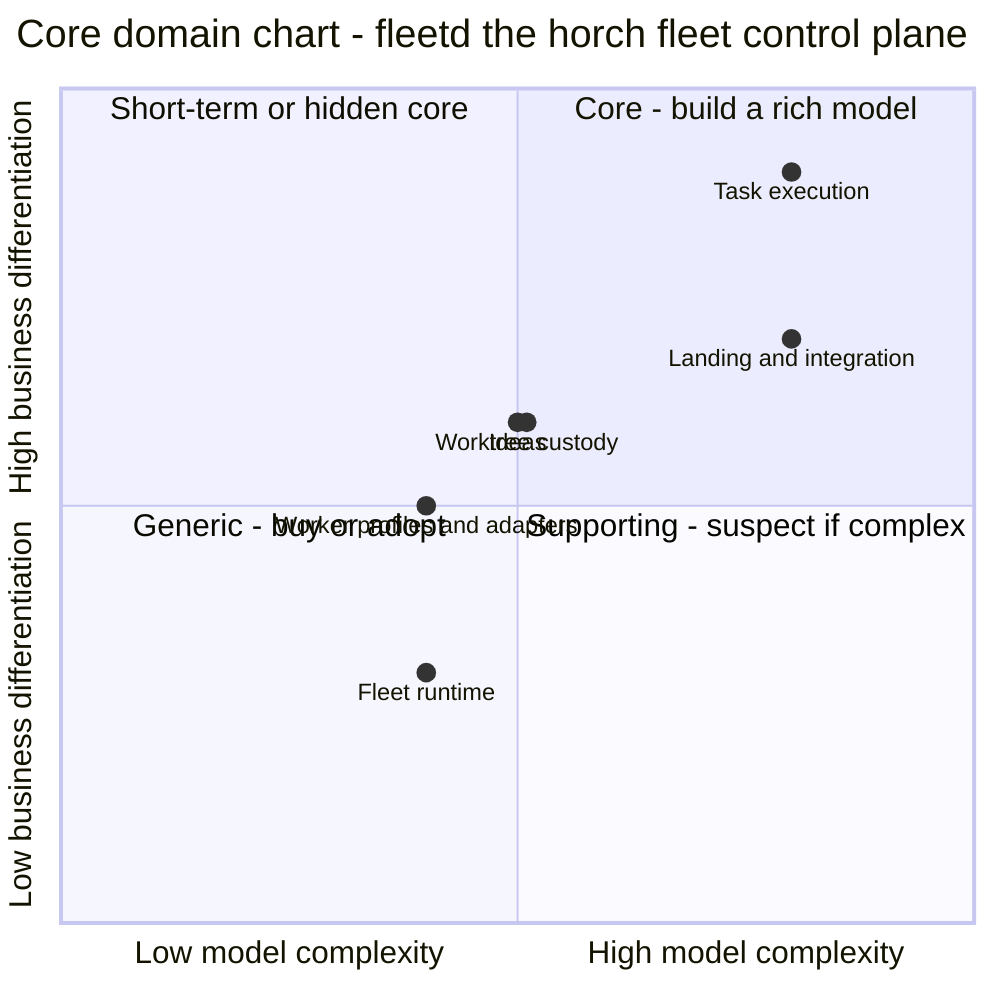

# Core domain chart — fleetd: the horch fleet control plane

## In plain words

We decided which parts of fleetd need the most careful design, and which parts stay simple.

**Decided:** 2 of 6 parts are core: running and checking tasks, and landing branches on features. The other 4 parts are built simply, except the plan checks of the ideas part, which get a careful model. The ledger rows are the truth, and the events table is an audit log. We buy nothing new. herdr and the OS service managers are used as they are.

**Assumed:** The ideas part is not core, because an AI does its hard thinking and the code is 1 fixed state machine plus the plan checks.

**Riskiest:** If the simple parts of the ideas part (intake and questions) grow rules, the flat design there will leak bugs.

---

_Step 4 of 9 (`ddd-strategize`) · mode `auto` · depth `standard` · produced `2026-11-12T20:41:54Z`_

**Where to invest:** core → `task-execution`, `integration`; supporting → `ideas`, `worktree-custody`, `worker-profiles`, `fleet-runtime`; generic (buy/adopt) → —.

2 of 6 subdomains are core: task-execution (decisive) and integration. Ideas, worktree-custody, worker-profiles and fleet-runtime are supporting and built simply; only the plan validation module of ideas gets a domain model (D1 option C). The ledger is a domain model with an audit events table, not event-sourced (D2 option A). Nothing is generic: herdr and the OS service managers are adopted inside fleet-runtime as adapters. Every subdomain is built in horch-core, and the platform layer is the leaf crate crates/horch-platform.

## Chart

Axes: x = model complexity (score/10), y = business differentiation (score/10). Top-right is the core; bottom-left is generic; a supporting subdomain far to the right is "suspect" (accidental complexity or a core in disguise). Points nudged by ≤ 0.01 for legibility (`worktree-custody`); the table below holds the true scores.

## Classifications

| Subdomain | Type | Diff | Cplx | Evolution | Sourcing | Pattern | Investment | Context(s) |
|---|---|---|---|---|---|---|---|---|
| Task execution (`task-execution`) | **core** | 9 | 8 | custom | build | domain-model | high | `task-execution` |
| Landing and integration (`integration`) | **core** | 7 | 8 | custom | build | domain-model | high | `integration` |
| Ideas (`ideas`) | supporting | 6 | 5 | custom | build | domain-model | medium | `ideas` |
| Worktree custody (`worktree-custody`) | supporting | 6 | 5 | custom | build | active-record | medium | `worktree-custody` |
| Worker profiles and adapters (`worker-profiles`) | supporting | 5 | 4 | custom | build | active-record | medium | `worker-profiles` |
| Fleet runtime (`fleet-runtime`) | supporting | 3 | 4 | custom | build | active-record | medium | `fleet-runtime` |

## Rationale and future direction

| Subdomain | Rationale | Future direction |
|---|---|---|
| `task-execution` | core - G1 (no task stalls silently) and G4 (use the subscription usage fully) are won or lost here; today's alternative is the long-lived orchestrator conversation with claims and a lazy watchdog, whose stalls are the reason for fleetd; rule 2 (diff >= 7); cplx 8 from the earned lease, the stall ladder, fallback and waiting_quota with a paused lease, retries, replan and the verifier with review scripts and paired judges; nothing to buy. · _Goals:_ G1, G4 · _Evolution:_ custom: cap-task-supervision, cap-task-verification and cap-usage-pacing are all custom; no product leases agent attempts across CLIs and usage pools. | Decisive core (both scores >= 8): the big investment, aggregates for task, attempt and verification with invariant tests for I1, I2 and I4. Review in 6 to 12 months; usage pacing can move to supporting once the pacing rule is stable (bet B3). |
| `integration` | core - G3 (each idea reaches the primary branch through its feature) depends on it, and G2 on its no-loss branch invariants; today's alternatives are hand reconciliation of task branches and hosted merge queues, which work on pull requests to a protected base, not on local task branches, and find no conflicts between in-flight features; rule 2 (diff >= 7); cplx 8 from bundles behind the fast gate, bisection, trial merges, stacking with resolver tasks and continuous rebases. · _Goals:_ G3, G2 · _Evolution:_ custom: cap-feature-integration is custom. Merge queues are a product for pull requests, but not for local task branches with a ledger row per branch. | Core, not decisive (diff 7). Feature and task-branch aggregates own the landing state machine and the no-loss rows 04 F5, F7, F9, F11, L5, L9. If a hosted merge queue later supports local branches, the bundle and bisect part can become supporting (table-stakes former core); trial merges and stacking stay core (bet B2). |
| `ideas` | supporting - G3 depends on it, and today's alternative is ideas typed into 1 orchestrator conversation; rule 3 (diff 6 with cplx 5 is below the core rule); cplx 5 because fleetd code runs 1 fixed idea state machine and the judgment work is done by the sub-orchestrator model (A1). Pattern domain-model for the plan validation module only (D1 option C, orchestrator D15): coverage, the DAG, judge pairing, the model guide and the declared gates are invariants. Intake and questions stay active-record. Medium investment: it feeds the core task-execution with committed plans. · _Goals:_ G3 · _Evolution:_ custom: cap-idea-intake, cap-idea-planning and cap-operator-attention are custom. | Hidden core: the hard part (research, interview, assumptions, plan) is done by the sub-orchestrator model. Keep the dispatcher, intake and questions flat (active-record). Give plan validation an aggregate with invariant tests, and keep the approval hash under test. Review in 6 to 12 months. |
| `worktree-custody` | supporting - G2 (no work a worker paid for is lost) depends on it; today's alternative is worktrees made by workers and orphaned on disk; rule 3 (diff 6, cplx 5); cplx 5 from 1 lifecycle of 8 states and 1 invariant (rescue ref written and read back before any removal, design I6); git does the work and is wrapped. Medium investment because a failure breaks G2 (A5). · _Goals:_ G2 · _Evolution:_ custom: cap-worktree-custody is custom; git worktrees are a commodity, the custody rules around them are not. | Supporting, kept simple: a worktree row per lifecycle plus a reconciler against git worktree list. Fault-injection tests for rows 04 W6, W8, W9. No timeline to change. |
| `worker-profiles` | supporting - G4 needs a fallback persona for every worker persona and G1 needs a liveness feed from each CLI; today's alternative is the teammates roster and agent CLIs run by hand; rule 3 (diff 5); cplx 4 from mapping 1 profile to the flags, environment and files of each CLI and from conformance tests. Medium investment because it owns the ANTHROPIC_API_KEY scrub (C2) and the CLIs change every week (C10). · _Goals:_ G4, G1 · _Evolution:_ custom: cap-agent-cli-adaption is custom; no product maps 1 profile to every agent CLI. | Supporting, kept as 1 adapter per CLI behind 1 profile shape. If the agent CLIs converge on 1 headless protocol, adapters move to transaction-script glue. |
| `fleet-runtime` | supporting - G1 needs a daemon that is itself watched; today's alternative is horch ledger watch, the lazily started watchdog; rule 3 (diff 3 but not solved elsewhere as a whole, so rule 1 does not fire); cplx 4 from the single ledger writer, the command channel and the supervision of the daemon on 3 OSes (C3). Pane hosting (herdr) and host services (OS service managers) are adopted and wrapped, not built (understand N14, A4). The platform layer is a leaf crate outside every context (decompose N7). Medium investment: a hang stops the whole fleet. · _Goals:_ G1 · _Evolution:_ custom: cap-fleet-record is custom; cap-host-services is commodity and cap-pane-hosting is product, and both are adopted as existing systems. | Supporting, kept thin. The herdr adapter and the service manager calls are adapters, not models. D16 settled the old question of understand Q2: Phase P moves all 178 OS-specific sites into crates/horch-platform before Phase 1, so fleet-runtime calls the platform interface and owns no OS module. |

## Investment

High: `task-execution`, `integration`. Medium: `ideas`, `worktree-custody`, `worker-profiles`, `fleet-runtime`. Low: —.

Rule: the best people and the modelling time go to the core; supporting subdomains stay simple; generic subdomains get integration effort only.

## Bets

- **B1** — A deterministic daemon with earned leases replaces the LLM orchestrator, and no task stalls silently. · _Risk:_ The lease misreads activity: a slow but healthy worker loses its lease, or a sleep and wake on 1 OS expires every lease (discover H13). · _Validate by:_ Phase 2 fault-injection tests (kill -STOP a worker; alarm within 1 lease) and 0 tasks left assigned with an expired lease (G1 metric). · _Subdomains:_ `task-execution`, `fleet-runtime`
- **B2** — Parallel features with trial merges, stacking and resolver tasks reach the primary branch through 1 pull request each, with no hand reconciliation. · _Risk:_ Resolver tasks grow past their size limit, or stacking chains features so 1 slow feature holds others. · _Validate by:_ The resolver size limit and structural merge tool tests (understand Q7) on the recorded conflicts of this repository. · _Subdomains:_ `integration`
- **B3** — Pacing dispatch to each pool's usage window, with fallback personas, uses the subscription usage fully and burns no attempt on a usage limit. · _Risk:_ No target for 'full use' exists (understand Q1), so the bet cannot fail visibly. · _Validate by:_ 0 attempts burned by a usage limit in Phase 2, and a target set for unused usage per window. · _Subdomains:_ `task-execution`, `worker-profiles`

## Deprecated

- `Q1` — Answered (orchestrator, D15): option C of D1. Ideas stays supporting; plan validation is a domain-model module, and intake and questions stay active-record. Recorded in D1 and A1.
- `Q2` — Answered (orchestrator, D15): option A of D2. The row is the truth and the events table is the audit trail; the ledger is not event-sourced. Recorded in D2 and A3.

## Assumptions

- **A1** (high) — Ideas stays supporting, not core. Decision D1 took option C (orchestrator, D15): the subdomain is split by module. Plan validation is a domain-model module: it holds the rules of coverage, the DAG, judge pairing, the model guide and the declared gates. Idea intake and worker questions stay active-record. The judgment work (research, interview, assumptions, spec, plan) is done by the sub-orchestrator model, not by fleetd code. Scored diff 6, cplx 5.
- **A2** (medium) — Core stays the minority: 2 of 6 subdomains (task-execution, integration). Ideas would make 3 of 6, which is half, not a minority (ticket rule for this run).
- **A3** (high) — The 2 cores use domain-model: state rows are the truth, and the events table is the audit trail that the one door writes beside each row in the same transaction (design, Ledger, rule 1 One door). Decision D2 took option A (orchestrator, D15): a domain model with an events table, not event-sourced.
- **A4** (high) — Fleet runtime is supporting, not generic. Its pane hosting (herdr) and host services (launchd, systemd, Windows service) are adopted and only wrapped, as understand N14 says. The single ledger writer and the command channel have no product to buy, so the subdomain as a whole is built. The platform layer is the leaf crate crates/horch-platform (design A19). It is not part of fleet-runtime and has no subdomain (decompose N7).
- **A5** (medium) — Worktree custody is supporting with medium investment. Its no-loss rule (rescue ref written and read back before any removal) is 1 invariant over a 8-state lifecycle, not an algorithm; a failure breaks G2, so it gets invariant tests and fault-injection tests.
- **A6** (high) — Worker profiles is supporting with medium investment because it owns the ANTHROPIC_API_KEY scrub (C2, an absolute operator rule). Its complexity is the rate of change of the agent CLIs, not domain rules.
- **A7** (high) — Every subdomain has evolution custom: each has at least 1 custom capability. The commodity and product capabilities of fleet-runtime (host services, pane hosting) are adopted systems, not built parts.

## Open questions

_None._

## Notes for downstream

- **N1** → connect, code (decision): Sharpens understand N14 and follows decompose N7: fleet-runtime builds only the single ledger writer, the command channel and the herdr adapter. herdr and the OS service managers are adopted systems behind adapters; no context models panes or services. The platform layer (crates/horch-platform) is a leaf crate outside fleet-runtime.
- **N2** → define, code (decision): Aggregates go to task-execution, integration and the plan validation module of ideas (domain-model, D1 option C). Plan validation holds coverage, the DAG, judge pairing, the model guide and the declared gates. Idea intake, questions, worktree-custody, worker-profiles and fleet-runtime are active-record with invariant tests (approval hash, rescue ref before removal, ANTHROPIC_API_KEY scrub).
- **N3** → organise (decision): The 1 decisive core (task-execution) fits the 1 team. The same team owns integration, the second core; no core needs a second team.
- **N4** → define, code (decision): D2 option A (orchestrator, D15): the ledger is a domain model with an events table, not event-sourced. transition() writes the state row and 1 event in 1 transaction; the row is the truth, and no table is rebuilt from events.

## Hand-off

- `ddd-connect`: integration effort follows investment — protect the core with an anticorruption layer where a bought/generic context is upstream of a built one (none in this context map). Adapters inside built contexts (an ACL around the vendor, not a context relationship): none.
- `ddd-organise`: the core (`task-execution`, `integration`) gets the strongest, most stable team; generic contexts need integrators only.
- `ddd-define`: strategic classification per context (a context takes its most demanding subdomain): `ideas` = supporting; `task-execution` = core; `worktree-custody` = supporting; `integration` = core; `worker-profiles` = supporting; `fleet-runtime` = supporting.
- `ddd-code`: aggregates only for contexts on a domain model: `ideas` (domain-model), `task-execution` (domain-model), `integration` (domain-model). Application services and a `design.md` only: `worktree-custody` (active-record), `worker-profiles` (active-record), `fleet-runtime` (active-record).
