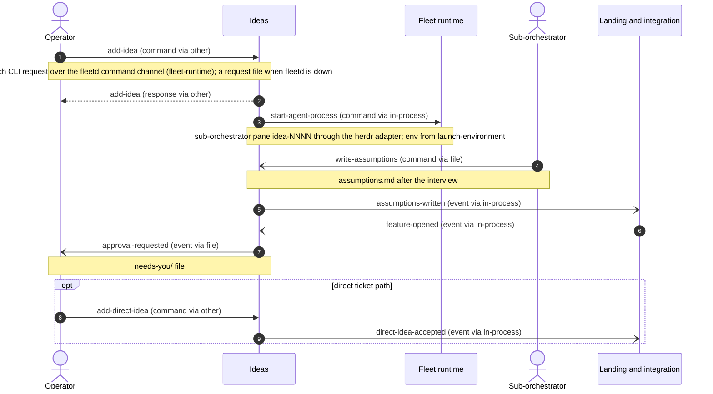
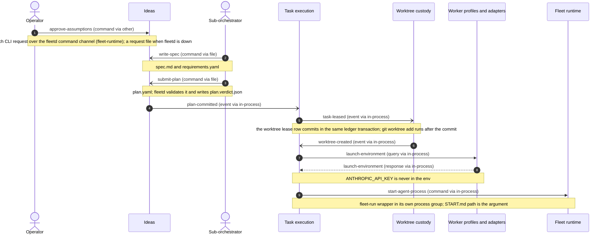
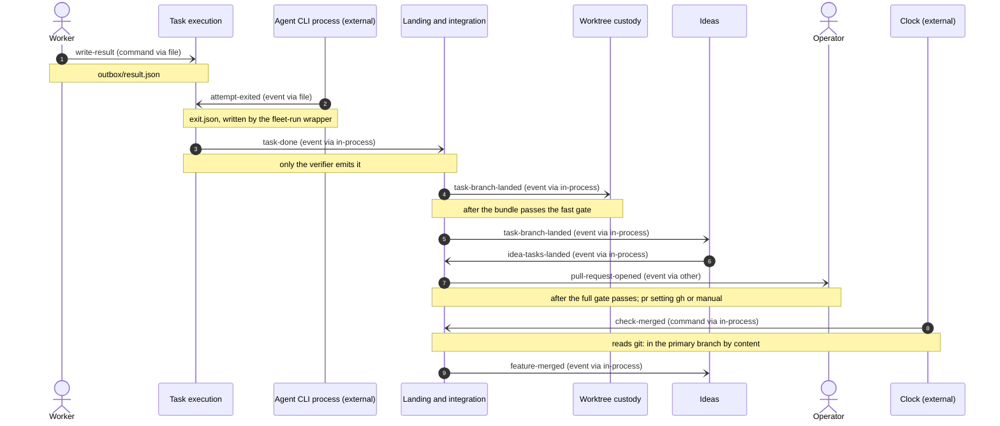
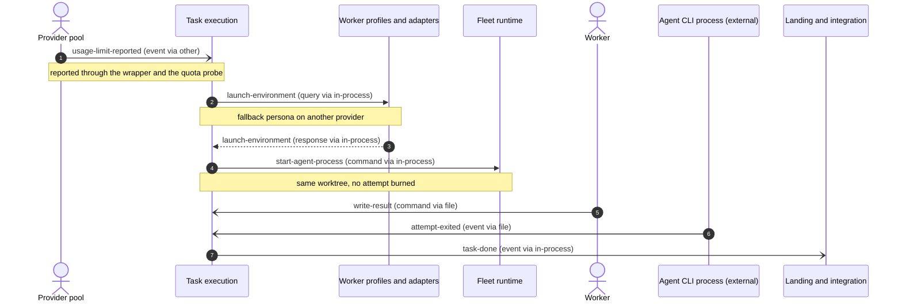
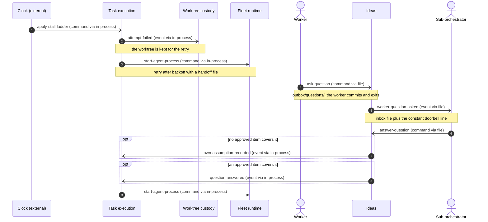
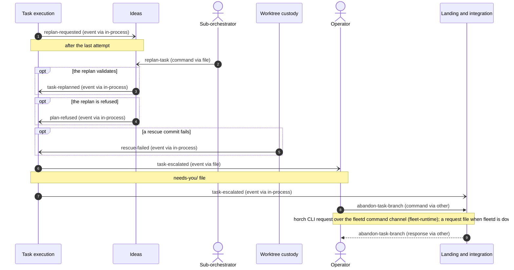
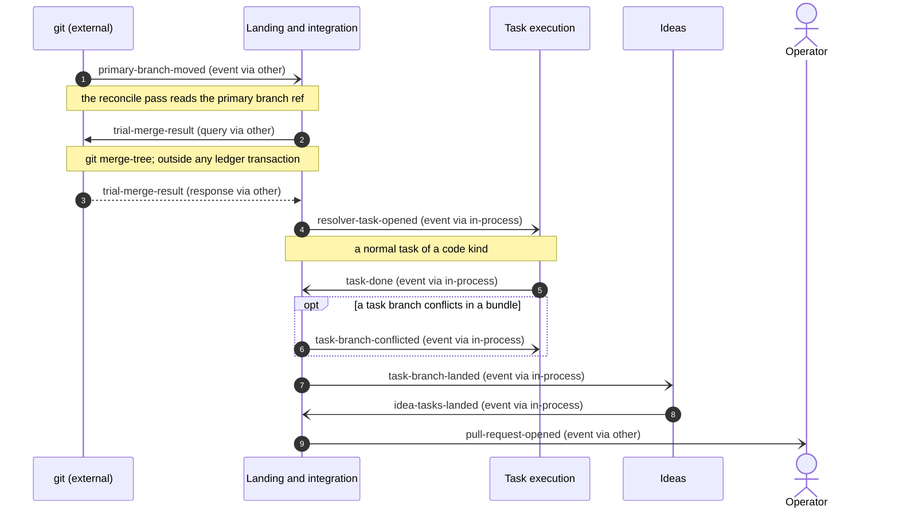

# Message flows — fleetd: the horch fleet control plane

## In plain words

We drew how the 6 parts of fleetd pass work to each other, in 7 step-by-step flows and 42 named messages.

**Decided:** All 6 parts run in 1 program, so they talk by in-memory messages that a 5-second loop re-checks. Only the operator's commands, the agents' files, git, GitHub and process starts leave the program.

**Assumed:** We assumed a lost in-memory message is harmless because the loop re-reads the database every 5 seconds and redoes missing work.

**Riskiest:** If a part reacts twice to the same message and is not built to ignore the repeat, it can launch a worker twice or open 2 features for 1 idea.

---

_Step 5 of the DDD chain (connect) · produced 2026-11-12T17:49:58Z · mode auto · depth standard · inputs: ddd/03-decompose/decompose.json, ddd/04-strategize/strategize.json, ddd/02-discover/discover.json, ddd/manifest.json, ddd/01-understand/understand.json, ddd/glossary.md, docs/specs/fleetd/design.md_

Rendered from `connect.json` by `ddd connect render`. The JSON is the chain (contract §7): edit it and re-render rather than editing tables here.

**Scale target:** 1–1 deployables, 1 team(s) — fleetd is a subcommand of the single horch binary. The operator and the fleet of AI agents are 1 team.. Mechanisms below assume the distances recorded per relationship; `ddd-organise` confirms or flips them.

## How to read the diagrams

| Arrow | Meaning |
|---|---|
| `->>` solid, filled head | synchronous command or query — the sender waits for the answer |
| `-)` solid, open head | asynchronous message — an event published (or a command queued); sender continues |
| `-->>` dotted | response to a query or command |
| `opt …` | steps that only happen under that condition |

Labels read `message-id (kind via mechanism)`. `via in-process` means both parties live in the same deployable (in-memory event or direct call); `message-bus` means an outbox-published event; `http`/`grpc` a network call.

## Flows

### F1 — Capture an idea and open its feature (scenario S1: Happy path: 1 rough idea becomes 1 merged feature)

S1 part 1, up to the approval request. The operator adds an idea, fleetd starts a sub-orchestrator pane for the feature, the sub-orchestrator writes assumptions.md, integration opens the feature branch and ideas asks the operator to approve. The direct ticket path (horch idea add --direct) skips the interview and opens the feature at once.

Policies realised: start-lead-on-capture, open-feature-on-assumptions, request-approval-on-feature, open-feature-on-direct

| # | From | To | Message | Kind | Sync | Via |
|---|---|---|---|---|---|---|
| 1 | operator | ideas | `add-idea` | command | yes | other |
| 2 | ideas | operator | `add-idea` | response | yes | other |
| 3 | ideas | fleet-runtime | `start-agent-process` | command | yes | in-process |
| 4 | sub-orchestrator | ideas | `write-assumptions` | command | no | file |
| 5 | ideas | integration | `assumptions-written` | event | no | in-process |
| 6 | integration | ideas | `feature-opened` | event | no | in-process |
| 7 | ideas | operator | `approval-requested` | event | no | file |
| 8 | operator | ideas | `add-direct-idea` | command | yes | other |
| 9 | ideas | integration | `direct-idea-accepted` | event | no | in-process |

### F2 — Approve, plan, and launch the first attempt (scenario S1: Happy path: 1 rough idea becomes 1 merged feature)

S1 part 2, from approval to a running attempt. The operator approves, the sub-orchestrator writes the spec and plan.yaml, plan validation commits it, task-execution leases a task in the same ledger transaction as the worktree lease row, worktree-custody creates the worktree after the commit, and task-execution launches the attempt with the environment that worker-profiles builds.

Policies realised: promote-on-plan-committed, create-worktree-on-lease, launch-on-worktree

| # | From | To | Message | Kind | Sync | Via |
|---|---|---|---|---|---|---|
| 1 | operator | ideas | `approve-assumptions` | command | yes | other |
| 2 | sub-orchestrator | ideas | `write-spec` | command | no | file |
| 3 | sub-orchestrator | ideas | `submit-plan` | command | no | file |
| 4 | ideas | task-execution | `plan-committed` | event | no | in-process |
| 5 | task-execution | worktree-custody | `task-leased` | event | no | in-process |
| 6 | worktree-custody | task-execution | `worktree-created` | event | no | in-process |
| 7 | task-execution | worker-profiles | `launch-environment` | query | yes | in-process |
| 8 | worker-profiles | task-execution | `launch-environment` | response | yes | in-process |
| 9 | task-execution | fleet-runtime | `start-agent-process` | command | yes | in-process |

### F3 — Verify, land, roll up and close (scenario S1: Happy path: 1 rough idea becomes 1 merged feature)

S1 part 3, from the worker's result to the merged feature. The worker writes result.json, the wrapper writes exit.json, the verifier moves the task to done, integration lands the task branch on the feature branch, worktree-custody removes the worktree, ideas rolls the idea up, integration runs the full gate and opens the pull request, and the clock finds the merge in the primary branch by content.

Policies realised: ready-branch-on-done, after-landing, full-gate-on-landed, close-on-feature-merged

| # | From | To | Message | Kind | Sync | Via |
|---|---|---|---|---|---|---|
| 1 | worker | task-execution | `write-result` | command | no | file |
| 2 | agent-cli | task-execution | `attempt-exited` | event | no | file |
| 3 | task-execution | integration | `task-done` | event | no | in-process |
| 4 | integration | worktree-custody | `task-branch-landed` | event | no | in-process |
| 5 | integration | ideas | `task-branch-landed` | event | no | in-process |
| 6 | ideas | integration | `idea-tasks-landed` | event | no | in-process |
| 7 | integration | operator | `pull-request-opened` | event | no | other |
| 8 | clock | integration | `check-merged` | command | no | in-process |
| 9 | integration | ideas | `feature-merged` | event | no | in-process |

### F4 — Usage limit moves the task to its fallback persona (scenario S2: A usage limit moves the task to its fallback persona with no burned attempt)

S2. A usage limit is not a stall and burns no attempt. task-execution asks worker-profiles for the fallback persona's environment and relaunches on the same worktree. The rest is the normal verify path of F3.

Policies realised: fallback-on-usage-limit, launch-on-fallback

| # | From | To | Message | Kind | Sync | Via |
|---|---|---|---|---|---|---|
| 1 | provider-pool | task-execution | `usage-limit-reported` | event | no | other |
| 2 | task-execution | worker-profiles | `launch-environment` | query | yes | in-process |
| 3 | worker-profiles | task-execution | `launch-environment` | response | yes | in-process |
| 4 | task-execution | fleet-runtime | `start-agent-process` | command | yes | in-process |
| 5 | worker | task-execution | `write-result` | command | no | file |
| 6 | agent-cli | task-execution | `attempt-exited` | event | no | file |
| 7 | task-execution | integration | `task-done` | event | no | in-process |

### F5 — Stalled attempt, worker question and resumed work (scenario S3: A worker stalls, its tree is kept, and the retry continues the same work)

S3. The clock ends a stalled attempt, worktree-custody keeps the tree, a retry starts in the same worktree, the worker asks a question, the sub-orchestrator records its own assumption or answers from approved items, and task-execution relaunches the attempt.

Policies realised: resume-on-own-assumption, resume-on-answer

| # | From | To | Message | Kind | Sync | Via |
|---|---|---|---|---|---|---|
| 1 | clock | task-execution | `apply-stall-ladder` | command | no | in-process |
| 2 | task-execution | worktree-custody | `attempt-failed` | event | no | in-process |
| 3 | task-execution | fleet-runtime | `start-agent-process` | command | yes | in-process |
| 4 | worker | ideas | `ask-question` | command | no | file |
| 5 | ideas | sub-orchestrator | `worker-question-asked` | event | no | file |
| 6 | sub-orchestrator | ideas | `answer-question` | command | no | file |
| 7 | ideas | task-execution | `own-assumption-recorded` | event | no | in-process |
| 8 | ideas | task-execution | `question-answered` | event | no | in-process |
| 9 | task-execution | fleet-runtime | `start-agent-process` | command | yes | in-process |

### F6 — Replan, refusal and escalation to the operator (no discover scenario — derived flow)

No discover scenario covers this path. It realises the cross-context policies of a task that runs out of attempts: the sub-orchestrator replans once, a refused replan or a failed rescue escalates the task, and the operator can abandon the task branch.

Policies realised: lead-replans-on-request, promote-on-replan, escalate-on-plan-refused, escalate-on-rescue-failed, operator-decides-escalation

| # | From | To | Message | Kind | Sync | Via |
|---|---|---|---|---|---|---|
| 1 | task-execution | ideas | `replan-requested` | event | no | in-process |
| 2 | sub-orchestrator | ideas | `replan-task` | command | no | file |
| 3 | ideas | task-execution | `task-replanned` | event | no | in-process |
| 4 | ideas | task-execution | `plan-refused` | event | no | in-process |
| 5 | worktree-custody | task-execution | `rescue-failed` | event | no | in-process |
| 6 | task-execution | operator | `task-escalated` | event | no | file |
| 7 | task-execution | integration | `task-escalated` | event | no | in-process |
| 8 | operator | integration | `abandon-task-branch` | command | yes | other |
| 9 | integration | operator | `abandon-task-branch` | response | yes | other |

### F7 — Conflicting features are stacked with a resolver task (scenario S4: 2 in-flight features conflict and are stacked with 1 resolver task)

S4. The primary branch moves, integration runs trial merges with git, stacks the younger feature on the older one and opens a resolver task, which task-execution runs like any task. A task branch that conflicts in a bundle goes back to task-execution for a new attempt.

Policies realised: on-primary-moved, relaunch-on-conflict

| # | From | To | Message | Kind | Sync | Via |
|---|---|---|---|---|---|---|
| 1 | git | integration | `primary-branch-moved` | event | no | other |
| 2 | integration | git | `trial-merge-result` | query | yes | other |
| 3 | git | integration | `trial-merge-result` | response | yes | other |
| 4 | integration | task-execution | `resolver-task-opened` | event | no | in-process |
| 5 | task-execution | integration | `task-done` | event | no | in-process |
| 6 | integration | task-execution | `task-branch-conflicted` | event | no | in-process |
| 7 | integration | ideas | `task-branch-landed` | event | no | in-process |
| 8 | ideas | integration | `idea-tasks-landed` | event | no | in-process |
| 9 | integration | operator | `pull-request-opened` | event | no | other |

## Message catalogue

| Message | Kind | Producer | Consumers | Payload | Delivery | Contract type | Notes |
|---|---|---|---|---|---|---|---|
| `add-idea` | command | operator | ideas | text, featureId? | sync | ui | response: ideaId; also via file (async, at-least-once): request file under the state root when fleetd is down; fleetd reads it at start; horch idea add |
| `add-direct-idea` | command | operator | ideas | ticketFile, featureId? | sync | ui | response: ideaId, featureId; also via file (async, at-least-once): request file under the state root when fleetd is down; fleetd reads it at start; horch idea add --direct |
| `approve-assumptions` | command | operator | ideas | ideaId, assumptionsHash | sync | ui | idempotency: an approval of the same assumptionsHash is a no-op; a stale hash is refused; response: approved; also via file (async, at-least-once): request file under the state root when fleetd is down; fleetd reads it at start |
| `abandon-task-branch` | command | operator | integration | branch, taskId | sync | ui | idempotency: an abandoned branch is not abandoned twice; the rescue ref is returned again; response: rescueRef; also via file (async, at-least-once): request file under the state root when fleetd is down; fleetd reads it at start |
| `write-assumptions` | command | sub-orchestrator | ideas | ideaId, assumptions.md | at-least-once | ui | idempotency: fleetd ingests a file once per (path, content hash); files are atomic and immutable |
| `write-spec` | command | sub-orchestrator | ideas | ideaId, spec.md, requirements.yaml | at-least-once | ui | idempotency: once per (ideaId, content hash) |
| `submit-plan` | command | sub-orchestrator | ideas | ideaId, plan.yaml | at-least-once | ui | idempotency: once per (ideaId, plan content hash); plan.verdict.json records the result |
| `answer-question` | command | sub-orchestrator | ideas | questionId, answer|assumption, citation? | at-least-once | ui | idempotency: once per questionId; a second answer is refused |
| `replan-task` | command | sub-orchestrator | ideas | taskId, planChange | at-least-once | ui | idempotency: once per (taskId, replan round); 1 replan per task |
| `write-result` | command | worker | task-execution | taskId, attemptId, status, commits[] | at-least-once | ui | idempotency: once per attemptId; result.json is immutable; outbox/result.json, written with fleet result |
| `ask-question` | command | worker | ideas | taskId, questionId, text | at-least-once | ui | idempotency: once per questionId (1 file each); outbox/questions/, written with fleet ask |
| `attempt-exited` | event | agent-cli | task-execution | attemptId, exitStatus, hasResult | at-least-once | external-api | idempotency: once per attemptId; exit.json is immutable; exit.json, written by the fleet-run wrapper from the process fact |
| `usage-limit-reported` | event | provider-pool | task-execution | attemptId, pool, resetAt | at-least-once | external-api | idempotency: once per (attemptId, pool); a repeat for a moved attempt is ignored |
| `primary-branch-moved` | event | git | integration | primaryBranch, tip | at-least-once | external-api | idempotency: once per (primaryBranch, tip) |
| `trial-merge-result` | query | git | integration | featureA, featureB|primary | sync | external-api | response: clean, paths[]; minted: git merge-tree trial merge |
| `check-merged` | command | clock | integration | featureId | at-least-once | external-api | idempotency: feature-merged is emitted once per featureId |
| `apply-stall-ladder` | command | clock | task-execution | attemptId | at-least-once | external-api | idempotency: each rung is recorded once per (attemptId, rung) |
| `approval-requested` | event | ideas | operator | ideaId, assumptionsHash | at-least-once | ui | idempotency: 1 needs-you file per (ideaId, assumptionsHash) |
| `worker-question-asked` | event | ideas | sub-orchestrator | taskId, questionId, text | at-least-once | ui | idempotency: 1 inbox file per questionId |
| `task-escalated` | event | task-execution | operator, integration | taskId, reason | at-least-once | customer-supplier | v1; idempotency: the reconcile pass is level-triggered, so a reaction can run again; 1 needs-you file per (taskId, reason); integration records it once per taskId |
| `pull-request-opened` | event | integration | operator | featureId, prUrl | at-least-once | ui | idempotency: 1 pull request per featureId |
| `assumptions-written` | event | ideas | integration | ideaId, featureId? | at-least-once | published-language | v1; idempotency: the reconcile pass is level-triggered, so a reaction can run again; integration opens at most 1 feature per idea; open-feature is a no-op when the idea has a feature |
| `feature-opened` | event | integration | ideas | featureId, branch, primaryBranch, ideaId | at-least-once | published-language | v1; idempotency: the reconcile pass is level-triggered, so a reaction can run again; ideas requests approval once per (ideaId, assumptionsHash) |
| `direct-idea-accepted` | event | ideas | integration | ideaId, ticketFile, featureId? | at-least-once | published-language | v1; idempotency: the reconcile pass is level-triggered, so a reaction can run again; at most 1 feature per idea |
| `plan-committed` | event | ideas | task-execution | ideaId, taskIds[] | at-least-once | customer-supplier | v1; idempotency: the reconcile pass is level-triggered, so a reaction can run again; promote-task is a no-op for a task past planned |
| `plan-refused` | event | ideas | task-execution | ideaId, taskId?, reasons[] | at-least-once | customer-supplier | v1; idempotency: the reconcile pass is level-triggered, so a reaction can run again; escalate-task is a no-op for an escalated task |
| `task-replanned` | event | ideas | task-execution | taskId, planChange | at-least-once | customer-supplier | v1; idempotency: the reconcile pass is level-triggered, so a reaction can run again; promote once per (taskId, replan round) |
| `question-answered` | event | ideas | task-execution | questionId, taskId | at-least-once | customer-supplier | v1; idempotency: the reconcile pass is level-triggered, so a reaction can run again; 1 launch per (taskId, questionId) |
| `own-assumption-recorded` | event | ideas | task-execution | questionId, taskId | at-least-once | customer-supplier | v1; idempotency: the reconcile pass is level-triggered, so a reaction can run again; 1 launch per (taskId, questionId) |
| `idea-tasks-landed` | event | ideas | integration | ideaId, featureId | at-least-once | published-language | v1; idempotency: the reconcile pass is level-triggered, so a reaction can run again; the full gate runs once per (featureId, feature tip) |
| `replan-requested` | event | task-execution | ideas | taskId, attempts | at-least-once | published-language | v1; idempotency: the reconcile pass is level-triggered, so a reaction can run again; 1 replan per task |
| `task-leased` | event | task-execution | worktree-custody | taskId, attemptId, worktreeId, branch | at-least-once | customer-supplier | v1; idempotency: the reconcile pass is level-triggered, so a reaction can run again; create-worktree is a no-op when the worktree exists for the task |
| `attempt-failed` | event | task-execution | worktree-custody | attemptId, taskId, outcome | at-least-once | customer-supplier | v1; idempotency: the reconcile pass is level-triggered, so a reaction can run again; the worktree state moves once per attemptId |
| `task-done` | event | task-execution | integration | taskId, branch, verdict | at-least-once | customer-supplier | v1; idempotency: the reconcile pass is level-triggered, so a reaction can run again; mark-branch-ready is a no-op for a ready branch |
| `worktree-created` | event | worktree-custody | task-execution | worktreeId, taskId, path, branch | at-least-once | published-language | v1; idempotency: the reconcile pass is level-triggered, so a reaction can run again; launch once per (taskId, attemptId) |
| `rescue-failed` | event | worktree-custody | task-execution | worktreeId, taskId | at-least-once | published-language | v1; idempotency: the reconcile pass is level-triggered, so a reaction can run again; escalate-task is a no-op for an escalated task |
| `task-branch-conflicted` | event | integration | task-execution | branch, taskId | at-least-once | published-language | v1; idempotency: the reconcile pass is level-triggered, so a reaction can run again; 1 new attempt per (taskId, conflicting feature tip) |
| `resolver-task-opened` | event | integration | task-execution | featureId, taskId, conflict | at-least-once | published-language | v1; idempotency: the reconcile pass is level-triggered, so a reaction can run again; 1 resolver task per (featureId, conflict) |
| `task-branch-landed` | event | integration | worktree-custody, ideas | branch, taskId, featureId, tip | at-least-once | published-language | v1; idempotency: the reconcile pass is level-triggered, so a reaction can run again; remove-worktree and roll-up-idea are no-ops when already done |
| `feature-merged` | event | integration | ideas | featureId | at-least-once | published-language | v1; idempotency: the reconcile pass is level-triggered, so a reaction can run again; close-idea is a no-op for a merged idea |
| `launch-environment` | query | worker-profiles | task-execution, ideas | profile, taskId|ideaId, attemptId? | sync | customer-supplier | v1; response: cli, flags[], env (scrubbed: no ANTHROPIC_API_KEY), configHomeFiles[], sandboxProfile; minted: resolve a profile to the exact launch of 1 process |
| `start-agent-process` | command | task-execution | fleet-runtime | launchEnvironment, startFile|pane, processGroup | sync | open-host-service | v1; response: pid, pgid, pane; minted: start the fleet-run wrapper (attempt) or a herdr pane (sub-orchestrator) through the platform layer and the herdr adapter. ideas sends it too, for sub-orchestrator panes. |

## Integration decisions (one per context-map relationship)

| Relationship | Upstream → downstream | Pattern | Mechanism | Assumed distance | Rationale |
|---|---|---|---|---|---|
| R1 | ideas → integration | published-language | in-process-call | same-deployable | Both contexts are code inside the 1 fleetd process (design: Architecture and roles; scale target 1 deployable). In-memory domain events of a versioned type, consumed in the level-triggered reconcile pass (design: Supervision, liveness and reconciliation). |
| R2 | ideas → task-execution | customer-supplier | in-process-call | same-deployable | Both contexts are code inside the 1 fleetd process (design: Architecture and roles; scale target 1 deployable). Events from ideas; task-execution reacts. No caller needs an answer now. |
| R3 | task-execution → ideas | published-language | in-process-call | same-deployable | Both contexts are code inside the 1 fleetd process (design: Architecture and roles; scale target 1 deployable). replan-requested as an in-memory event; the sub-orchestrator does the replan through files. |
| R4 | task-execution → worktree-custody | customer-supplier | in-process-call | same-deployable | Both contexts are code inside the 1 fleetd process (design: Architecture and roles; scale target 1 deployable). task-leased and the worktree lease row commit in 1 ledger transaction; git worktree add runs after the commit (decompose R4, CC5). |
| R5 | worktree-custody → task-execution | published-language | in-process-call | same-deployable | Both contexts are code inside the 1 fleetd process (design: Architecture and roles; scale target 1 deployable). worktree-created and rescue-failed as in-memory events read in the next pass. |
| R6 | task-execution → integration | customer-supplier | in-process-call | same-deployable | Both contexts are code inside the 1 fleetd process (design: Architecture and roles; scale target 1 deployable). task-done and task-escalated as in-memory events; integration hosts mark-branch-ready. |
| R7 | integration → task-execution | published-language | in-process-call | same-deployable | Both contexts are code inside the 1 fleetd process (design: Architecture and roles; scale target 1 deployable). task-branch-conflicted and resolver-task-opened as in-memory events; task-execution launches the attempt. |
| R8 | integration → worktree-custody | published-language | in-process-call | same-deployable | Both contexts are code inside the 1 fleetd process (design: Architecture and roles; scale target 1 deployable). task-branch-landed as an in-memory event; worktree-custody refuses a removal that loses work (04 W6). |
| R9 | integration → ideas | published-language | in-process-call | same-deployable | Both contexts are code inside the 1 fleetd process (design: Architecture and roles; scale target 1 deployable). task-branch-landed and feature-merged as in-memory events; ideas never reads git. |
| R10 | worker-profiles → task-execution | customer-supplier | in-process-call | same-deployable | Both contexts are code inside the 1 fleetd process (design: Architecture and roles; scale target 1 deployable). Direct synchronous query launch-environment at launch: task-execution cannot start a process without the scrubbed env (decompose N2). |
| R11 | worker-profiles → ideas | customer-supplier | in-process-call | same-deployable | Both contexts are code inside the 1 fleetd process (design: Architecture and roles; scale target 1 deployable). The same launch-environment query, asked by ideas for a sub-orchestrator pane. F1 shows it as a note on start-agent-process, not as its own step, to keep F1 within 9 messages. |
| R12 | fleet-runtime → task-execution | open-host-service | in-process-call | same-deployable | Both contexts are code inside the 1 fleetd process (design: Architecture and roles; scale target 1 deployable). Calls through the fleet-runtime facade: start-agent-process, process facts, the single ledger writer (decompose N5). |
| R13 | fleet-runtime → ideas | open-host-service | in-process-call | same-deployable | Both contexts are code inside the 1 fleetd process (design: Architecture and roles; scale target 1 deployable). The same facade for ideas: the command channel delivers horch idea commands, and start-agent-process opens sub-orchestrator panes through the herdr adapter. |

## Coupling concerns

- **CC1** (high) — task-execution and integration depend on each other: task-done and task-escalated go one way, task-branch-conflicted and resolver-task-opened go the other. Both are core, so a change in one state machine can force a change in the other. — contexts: task-execution, integration — smell: bidirectional; flows: F3, F6, F7; mitigation: Keep both directions as versioned in-memory events only, never direct calls; decompose can declare R6 and R7 a partnership (Q4).
- **CC2** (medium) — ideas and task-execution depend on each other: plan and answer events go to task-execution, replan-requested comes back to ideas. — contexts: ideas, task-execution — smell: bidirectional; flows: F2, F5, F6; mitigation: Accepted: decompose split the 2 directions into R2 and R3 on purpose. Both directions stay events.
- **CC3** (medium) — ideas and integration depend on each other: assumptions-written and idea-tasks-landed go to integration, feature-opened, task-branch-landed and feature-merged come back. — contexts: ideas, integration — smell: bidirectional; flows: F1, F3, F7; mitigation: Accepted: R1 and R9 are both published languages; ideas never reads git and integration never reads idea files.
- **CC4** (medium) — task-execution and worktree-custody depend on each other (R4 and R5): the worktree lifecycle follows the task lease and the attempt end, and launch waits for the worktree. — contexts: task-execution, worktree-custody — smell: bidirectional; flows: F2, F5, F6; mitigation: Accepted as the lifecycle link of decompose N6; keep it as events in both directions.
- **CC5** (medium) — task-leased is an event, but task-execution cannot launch until the worktree exists, and a failed git worktree add must come back to task-execution. The event hides a command that needs a result. — contexts: task-execution, worktree-custody — smell: event-should-be-command; flows: F2; mitigation: task-execution acts as the process manager of dispatch: lease and worktree lease row in 1 transaction, then create-worktree, then launch on worktree-created, with a timeout back to ready.; saga / process-manager candidate — design it at deep depth
- **CC6** (high) — Trial merges, git worktree add and remove, and process starts are external calls. If one runs inside the ledger write transaction, a slow git or a hung process start holds the only writer. — contexts: integration, worktree-custody, fleet-runtime — smell: external-in-transaction; flows: F2, F7; mitigation: Commit, then call, then record the outcome as an event in the next pass; never call git or start a process while the ledger transaction is open.
- **CC7** (high) — abandon-task-branch drops a task branch in integration, but the rescue ref that keeps the work is made in worktree-custody (04 W6). Both must happen, in order, or work is lost. — contexts: integration, worktree-custody — smell: distributed-transaction; flows: F6; mitigation: integration asks worktree-custody to rescue first and drops the branch only on worktree-rescued; integration owns this process.; saga / process-manager candidate — design it at deep depth
- **CC8** (medium) — plan-refused is an ideas fact, but escalate-task runs in task-execution, which owns neither the plan nor the reasons. The operator inbox owner is also open (decompose Q3). — contexts: ideas, task-execution — smell: wrong-policy-host; flows: F6; mitigation: Keep the policy in task-execution only for a replan of an existing task; a refused first plan stays in ideas. Settle the needs-you owner in define.
- **CC9** (low) — task-branch-landed has 2 consumers that need different data: worktree-custody needs the task and worktree, ideas needs the feature and idea roll-up. — contexts: integration, worktree-custody, ideas — smell: wide-fan-out; flows: F3, F7; mitigation: Keep 1 thin event (branch, taskId, featureId, tip); each consumer reads its own rows.

## Assumptions

- **A1** (high) All 6 contexts run in the 1 fleetd process, so every context-to-context message is in-process. Only the command channel, the file protocol, the herdr adapter, the platform layer, git and GitHub cross a process boundary (design: Architecture and roles).
- **A2** (high) Cross-context events are in-memory events consumed in the level-triggered 5 s reconcile pass, which re-derives work from ledger rows, so a lost event is caught on the next pass. Delivery is at-least-once and every consumer is idempotent on a natural key (design: Supervision, liveness and reconciliation; decision D1).
- **A3** (high) Every state change in every flow commits through the single ledger writer in fleet-runtime (decompose N5). The flows do not draw that call on each step.
- **A4** (high) Operator commands travel as horch CLI requests over the fleetd command channel (Unix socket or named pipe), drawn as via other. When fleetd is down the request goes to a file that fleetd reads at start (design: The command channel).
- **A5** (high) Agent hand-offs (assumptions.md, plan.yaml, result.json, questions, exit.json) are files: atomic, immutable and read in the pass, so they are at-least-once and idempotent on path and content hash (design: Workspace layout and file protocol).
- **A6** (medium) 3 message ids are minted here: launch-environment (query), start-agent-process (command) and trial-merge-result (query). Discover has no id for these calls.
- **A7** (medium) The facts of the fleet-run wrapper (exit.json) are drawn as coming from agent-cli. Which context owns the wrapper code is open (decision D2, Q1).
- **A8** (medium) git is called by 2 contexts: worktree-custody for worktrees and integration for refs, bundles and trial merges (Q3).

## Open questions

- **Q1** Which context owns the fleet-run wrapper: task-execution, worker-profiles or fleet-runtime (decision D2)? — owner: operator
- **Q2** Can discover adopt the minted ids launch-environment, start-agent-process and trial-merge-result? — owner: ddd-discover
- **Q3** git has 2 callers (worktree-custody and integration). Is split ownership by concern acceptable, or must 1 context own all git calls? — owner: operator
- **Q4** R6 and R7 make 2 core contexts depend on each other (CC1). Should decompose declare them a partnership? — owner: operator
- **Q5** Does the sub-orchestrator answer a worker question with a file in the idea folder or with horch idea note over the command channel? — owner: operator

---
Next step: `/ddd-organise` groups contexts into teams and deployables using the coupling concerns and sync chains above.
