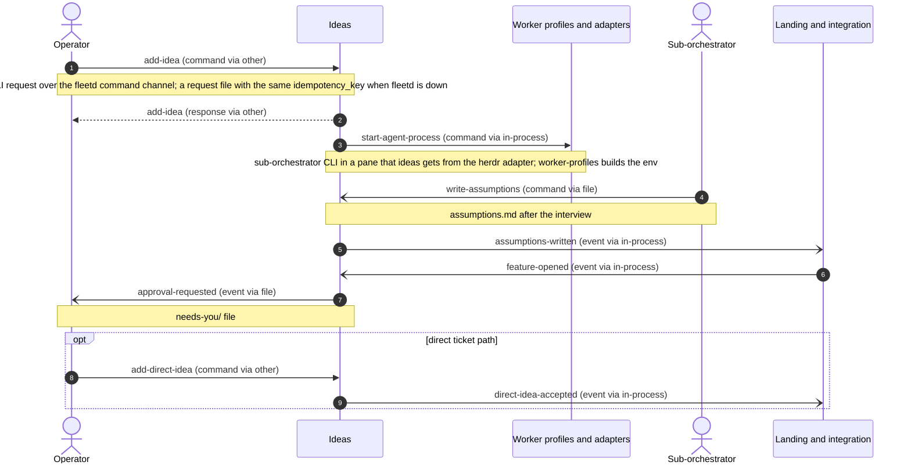
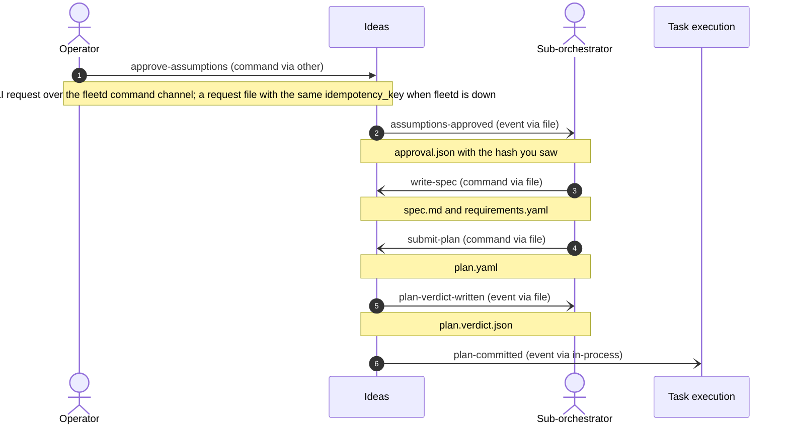
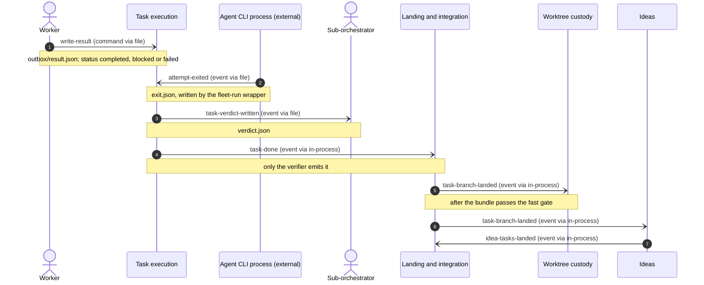
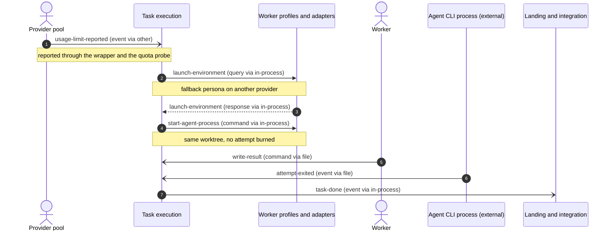
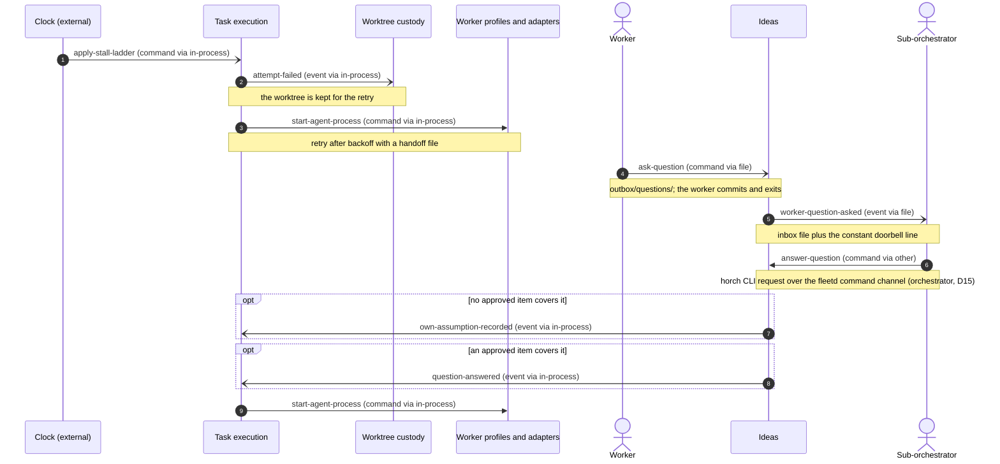
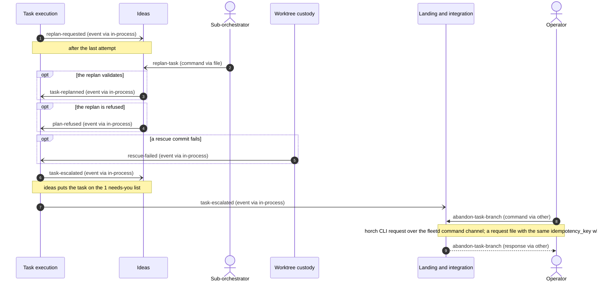
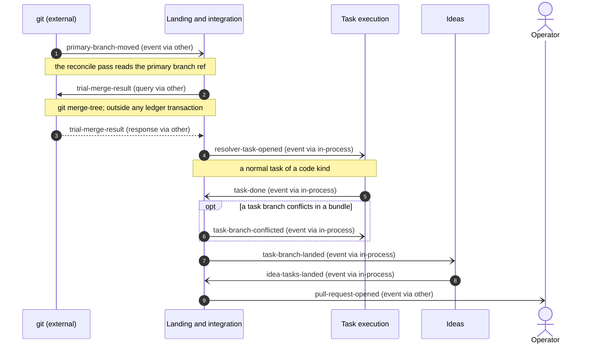
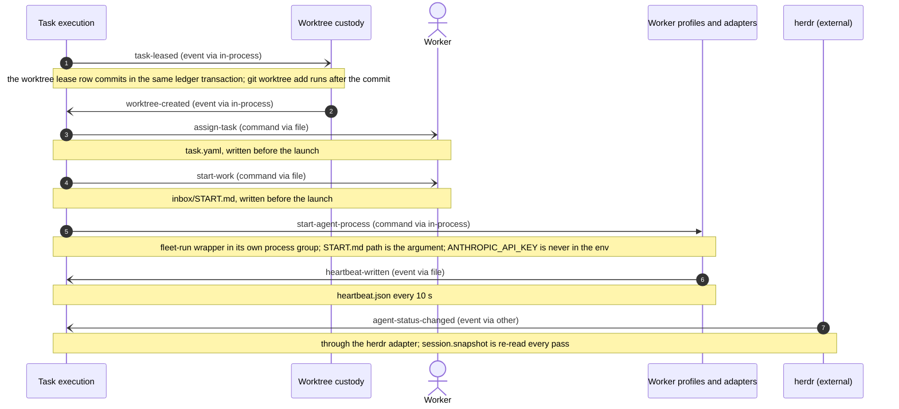
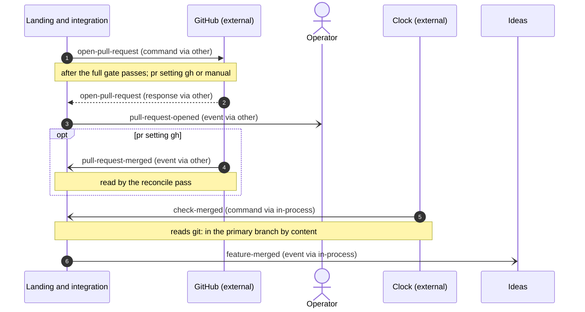

# Message flows — fleetd: the horch fleet control plane

## In plain words

We drew how the 6 parts of fleetd pass work to each other, in 9 step-by-step flows and 51 named messages.

**Decided:** All 6 parts run in 1 program, so they talk by in-memory messages that a 5-second loop re-checks. Only the operator's commands, the agents' files, herdr, git, GitHub and process starts leave the program. worker-profiles starts every agent process.

**Assumed:** We assumed a lost in-memory message is harmless because the loop re-reads the database every 5 seconds and redoes missing work.

**Riskiest:** If a part reacts twice to the same message and is not built to ignore the repeat, it can launch a worker twice or open 2 features for 1 idea.

---

_Step 5 of the DDD chain (connect) · produced 2026-11-12T20:51:30Z · mode auto · depth standard · inputs: ddd/03-decompose/decompose.json, ddd/04-strategize/strategize.json, ddd/02-discover/discover.json, ddd/manifest.json, ddd/01-understand/understand.json, ddd/glossary.md, docs/specs/fleetd/design.md_

Rendered from `connect.json` by `ddd connect render`. The JSON is the chain (contract §7): edit it and re-render rather than editing tables here.

**Scale target:** 1–1 deployables, 1 team(s) — fleetd is a subcommand of the single horch binary. The operator and the fleet of AI agents are 1 team.. Mechanisms below assume the distances recorded per relationship; `ddd-organise` confirms or flips them.

## How to read the diagrams

| Arrow | Meaning |
|---|---|
| `->>` solid, filled head | synchronous command or query — the sender waits for the answer |
| `-)` solid, open head | asynchronous message — an event published (or a command queued); sender continues |
| `-->>` dotted | response to a query or command |
| `opt …` | steps that only happen under that condition |

Labels read `message-id (kind via mechanism)`. `via in-process` means both parties live in the same deployable (in-memory event or direct call); `message-bus` means an outbox-published event; `http`/`grpc` a network call.

## Flows

### F1 — Capture an idea and open its feature (scenario S1: Happy path: 1 rough idea becomes 1 merged feature)

S1 part 1, up to the approval request. The operator adds an idea, fleetd starts a sub-orchestrator pane for the feature, the sub-orchestrator writes assumptions.md, integration opens the feature branch and ideas asks the operator to approve. The direct ticket path (horch idea add --direct) skips the interview and opens the feature at once.

Policies realised: start-lead-on-capture, open-feature-on-assumptions, request-approval-on-feature, open-feature-on-direct

| # | From | To | Message | Kind | Sync | Via |
|---|---|---|---|---|---|---|
| 1 | operator | ideas | `add-idea` | command | yes | other |
| 2 | ideas | operator | `add-idea` | response | yes | other |
| 3 | ideas | worker-profiles | `start-agent-process` | command | yes | in-process |
| 4 | sub-orchestrator | ideas | `write-assumptions` | command | no | file |
| 5 | ideas | integration | `assumptions-written` | event | no | in-process |
| 6 | integration | ideas | `feature-opened` | event | no | in-process |
| 7 | ideas | operator | `approval-requested` | event | no | file |
| 8 | operator | ideas | `add-direct-idea` | command | yes | other |
| 9 | ideas | integration | `direct-idea-accepted` | event | no | in-process |

### F2 — Approve and commit the plan (scenario S1: Happy path: 1 rough idea becomes 1 merged feature)

S1 part 2, from approval to a committed plan. The operator approves, fleetd writes approval.json, the sub-orchestrator writes the spec and plan.yaml, plan validation writes plan.verdict.json and commits the plan. F8 continues with the lease and the launch.

Policies realised: promote-on-plan-committed

| # | From | To | Message | Kind | Sync | Via |
|---|---|---|---|---|---|---|
| 1 | operator | ideas | `approve-assumptions` | command | yes | other |
| 2 | ideas | sub-orchestrator | `assumptions-approved` | event | no | file |
| 3 | sub-orchestrator | ideas | `write-spec` | command | no | file |
| 4 | sub-orchestrator | ideas | `submit-plan` | command | no | file |
| 5 | ideas | sub-orchestrator | `plan-verdict-written` | event | no | file |
| 6 | ideas | task-execution | `plan-committed` | event | no | in-process |

### F3 — Verify, land and roll up (scenario S1: Happy path: 1 rough idea becomes 1 merged feature)

S1 part 4, from the worker's result to the idea roll-up. The worker writes result.json, the wrapper writes exit.json, the verifier writes verdict.json and moves the task to done, integration lands the task branch on the feature branch, worktree-custody removes the worktree and ideas rolls the idea up. F9 continues with the pull request.

Policies realised: ready-branch-on-done, after-landing, full-gate-on-landed

| # | From | To | Message | Kind | Sync | Via |
|---|---|---|---|---|---|---|
| 1 | worker | task-execution | `write-result` | command | no | file |
| 2 | agent-cli | task-execution | `attempt-exited` | event | no | file |
| 3 | task-execution | sub-orchestrator | `task-verdict-written` | event | no | file |
| 4 | task-execution | integration | `task-done` | event | no | in-process |
| 5 | integration | worktree-custody | `task-branch-landed` | event | no | in-process |
| 6 | integration | ideas | `task-branch-landed` | event | no | in-process |
| 7 | ideas | integration | `idea-tasks-landed` | event | no | in-process |

### F4 — Usage limit moves the task to its fallback persona (scenario S2: A usage limit moves the task to its fallback persona with no burned attempt)

S2. A usage limit is not a stall and burns no attempt. task-execution asks worker-profiles for the fallback persona's environment and relaunches on the same worktree. The rest is the normal verify path of F3.

Policies realised: fallback-on-usage-limit, launch-on-fallback

| # | From | To | Message | Kind | Sync | Via |
|---|---|---|---|---|---|---|
| 1 | provider-pool | task-execution | `usage-limit-reported` | event | no | other |
| 2 | task-execution | worker-profiles | `launch-environment` | query | yes | in-process |
| 3 | worker-profiles | task-execution | `launch-environment` | response | yes | in-process |
| 4 | task-execution | worker-profiles | `start-agent-process` | command | yes | in-process |
| 5 | worker | task-execution | `write-result` | command | no | file |
| 6 | agent-cli | task-execution | `attempt-exited` | event | no | file |
| 7 | task-execution | integration | `task-done` | event | no | in-process |

### F5 — Stalled attempt, worker question and resumed work (scenario S3: A worker stalls, its tree is kept, and the retry continues the same work)

S3. The clock ends a stalled attempt, worktree-custody keeps the tree, a retry starts in the same worktree, the worker asks a question, the sub-orchestrator records its own assumption or answers from approved items through the command channel, and task-execution relaunches the attempt.

Policies realised: resume-on-own-assumption, resume-on-answer

| # | From | To | Message | Kind | Sync | Via |
|---|---|---|---|---|---|---|
| 1 | clock | task-execution | `apply-stall-ladder` | command | no | in-process |
| 2 | task-execution | worktree-custody | `attempt-failed` | event | no | in-process |
| 3 | task-execution | worker-profiles | `start-agent-process` | command | yes | in-process |
| 4 | worker | ideas | `ask-question` | command | no | file |
| 5 | ideas | sub-orchestrator | `worker-question-asked` | event | no | file |
| 6 | sub-orchestrator | ideas | `answer-question` | command | yes | other |
| 7 | ideas | task-execution | `own-assumption-recorded` | event | no | in-process |
| 8 | ideas | task-execution | `question-answered` | event | no | in-process |
| 9 | task-execution | worker-profiles | `start-agent-process` | command | yes | in-process |

### F6 — Replan, refusal and escalation to the operator (no discover scenario — derived flow)

No discover scenario covers this path. It realises the cross-context policies of a task that runs out of attempts: the sub-orchestrator replans once, a refused replan or a failed rescue escalates the task, and the operator can abandon the task branch.

Policies realised: lead-replans-on-request, promote-on-replan, escalate-on-plan-refused, escalate-on-rescue-failed, operator-decides-escalation

| # | From | To | Message | Kind | Sync | Via |
|---|---|---|---|---|---|---|
| 1 | task-execution | ideas | `replan-requested` | event | no | in-process |
| 2 | sub-orchestrator | ideas | `replan-task` | command | no | file |
| 3 | ideas | task-execution | `task-replanned` | event | no | in-process |
| 4 | ideas | task-execution | `plan-refused` | event | no | in-process |
| 5 | worktree-custody | task-execution | `rescue-failed` | event | no | in-process |
| 6 | task-execution | ideas | `task-escalated` | event | no | in-process |
| 7 | task-execution | integration | `task-escalated` | event | no | in-process |
| 8 | operator | integration | `abandon-task-branch` | command | yes | other |
| 9 | integration | operator | `abandon-task-branch` | response | yes | other |

### F7 — Conflicting features are stacked with a resolver task (scenario S4: 2 in-flight features conflict and are stacked with 1 resolver task)

S4. The primary branch moves, integration runs trial merges with git, stacks the younger feature on the older one and opens a resolver task, which task-execution runs like any task. A task branch that conflicts in a bundle goes back to task-execution for a new attempt.

Policies realised: on-primary-moved, relaunch-on-conflict

| # | From | To | Message | Kind | Sync | Via |
|---|---|---|---|---|---|---|
| 1 | git | integration | `primary-branch-moved` | event | no | other |
| 2 | integration | git | `trial-merge-result` | query | yes | other |
| 3 | git | integration | `trial-merge-result` | response | yes | other |
| 4 | integration | task-execution | `resolver-task-opened` | event | no | in-process |
| 5 | task-execution | integration | `task-done` | event | no | in-process |
| 6 | integration | task-execution | `task-branch-conflicted` | event | no | in-process |
| 7 | integration | ideas | `task-branch-landed` | event | no | in-process |
| 8 | ideas | integration | `idea-tasks-landed` | event | no | in-process |
| 9 | integration | operator | `pull-request-opened` | event | no | other |

### F8 — Lease, write the task files and launch the first attempt (scenario S1: Happy path: 1 rough idea becomes 1 merged feature)

S1 part 3, from the committed plan (F2) to a running attempt. task-execution leases a task in the same ledger transaction as the worktree lease row, worktree-custody creates the worktree after the commit, task-execution writes task.yaml and START.md, and worker-profiles starts the fleet-run wrapper. The wrapper heartbeat and the herdr agent status then renew the lease. F3 continues at the result.

Policies realised: create-worktree-on-lease, launch-on-worktree, start-process-on-launch

| # | From | To | Message | Kind | Sync | Via |
|---|---|---|---|---|---|---|
| 1 | task-execution | worktree-custody | `task-leased` | event | no | in-process |
| 2 | worktree-custody | task-execution | `worktree-created` | event | no | in-process |
| 3 | task-execution | worker | `assign-task` | command | no | file |
| 4 | task-execution | worker | `start-work` | command | no | file |
| 5 | task-execution | worker-profiles | `start-agent-process` | command | yes | in-process |
| 6 | worker-profiles | task-execution | `heartbeat-written` | event | no | file |
| 7 | herdr | task-execution | `agent-status-changed` | event | no | other |

### F9 — Open the pull request and close the feature (scenario S1: Happy path: 1 rough idea becomes 1 merged feature)

S1 part 5, from the full gate (F3) to the merged feature. integration opens the pull request on GitHub, tells the operator, GitHub reports the merge, and the clock confirms the merge in the primary branch by content before ideas closes the idea.

Policies realised: close-on-feature-merged

| # | From | To | Message | Kind | Sync | Via |
|---|---|---|---|---|---|---|
| 1 | integration | github | `open-pull-request` | command | yes | other |
| 2 | github | integration | `open-pull-request` | response | yes | other |
| 3 | integration | operator | `pull-request-opened` | event | no | other |
| 4 | github | integration | `pull-request-merged` | event | no | other |
| 5 | clock | integration | `check-merged` | command | no | in-process |
| 6 | integration | ideas | `feature-merged` | event | no | in-process |

## Message catalogue

| Message | Kind | Producer | Consumers | Payload | Delivery | Contract type | Notes |
|---|---|---|---|---|---|---|---|
| `add-idea` | command | operator | ideas | text, feature_id?, idempotency_key | sync | ui | idempotency: fleetd applies a request once per idempotency_key and returns the first outcome again; response: outcome (accepted or refused), reason (when refused); also via file (async, at-least-once): request file under the state root when fleetd is down; fleetd reads it at start; the file carries the same idempotency_key; horch idea add |
| `add-direct-idea` | command | operator | ideas | ticket_file, feature_id?, idempotency_key | sync | ui | idempotency: fleetd applies a request once per idempotency_key and returns the first outcome again; response: outcome (accepted or refused), reason (when refused); also via file (async, at-least-once): request file under the state root when fleetd is down; fleetd reads it at start; the file carries the same idempotency_key; horch idea add --direct |
| `approve-assumptions` | command | operator | ideas | idea_id, assumptions_hash, idempotency_key | sync | ui | idempotency: an approval of the same assumptionsHash is a no-op; a stale hash is refused; fleetd applies a request once per idempotency_key and returns the first outcome again; response: outcome (accepted or refused), reason (when refused); also via file (async, at-least-once): request file under the state root when fleetd is down; fleetd reads it at start; the file carries the same idempotency_key |
| `abandon-task-branch` | command | operator | integration | branch, task_id, idempotency_key | sync | ui | idempotency: an abandoned branch is not abandoned twice; the rescue ref is returned again; fleetd applies a request once per idempotency_key and returns the first outcome again; response: outcome (accepted or refused), reason (when refused); also via file (async, at-least-once): request file under the state root when fleetd is down; fleetd reads it at start; the file carries the same idempotency_key |
| `write-assumptions` | command | sub-orchestrator | ideas | idea_id, assumptions.md | at-least-once | ui | idempotency: fleetd ingests a file once per (path, content hash); files are atomic and immutable |
| `write-spec` | command | sub-orchestrator | ideas | idea_id, spec.md, requirements.yaml | at-least-once | ui | idempotency: once per (ideaId, content hash) |
| `submit-plan` | command | sub-orchestrator | ideas | idea_id, plan.yaml | at-least-once | ui | idempotency: once per (ideaId, plan content hash); plan.verdict.json records the result |
| `answer-question` | command | sub-orchestrator | ideas | question_id, answer|assumption, citation?, idempotency_key | sync | ui | idempotency: once per question_id; a second answer is refused with its reason; response: outcome (accepted or refused), reason (when refused); also via file (async, at-least-once): request file under the state root when fleetd is down; fleetd reads it at start; the file carries the same idempotency_key; horch CLI request of the sub-orchestrator over the fleetd command channel (orchestrator, D15); fleetd stays the only ledger writer |
| `replan-task` | command | sub-orchestrator | ideas | task_id, plan_change | at-least-once | ui | idempotency: once per (taskId, replan round); 1 replan per task |
| `write-result` | command | worker | task-execution | task, attempt, status (completed|blocked|failed), summary, commits[], files_changed[], acceptance_self_check[], notes_for_next | at-least-once | ui | idempotency: once per attemptId; result.json is immutable; outbox/result.json, written with horch result; status is 1 of the closed list completed, blocked, failed (orchestrator, D15) |
| `ask-question` | command | worker | ideas | task_id, question_id, text | at-least-once | ui | idempotency: once per questionId (1 file each); outbox/questions/, written with fleet ask |
| `attempt-exited` | event | agent-cli | task-execution | attempt_id, exit_status, has_result | at-least-once | external-api | idempotency: once per attemptId; exit.json is immutable; exit.json, written by the fleet-run wrapper (worker-profiles, D2) from the exit fact of the CLI process |
| `usage-limit-reported` | event | provider-pool | task-execution | attempt_id, pool, reset_at? | at-least-once | external-api | idempotency: once per (attemptId, pool); a repeat for a moved attempt is ignored; reset_at is optional (orchestrator, D15): when it is absent, fleetd waits until the pool probe reports ok |
| `primary-branch-moved` | event | git | integration | primary_branch, tip | at-least-once | external-api | idempotency: once per (primaryBranch, tip) |
| `trial-merge-result` | query | git | integration | feature_a, feature_b|primary | sync | external-api | response: clean, paths[]; minted: git merge-tree trial merge |
| `check-merged` | command | clock | integration | feature_id | at-least-once | external-api | idempotency: feature-merged is emitted once per featureId |
| `apply-stall-ladder` | command | clock | task-execution | attempt_id | at-least-once | external-api | idempotency: each rung is recorded once per (attemptId, rung) |
| `approval-requested` | event | ideas | operator | idea_id, assumptions_hash | at-least-once | ui | idempotency: 1 needs-you file per (ideaId, assumptionsHash) |
| `worker-question-asked` | event | ideas | sub-orchestrator | task_id, question_id, text | at-least-once | ui | idempotency: 1 inbox file per questionId |
| `task-escalated` | event | task-execution | ideas, integration | task_id, reason | at-least-once | customer-supplier | v1; idempotency: the reconcile pass is level-triggered, so a reaction can run again; 1 needs-you file per (taskId, reason); integration records it once per taskId; ideas puts the task on the 1 needs-you list (decompose N9); the operator sees it there |
| `pull-request-opened` | event | integration | operator | feature_id, pr_url | at-least-once | ui | idempotency: 1 pull request per featureId |
| `assumptions-written` | event | ideas | integration | idea_id, feature_id? | at-least-once | published-language | v1; idempotency: the reconcile pass is level-triggered, so a reaction can run again; integration opens at most 1 feature per idea; open-feature is a no-op when the idea has a feature |
| `feature-opened` | event | integration | ideas | feature_id, branch, primary_branch, idea_id | at-least-once | published-language | v1; idempotency: the reconcile pass is level-triggered, so a reaction can run again; ideas requests approval once per (ideaId, assumptionsHash) |
| `direct-idea-accepted` | event | ideas | integration | idea_id, ticket_file, feature_id? | at-least-once | published-language | v1; idempotency: the reconcile pass is level-triggered, so a reaction can run again; at most 1 feature per idea |
| `plan-committed` | event | ideas | task-execution | idea_id, task_ids[] | at-least-once | customer-supplier | v1; idempotency: the reconcile pass is level-triggered, so a reaction can run again; promote-task is a no-op for a task past planned |
| `plan-refused` | event | ideas | task-execution | idea_id, task_id?, reasons[] | at-least-once | customer-supplier | v1; idempotency: the reconcile pass is level-triggered, so a reaction can run again; escalate-task is a no-op for an escalated task; each refusal carries its reasons |
| `task-replanned` | event | ideas | task-execution | task_id, plan_change | at-least-once | customer-supplier | v1; idempotency: the reconcile pass is level-triggered, so a reaction can run again; promote once per (taskId, replan round) |
| `question-answered` | event | ideas | task-execution | question_id, task_id | at-least-once | customer-supplier | v1; idempotency: the reconcile pass is level-triggered, so a reaction can run again; 1 launch per (taskId, questionId) |
| `own-assumption-recorded` | event | ideas | task-execution | question_id, task_id | at-least-once | customer-supplier | v1; idempotency: the reconcile pass is level-triggered, so a reaction can run again; 1 launch per (taskId, questionId) |
| `idea-tasks-landed` | event | ideas | integration | idea_id, feature_id | at-least-once | published-language | v1; idempotency: the reconcile pass is level-triggered, so a reaction can run again; the full gate runs once per (featureId, feature tip) |
| `replan-requested` | event | task-execution | ideas | task_id, attempts | at-least-once | published-language | v1; idempotency: the reconcile pass is level-triggered, so a reaction can run again; 1 replan per task |
| `task-leased` | event | task-execution | worktree-custody | task_id, attempt_id, worktree_id, branch | at-least-once | customer-supplier | v1; idempotency: the reconcile pass is level-triggered, so a reaction can run again; create-worktree is a no-op when the worktree exists for the task |
| `attempt-failed` | event | task-execution | worktree-custody | attempt_id, task_id, outcome | at-least-once | customer-supplier | v1; idempotency: the reconcile pass is level-triggered, so a reaction can run again; the worktree state moves once per attemptId |
| `task-done` | event | task-execution | integration | task_id, branch, verdict | at-least-once | customer-supplier | v1; idempotency: the reconcile pass is level-triggered, so a reaction can run again; mark-branch-ready is a no-op for a ready branch |
| `worktree-created` | event | worktree-custody | task-execution | worktree_id, task_id, path, branch | at-least-once | published-language | v1; idempotency: the reconcile pass is level-triggered, so a reaction can run again; launch once per (taskId, attemptId) |
| `rescue-failed` | event | worktree-custody | task-execution | worktree_id, task_id | at-least-once | published-language | v1; idempotency: the reconcile pass is level-triggered, so a reaction can run again; escalate-task is a no-op for an escalated task |
| `task-branch-conflicted` | event | integration | task-execution | branch, task_id | at-least-once | published-language | v1; idempotency: the reconcile pass is level-triggered, so a reaction can run again; 1 new attempt per (taskId, conflicting feature tip) |
| `resolver-task-opened` | event | integration | task-execution | feature_id, task_id, conflict | at-least-once | published-language | v1; idempotency: the reconcile pass is level-triggered, so a reaction can run again; 1 resolver task per (featureId, conflict) |
| `task-branch-landed` | event | integration | worktree-custody, ideas | branch, task_id, feature_id, tip | at-least-once | published-language | v1; idempotency: the reconcile pass is level-triggered, so a reaction can run again; remove-worktree and roll-up-idea are no-ops when already done |
| `feature-merged` | event | integration | ideas | feature_id | at-least-once | published-language | v1; idempotency: the reconcile pass is level-triggered, so a reaction can run again; close-idea is a no-op for a merged idea |
| `launch-environment` | query | worker-profiles | task-execution, ideas | profile, task_id|idea_id, attempt_id? | sync | customer-supplier | v1; response: cli, flags[], env (scrubbed: no ANTHROPIC_API_KEY), config_home_files[], sandbox_profile; resolve a profile to the exact launch of 1 process; task-execution reads it to check a fallback persona and its provider (F4); worker-profiles uses it inside start-agent-process |
| `start-agent-process` | command | task-execution | worker-profiles | profile, task_id|idea_id, attempt_id?, start_file, pane? | sync | customer-supplier | v1; idempotency: 1 process per attempt_id, or per idea_id for a sub-orchestrator; a start for a live recorded process is a no-op; response: pid, pgid, pane; worker-profiles owns it (decompose N8, D2): it resolves the launch environment and starts the fleet-run wrapper (attempt) or the sub-orchestrator CLI (pane) through the platform layer; ideas sends it too (R11) |
| `open-pull-request` | command | integration | github | feature_id, branch, base_branch | sync | external-api | idempotency: 1 pull request per feature_id; integration reads features.pr first and does not open a second one; response: pr; after the full gate passes; pr setting gh opens it with gh, manual pushes the feature branch and records the compare URL; a stacked feature uses the lower feature branch as base (design: Features, landing and integration) |
| `pull-request-merged` | event | github | integration | feature_id, pr, merge_commit | at-least-once | external-api | idempotency: once per feature_id; check-merged confirms the merge in the primary branch by content before feature-merged; the merge fact from GitHub; a manual merge is found by check-merged alone |
| `assign-task` | command | task-execution | worker | task, idea, key, attempt, profile, worktree, branch, read_first[], goal, covers[], acceptance[], lease{expires, renew_every_s}, report_to | at-least-once | ui | v1; idempotency: task.yaml is written by fleetd before the launch, atomic and never rewritten; a change is a new attempt; task.yaml, written by fleetd from the committed plan (design: Workspace layout and file protocol) |
| `start-work` | command | task-execution | worker | task_yaml, rescue_commit?, progress_notes? | at-least-once | ui | v1; idempotency: 1 inbox/START.md per attempt; the doorbell line that points at it is constant (FM-15); inbox/START.md, what the worker reads first; its path is the launch argument |
| `heartbeat-written` | event | worker-profiles | task-execution | task, attempt, pid, pgid, mux_pane, proc_state, agent_state, last_output_at, last_tool_event, tokens, seq, written_at | at-most-once | customer-supplier | v1; idempotency: the file is rewritten every 10 s; the highest seq wins and a lower or equal seq is ignored; heartbeat.json, written by the fleet-run wrapper (worker-profiles, D2), not the model; an outside signal that renews the lease |
| `task-verdict-written` | event | task-execution | sub-orchestrator | task, attempt, decision, reasons[] | at-least-once | ui | v1; idempotency: 1 verdict.json per verified attempt; fleetd is its only writer; verdict.json, the decision of the verifier |
| `plan-verdict-written` | event | ideas | sub-orchestrator | idea, decision (committed|refused), reasons[] | at-least-once | ui | v1; idempotency: 1 plan.verdict.json per (idea, plan content hash); plan.verdict.json, the result of plan validation; a refusal carries its reasons |
| `assumptions-approved` | event | ideas | sub-orchestrator | idea, assumptions_hash | at-least-once | ui | v1; idempotency: fleetd writes approval.json only on your approve, with the hash you saw, and ignores any other approval.json (FM-32, I7); approval.json, written by fleetd when you run horch idea approve |
| `agent-status-changed` | event | herdr | task-execution, ideas | pane, agent_status | at-most-once | external-api | idempotency: edge events can be lost by design; each pass re-reads session.snapshot, so a repeat or a loss changes nothing; also via other (sync, sync): session.snapshot, re-read in every pass (level-triggered); pane.agent_status_changed from the herdr socket events.subscribe, received through the herdr adapter of fleet-runtime (R12, R13): working, blocked on a dialog, or idle |

## Integration decisions (one per context-map relationship)

| Relationship | Upstream → downstream | Pattern | Mechanism | Assumed distance | Rationale |
|---|---|---|---|---|---|
| R1 | ideas → integration | published-language | in-process-call | same-deployable | Both contexts are code inside the 1 fleetd process (design: Architecture and roles; scale target 1 deployable). In-memory domain events of a versioned type, consumed in the level-triggered reconcile pass (design: Supervision, liveness and reconciliation). |
| R2 | ideas → task-execution | customer-supplier | in-process-call | same-deployable | Both contexts are code inside the 1 fleetd process (design: Architecture and roles; scale target 1 deployable). Events from ideas; task-execution reacts. No caller needs an answer now. |
| R3 | task-execution → ideas | published-language | in-process-call | same-deployable | Both contexts are code inside the 1 fleetd process (design: Architecture and roles; scale target 1 deployable). replan-requested as an in-memory event; the sub-orchestrator does the replan through files. |
| R4 | task-execution → worktree-custody | customer-supplier | in-process-call | same-deployable | Both contexts are code inside the 1 fleetd process (design: Architecture and roles; scale target 1 deployable). task-leased and the worktree lease row commit in 1 ledger transaction; git worktree add runs after the commit (decompose R4, CC5). |
| R5 | worktree-custody → task-execution | published-language | in-process-call | same-deployable | Both contexts are code inside the 1 fleetd process (design: Architecture and roles; scale target 1 deployable). worktree-created and rescue-failed as in-memory events read in the next pass. |
| R6 | task-execution → integration | customer-supplier | in-process-call | same-deployable | Both contexts are code inside the 1 fleetd process (design: Architecture and roles; scale target 1 deployable). task-done and task-escalated as in-memory events; integration hosts mark-branch-ready. R6 and R7 are a partnership (orchestrator, D15): they change together. |
| R7 | integration → task-execution | published-language | in-process-call | same-deployable | Both contexts are code inside the 1 fleetd process (design: Architecture and roles; scale target 1 deployable). task-branch-conflicted and resolver-task-opened as in-memory events; task-execution launches the attempt. R6 and R7 are a partnership (orchestrator, D15). |
| R8 | integration → worktree-custody | published-language | in-process-call | same-deployable | Both contexts are code inside the 1 fleetd process (design: Architecture and roles; scale target 1 deployable). task-branch-landed as an in-memory event; worktree-custody refuses a removal that loses work (04 W6). |
| R9 | integration → ideas | published-language | in-process-call | same-deployable | Both contexts are code inside the 1 fleetd process (design: Architecture and roles; scale target 1 deployable). task-branch-landed and feature-merged as in-memory events; ideas never reads git. |
| R10 | worker-profiles → task-execution | customer-supplier | in-process-call | same-deployable | Both contexts are code inside the 1 fleetd process (design: Architecture and roles; scale target 1 deployable). task-execution sends start-agent-process to worker-profiles, which owns the environment scrub and the fleet-run wrapper (decompose N8, D2). task-execution asks launch-environment synchronously only to check a fallback persona (F4). heartbeat.json comes back as a file. |
| R11 | worker-profiles → ideas | customer-supplier | in-process-call | same-deployable | Both contexts are code inside the 1 fleetd process (design: Architecture and roles; scale target 1 deployable). ideas sends start-agent-process to worker-profiles for a sub-orchestrator pane (F1), with the same environment scrub. |
| R12 | fleet-runtime → task-execution | open-host-service | in-process-call | same-deployable | Both contexts are code inside the 1 fleetd process (design: Architecture and roles; scale target 1 deployable). Calls through the fleet-runtime facade: the single ledger writer (decompose N5) and the herdr adapter, which gives panes and delivers agent-status-changed. Process starts go through worker-profiles, not fleet-runtime. No flow draws a step to fleet-runtime: the ledger writer sits under every step (A3), and the flows draw the herdr adapter as herdr itself. |
| R13 | fleet-runtime → ideas | open-host-service | in-process-call | same-deployable | Both contexts are code inside the 1 fleetd process (design: Architecture and roles; scale target 1 deployable). The same facade for ideas: the command channel delivers horch idea commands and the answers of the sub-orchestrator, and the herdr adapter gives sub-orchestrator panes. No flow draws a step to fleet-runtime: the ledger writer sits under every step (A3), and the flows draw the herdr adapter as herdr itself. |

## Coupling concerns

- **CC1** (high) — task-execution and integration depend on each other: task-done and task-escalated go one way, task-branch-conflicted and resolver-task-opened go the other. Both are core, so a change in one state machine can force a change in the other. — contexts: task-execution, integration — smell: bidirectional; flows: F3, F6, F7; mitigation: Keep both directions as versioned in-memory events only, never direct calls. The orchestrator (D15) declared R6 and R7 a partnership: the 2 contexts plan their changes together (answers Q4).
- **CC2** (medium) — ideas and task-execution depend on each other: plan and answer events go to task-execution, replan-requested comes back to ideas. — contexts: ideas, task-execution — smell: bidirectional; flows: F2, F5, F6; mitigation: Accepted: decompose split the 2 directions into R2 and R3 on purpose. Both directions stay events.
- **CC3** (medium) — ideas and integration depend on each other: assumptions-written and idea-tasks-landed go to integration, feature-opened, task-branch-landed and feature-merged come back. — contexts: ideas, integration — smell: bidirectional; flows: F1, F3, F7; mitigation: Accepted: R1 and R9 are both published languages; ideas never reads git and integration never reads idea files.
- **CC4** (medium) — task-execution and worktree-custody depend on each other (R4 and R5): the worktree lifecycle follows the task lease and the attempt end, and launch waits for the worktree. — contexts: task-execution, worktree-custody — smell: bidirectional; flows: F2, F5, F6; mitigation: Accepted as the lifecycle link of decompose N6; keep it as events in both directions.
- **CC5** (medium) — task-leased is an event, but task-execution cannot launch until the worktree exists, and a failed git worktree add must come back to task-execution. The event hides a command that needs a result. — contexts: task-execution, worktree-custody — smell: event-should-be-command; flows: F8; mitigation: task-execution acts as the process manager of dispatch: lease and worktree lease row in 1 transaction, then create-worktree, then launch on worktree-created, with a timeout back to ready.; saga / process-manager candidate — design it at deep depth
- **CC6** (high) — Trial merges, git worktree add and remove, and process starts are external calls. If one runs inside the ledger write transaction, a slow git or a hung process start holds the only writer. — contexts: integration, worktree-custody, worker-profiles — smell: external-in-transaction; flows: F7, F8; mitigation: Commit, then call, then record the outcome as an event in the next pass; never call git or start a process while the ledger transaction is open.
- **CC7** (high) — abandon-task-branch drops a task branch in integration, but the rescue ref that keeps the work is made in worktree-custody (04 W6). Both must happen, in order, or work is lost. — contexts: integration, worktree-custody — smell: distributed-transaction; flows: F6; mitigation: integration asks worktree-custody to rescue first and drops the branch only on worktree-rescued; integration owns this process.; saga / process-manager candidate — design it at deep depth
- **CC8** (medium) — plan-refused is an ideas fact, but escalate-task runs in task-execution, which owns neither the plan nor the reasons. — contexts: ideas, task-execution — smell: wrong-policy-host; flows: F6; mitigation: Keep the policy in task-execution only for a replan of an existing task; a refused first plan stays in ideas. ideas owns the 1 needs-you list (orchestrator, D15), so task-escalated goes back to ideas (F6).
- **CC9** (low) — task-branch-landed has 2 consumers that need different data: worktree-custody needs the task and worktree, ideas needs the feature and idea roll-up. — contexts: integration, worktree-custody, ideas — smell: wide-fan-out; flows: F3, F7; mitigation: Keep 1 thin event (branch, task_id, feature_id, tip); each consumer reads its own rows.

## Deprecated (removed on a re-run; ids are never reused)

- `Q1` (open_questions) — Answered (orchestrator, D15): worker-profiles owns the fleet-run wrapper. Recorded in D2 (option B) and A7. — since 2026-11-12
- `Q2` (open_questions) — Answered by discover N10: discover adopted start-agent-process (command) and launch-environment and trial-merge-result (read models, modelled here as queries). Recorded in A6. — since 2026-11-12
- `Q3` (open_questions) — Answered (orchestrator, D15): git has 2 callers, split by concern. worktree-custody calls git for worktrees and rescue refs, integration for branches and merges. Recorded in A8. — since 2026-11-12
- `Q4` (open_questions) — Answered (orchestrator, D15): task-execution and integration are a partnership. Recorded in CC1, R6, R7 and N6. decompose still names R6 customer-supplier and R7 published-language. — since 2026-11-12
- `Q5` (open_questions) — Answered (orchestrator, D15): the sub-orchestrator answers a worker question through the command channel; fleetd stays the only ledger writer. Recorded in answer-question and F5. — since 2026-11-12

## Assumptions

- **A1** (high) All 6 contexts run in the 1 fleetd process, so every context-to-context message is in-process. Only the command channel, the file protocol, the herdr adapter, the platform layer, git and GitHub cross a process boundary (design: Architecture and roles).
- **A2** (high) Cross-context events are in-memory events consumed in the level-triggered 5 s reconcile pass, which re-derives work from ledger rows, so a lost event is caught on the next pass. Delivery is at-least-once and every consumer is idempotent on a natural key (design: Supervision, liveness and reconciliation; decision D1).
- **A3** (high) Every state change in every flow commits through the single ledger writer in fleet-runtime (decompose N5). The flows do not draw that call on each step.
- **A4** (high) Operator commands travel as horch CLI requests over the fleetd command channel (Unix socket or named pipe, through the platform layer), drawn as via other. When fleetd is down the request goes to a request file that fleetd reads at start (design: The command channel). Each request carries an idempotency_key, and a refusal carries its reason (orchestrator, D15).
- **A5** (high) Agent hand-offs (assumptions.md, plan.yaml, result.json, questions, exit.json) are files: atomic, immutable and read in the pass, so they are at-least-once and idempotent on path and content hash (design: Workspace layout and file protocol).
- **A6** (high) 3 message ids were minted here: launch-environment (query), start-agent-process (command) and trial-merge-result (query). Discover adopted all 3 (discover N10): start-agent-process is a discover command, and the 2 queries reuse discover read-model ids.
- **A7** (high) The fleet-run wrapper belongs to worker-profiles (D2 option B, orchestrator D15). It writes heartbeat.json and exit.json. exit.json stays drawn as coming from agent-cli, because it records the exit fact of the CLI process.
- **A8** (high) git is called by 2 contexts, split by concern: worktree-custody for worktrees and rescue refs, integration for branches, merges, bundles and trial merges (orchestrator, D15).
- **A9** (medium) worker-profiles owns start-agent-process (decompose N8). task-execution and ideas send it; worker-profiles resolves the launch environment, runs the fleet-run wrapper and starts it in its own process group through the platform layer. When the profile needs a pane, the caller gets the pane from the herdr adapter of fleet-runtime (R12, R13) and passes it in the request.
- **A10** (high) Each file of the design workspace layout that crosses the process boundary is 1 message: task.yaml (assign-task), inbox/START.md (start-work), heartbeat.json (heartbeat-written), verdict.json (task-verdict-written), plan.verdict.json (plan-verdict-written) and approval.json (assumptions-approved). The path names its 1 writer (design: Workspace layout and file protocol, rule 3). 6 of these ids are minted here, because discover has no id for them: assign-task, start-work, heartbeat-written, task-verdict-written, plan-verdict-written and agent-status-changed (Q6).
- **A11** (high) Payload field names are the snake_case names of the design (orchestrator, D15). A file message uses the field names of the design example of that file; an in-memory event uses <entity>_id.
- **A12** (high) The model has 9 flows, 2 more than the 4 to 7 of depth standard. F2 and F3 were split at a hand-off (F8, F9) to keep each flow at 9 messages or fewer after the new file and pull request messages.

## Open questions

- **Q6** Can discover adopt the 6 minted ids assign-task, start-work (commands) and heartbeat-written, task-verdict-written, plan-verdict-written, agent-status-changed (events)? — owner: ddd-discover

---
Next step: `/ddd-organise` groups contexts into teams and deployables using the coupling concerns and sync chains above.
