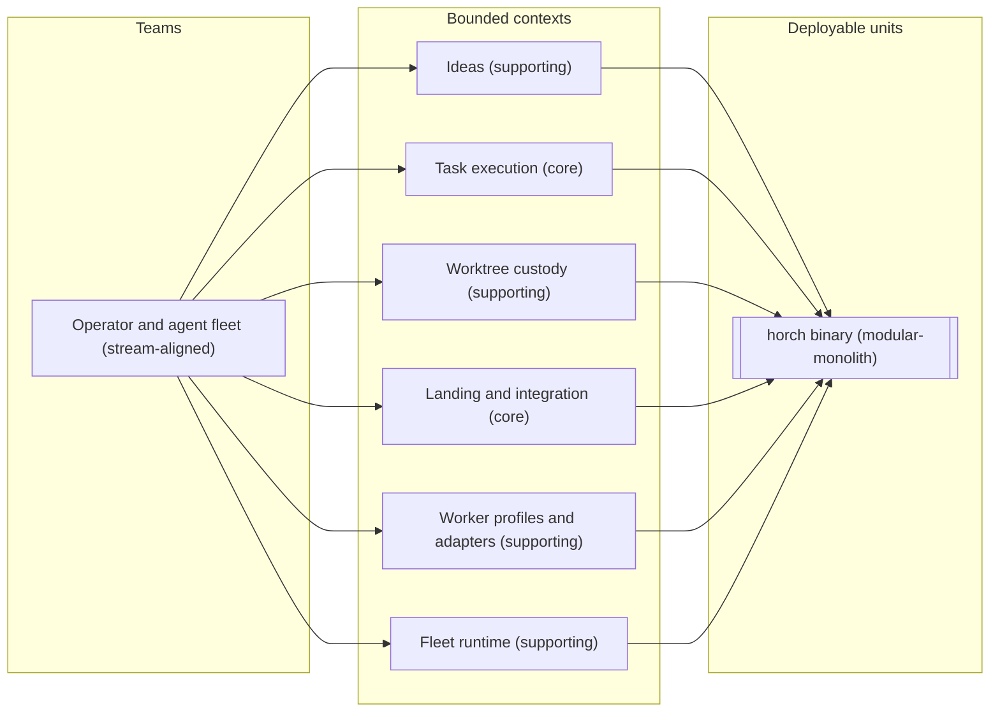

# Team topology - fleetd: the horch fleet control plane

_Step 6 of 9 (organise) · mode auto · depth standard · produced 2026-11-12_
_Inputs: ddd/manifest.json, ddd/03-decompose/decompose.json, ddd/05-connect/connect.json, ddd/04-strategize/strategize.json, ddd/01-understand/understand.json, ddd/glossary.md, docs/specs/fleetd/design.md, docs/architecture.md_

## In plain words

We decided who owns each part of fleetd and how many separate programs ship.

**Decided:** 1 team (the operator and the AI agents) owns all 6 parts. All 6 parts ship in 1 program, the horch binary, as separate modules.

**Assumed:** Each part keeps its own database tables and folders inside that 1 program, and no part edits another part's tables.

**Riskiest:** 1 team owns 6 parts, 2 of them core. If nothing checks the module walls, the parts tangle and a later split costs much more. Where docs sync runs is still open (D2).

---

## Summary

- 1 team, 1 deployable, topology style `modular-monolith`; target 1-1, within target. The design fixes it: fleetd is a subcommand of the single horch binary (design: Amendments D9, FM-34).
- Core contexts `task-execution` and `integration` are owned by `core-team`, with the 4 supporting contexts. No context is bought or generic. herdr, the agent CLIs, git, GitHub and the OS service managers are external systems behind adapters, not deployables (A6).
- First extraction candidate: none. No input gives a split reason (see Scale check).

## Teams

| Team | Type | Size | Owns contexts | Cognitive load | Notes (minimal team API) |
|---|---|---|---|---|---|
| `core-team` Operator and agent fleet | stream-aligned | not fixed (1 operator plus a changing number of agents, A1) | `ideas`, `task-execution`, `worktree-custody`, `integration`, `worker-profiles`, `fleet-runtime` | high | Runs the horch binary on the operator's machine. Reached through the horch CLI, herdr panes and the needs-you folder. |

### Cognitive-load assessment

- **Intrinsic load:** 2 core contexts (`task-execution` and `integration`, model complexity 8 each in strategize) and 4 supporting contexts (complexity 4 to 5).
- **Extraneous load:** 1 deployable, but 3 host OSes (understand C3), 6 agent CLIs, herdr, git, GitHub and 3 service managers.
- **Rubric:** deployables per person is fine (1 unit). Contexts per team is high (6, the threshold is 5). Qualitative drivers are high (2 core contexts).
- **Verdict:** high (A7).
- **Mitigation:** no second team exists, so a context cannot move. Keep each context a module with its own tables and folders, enforce the boundaries with a test (Q2), give an agent 1 context per task where possible, and add the contexts one at a time in the 8 migration phases (understand C9).

## Interaction modes

One team - no cross-team interactions.

## Deployment topology

### Deployables

#### horch binary (`horch`, modular-monolith)

- **Contexts:** `ideas`, `task-execution`, `worktree-custody`, `integration`, `worker-profiles`, `fleet-runtime` (1 module each inside horch-core).
- **Team:** `core-team`
- **Data store:** own - 1 SQLite ledger (`~/.horch/ledger.sqlite3`, WAL) plus the workspace files. Each context owns its tables and folders (see below).
- **Independent deploy:** yes, through horch self-update and the GitHub release assets (understand C7).
- **Process roles (N1):** the same binary runs as the fleetd daemon (the only ledger writer), as short-lived CLI commands (read-only ledger, requests on the command channel), as the fleet-run wrapper (1 per attempt, A3) and as `horch fleetd check`.
- **Why these contexts live together:** fleetd is a subcommand of the single horch binary, so the CLI, the daemon and the wrapper always have the same version (design: Amendments D9, FM-34; understand C1). All 13 relationships are in-process (connect N1). task-execution calls worker-profiles and fleet-runtime synchronously at every launch (connect F2, F4). 1 team owns every context.

## Data-store ownership

All rows go through the single ledger writer in `fleet-runtime` (decompose N5). The owning context decides its rows (N2).

| Context | Store / schema | Owned by deployable | How others get at it |
|---|---|---|---|
| `ideas` | ledger tables `ideas`, `requirements`, `questions` (A5); idea folders | `horch` | events `plan-committed`, `idea-tasks-landed`, `question-answered` |
| `task-execution` | ledger tables `tasks`, `task_deps`, `task_covers`, `attempts`, `leases`; task and attempt folders | `horch` | events `task-leased`, `task-done`, `task-escalated`, `replan-requested` |
| `worktree-custody` | ledger table `worktrees` | `horch` | events `worktree-created`, `rescue-failed` |
| `integration` | ledger tables `features`, `branches`, `gate_runs`, `trial_merges` | `horch` | events `feature-opened`, `task-branch-landed`, `feature-merged`, `resolver-task-opened` |
| `worker-profiles` | teammate profile files, no ledger table | `horch` | query `launch-environment` through the module contract |
| `fleet-runtime` | ledger tables `events`, `ingested`; the command channel | `horch` | command `start-agent-process`; the single ledger writer |

## Decisions

- **D1 (topology, chosen A, made by step):** 1 horch binary. Option B (a separate fleetd daemon binary) and option C (a separate wrapper binary) let the CLI and the daemon differ in version, the failure FM-34 prevents. The design settles it (D9).
- **D2 (topology, open):** where docs sync runs. Recommendation A: a horch subcommand that fleetd schedules, inside the 1 deployable. The strongest argument against A: the design says to generalise `crates/herdr-docs-sync`, which is its own binary today (option B). The operator decides (Q1).

## Scale check

- **Target:** 1-1 deployables (manifest notes: "fleetd is a subcommand of the single horch binary. The operator and the fleet of AI agents are 1 team."). **Actual:** 1. **Within target:** yes.
- **Why not fewer:** 1 is the minimum.
- **Why not more:** `ideas`, `integration` and `worktree-custody` have async-only inbound, so they are the cheapest to extract. No input gives a split reason: no independent scaling, runtime, regulation, stack or second team. The design requires 1 binary (D9, FM-34). The ledger has 1 writer process (understand C4). `task-execution`, `worker-profiles` and `fleet-runtime` are joined by synchronous calls (connect F2, F4), so a split there adds a process hop to every launch.

## Upstream notes for this step

- understand N6, decompose N1: confirmed. All 6 contexts are modules in 1 deployable (A2, D1).
- strategize N3: confirmed. 1 team owns both cores (A1).
- connect N1: confirmed. The process boundaries it lists are between process roles of the 1 binary and external systems, not between deployables (N1).

## Assumptions

- **A1** (high) 1 stream-aligned team, core-team, owns all 6 contexts. The size is not fixed because the agent count has no cap (understand C13).
- **A2** (high) 1 deployable, the horch binary, holds all 6 contexts (design D9, FM-34; understand C1, N6; decompose N1).
- **A3** (medium) The fleet-run wrapper and `horch fleetd check` are process roles of the horch binary. The wrapper owner is still open (connect D2).
- **A4** (medium) 1 SQLite ledger plus the workspace files; each context owns its tables (table above).
- **A5** (low) The `questions` table belongs to `ideas`, as decompose D2 recommends (still open). It moves with the answer of decompose D2 or decompose Q3.
- **A6** (high) herdr, the agent CLIs, git, GitHub and the OS service managers are external systems behind adapters, not deployables (strategize N1).
- **A7** (medium) Cognitive load of core-team is high; mitigation as above.
- **A8** (medium) Each context owns its workspace folders: idea folders to `ideas`, task and attempt folders to `task-execution`, profile files to `worker-profiles` (understand N17).

## Open questions

- **Q1** (non-blocking, owner: operator) Where does docs sync run: as a horch subcommand that fleetd schedules inside the 1 deployable, or as the separate agent-docs-sync binary that grows from crates/herdr-docs-sync (decision D2)? No context owns docs sync yet (decompose Q2).
- **Q2** (non-blocking, owner: operator) Must a test enforce the module boundaries of the 6 contexts (for example an arch_scan rule: no context writes the tables or folders of another context)? This is the main mitigation of the high cognitive load (A7).
