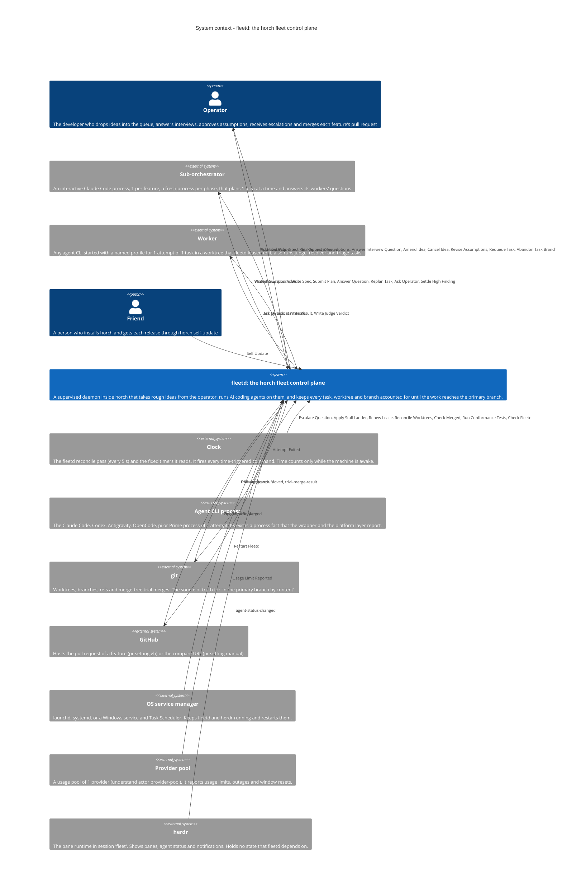

# System context — fleetd: the horch fleet control plane

## In plain words

This step wrote 1 page for each of the 6 parts of fleetd. Each page says what the part decides, who it talks to, its words, its rules and how to measure it. Round 2 applied the decisions of the review.

**Decided:** Only the verifier says a task is done. Only fleetd writes the ledger. No worktree or branch is deleted before its work is saved. worker-profiles starts every agent and removes ANTHROPIC_API_KEY. ideas owns the 1 list of things that wait for the operator. git is split: worktree-custody keeps worktrees and rescue refs, integration moves branches.

**Assumed:** The orchestrator chose cost-reducer for the core parts and specification-model plus approver for ideas. The operator can reverse both. We guessed that fleet-runtime owns the hang restart on all 3 OSes (06 S14).

**Riskiest:** The rescue ref that must exist before a branch rebase (I10) belongs to worktree-custody, but the rebase belongs to integration, and no message joins them yet (Q6). A wrong answer can lose the old tip of a branch.

---

<!-- generated by ddd define render from ddd/07-define/define.json on 2026-11-12T21:59:19Z. Edit define.json and re-render; delete this line to protect hand edits. -->

A supervised daemon inside horch that takes rough ideas from the operator, runs AI coding agents on them, and keeps every task, worktree and branch accounted for until the work reaches the primary branch. C4 level 1: the system as a single box, the people who use it and the external systems it depends on. No technology or internal structure here — that lives in the bounded context canvases and in `ddd-code`.

## People and external systems

| Party | Type | Sends to the system | Receives from the system |
|---|---|---|---|
| Operator (`operator`) | person | Add Idea → `ideas`; Add Direct Idea → `ideas`; Approve Assumptions → `ideas`; Answer Interview Question → `ideas`; Amend Idea → `ideas`; Cancel Idea → `ideas`; Revise Assumptions → `ideas`; Requeue Task → `task-execution`; Abandon Task Branch → `integration`; Merge Pull Request → `integration` | Approval Requested ← `ideas`; Pull Request Opened ← `integration` |
| Sub-orchestrator (`sub-orchestrator`) | external system | Write Assumptions → `ideas`; Write Spec → `ideas`; Submit Plan → `ideas`; Answer Question → `ideas`; Replan Task → `ideas`; Ask Operator → `ideas`; Settle High Finding → `task-execution` | Worker Question Asked ← `ideas`; plan-verdict-written ← `ideas`; Assumptions Approved ← `ideas`; task-verdict-written ← `task-execution` |
| Worker (`worker`) | external system | Ask Question → `ideas`; Write Result → `task-execution`; Write Judge Verdict → `task-execution` | assign-task ← `task-execution`; start-work ← `task-execution` |
| herdr (`herdr`) | external system | agent-status-changed → `ideas`; agent-status-changed → `task-execution` | — |
| Clock (`clock`) | external system | Escalate Question → `ideas`; Apply Stall Ladder → `task-execution`; Renew Lease → `task-execution`; Reconcile Worktrees → `worktree-custody`; Check Merged → `integration`; Run Conformance Tests → `worker-profiles`; Check Fleetd → `fleet-runtime` | — |
| Provider pool (`provider-pool`) | external system | Usage Limit Reported → `task-execution` | — |
| git (`git`) | external system | Primary Branch Moved → `integration`; trial-merge-result → `integration` | trial-merge-result ← `integration` |
| GitHub (`github`) | external system | Pull Request Merged → `integration` | Open Pull Request ← `integration` |
| Friend (`friend`) | person | Self Update → `fleet-runtime` | — |
| OS service manager (`os-service-manager`) | external system | Restart Fleetd → `fleet-runtime` | — |

## Bounded contexts and deployables

_Topology_: modular-monolith, 1 deployable(s), 1 team(s).

| Context | Purpose | Domain | Roles | Team | Deployable | Canvas |
|---|---|---|---|---|---|---|
| **Ideas** (`ideas`) | Ideas takes each rough idea of the operator from capture to 1 committed, validated plan, and closes the idea when its feature is merged (G3). | supporting | specification-model, approver | Operator and agent fleet | horch binary (modular-monolith) | [ideas/bounded-context-canvas.md](ideas/bounded-context-canvas.md) |
| **Task execution** (`task-execution`) | Task execution decides which worker runs each ready task, holds every attempt to an earned lease, and decides from facts on disk when a task is done, so that n… | core | execution-context | Operator and agent fleet | horch binary (modular-monolith) | [task-execution/bounded-context-canvas.md](task-execution/bounded-context-canvas.md) |
| **Worktree custody** (`worktree-custody`) | Worktree custody owns every worktree from the moment it is reserved to the moment it is removed, so that no work a worker paid for is lost (G2). | supporting | execution-context | Operator and agent fleet | horch binary (modular-monolith) | [worktree-custody/bounded-context-canvas.md](worktree-custody/bounded-context-canvas.md) |
| **Landing and integration** (`integration`) | Integration decides when verified task branches land on their feature branch and when a feature is ready for its pull request, so that each idea reaches the pr… | core | execution-context | Operator and agent fleet | horch binary (modular-monolith) | [integration/bounded-context-canvas.md](integration/bounded-context-canvas.md) |
| **Worker profiles and adapters** (`worker-profiles`) | Worker profiles turns 1 named worker profile into the exact CLI, flags, environment, config files and sandbox of each agent launch, so that every agent runs on… | supporting | enforcer | Operator and agent fleet | horch binary (modular-monolith) | [worker-profiles/bounded-context-canvas.md](worker-profiles/bounded-context-canvas.md) |
| **Fleet runtime** (`fleet-runtime`) | Fleet runtime keeps fleetd alive and current on macOS, Linux and Windows, so that supervision never stops silently and no work is lost on a restart (G1, G2). | supporting | gateway, execution-context | Operator and agent fleet | horch binary (modular-monolith) | [fleet-runtime/bounded-context-canvas.md](fleet-runtime/bounded-context-canvas.md) |

### Context relationships (from decompose)

| Id | Upstream | Downstream | Pattern | Why |
|---|---|---|---|---|
| R1 | `ideas` | `integration` | published-language | ideas -> integration, published-language: assumptions-written and direct-idea-accepted (ideaId, featureId) trigger open-feature. Upstream is ideas because the idea events are its to change. Integration consumes them as-is and needs no change in ideas, so not customer-supplier. Async through the reconcile pass. |
| R2 | `ideas` | `task-execution` | customer-supplier | ideas -> task-execution, customer-supplier: plan-committed and task-replanned trigger promote-task; plan-refused triggers escalate-task; question-answered and own-assumption-recorded trigger launch-attempt. The committed plan.yaml is the contract that every task comes from, and plan validation exists to serve task-execution (checks, owner paths, paired judges), so task-execution's needs shape ideas' plan schema. Async. |
| R3 | `task-execution` | `ideas` | published-language | task-execution -> ideas, published-language: replan-requested (taskId, attempts) triggers replan-task by the sub-orchestrator after the last attempt. ideas consumes the event as-is. Separate from R2 because the direction of influence is reversed for this fact. Async. |
| R4 | `task-execution` | `worktree-custody` | customer-supplier | task-execution -> worktree-custody, customer-supplier: task-leased triggers create-worktree; the worktree lease row is written in the same transaction as the task lease. worktree-custody serves the dispatch need (1 worktree per task before launch). The pair also carries the attempt end: active to created or orphaned. Sync inside the fleetd pass. |
| R5 | `worktree-custody` | `task-execution` | published-language | worktree-custody -> task-execution, published-language: worktree-created triggers launch-attempt; rescue-failed triggers escalate-task. task-execution reacts to worktree facts as-is. Async through the reconcile pass. |
| R6 | `task-execution` | `integration` | partnership | task-execution -> integration, partnership (orchestrator, D15): task-done triggers mark-branch-ready; task-escalated lets the operator run abandon-task-branch. Integration asks task-execution to run triage and resolver tasks (open-triage-task, open-resolver-task create normal tasks). R6 and R7 change together: the 2 contexts plan their changes together. Async. |
| R7 | `integration` | `task-execution` | partnership | integration -> task-execution, partnership (orchestrator, D15): task-branch-conflicted triggers launch-attempt on the same task. R6 and R7 change together: the 2 contexts plan their changes together. Async. |
| R8 | `integration` | `worktree-custody` | published-language | integration -> worktree-custody, published-language: task-branch-landed triggers remove-worktree; the worktree moves to landing and landed with its task branch (N6). worktree-custody still refuses a removal that would lose work (04 W6). Async. |
| R9 | `integration` | `ideas` | published-language | integration -> ideas, published-language: task-branch-landed triggers roll-up-idea, and feature-merged triggers close-idea. ideas consumes branch facts as-is and never reads git. Async. |
| R10 | `worker-profiles` | `task-execution` | customer-supplier | worker-profiles -> task-execution, customer-supplier: launch-attempt resolves a profile to exact CLI flags, environment and files, with the ANTHROPIC_API_KEY scrub (N2); profile-marked-unhealthy removes a profile from dispatch and fallback. task-execution needs profiles that fit its dispatch and fallback rules and can negotiate them. attempt-launched triggers start-agent-process (policy start-process-on-launch), and worker-profiles starts the fleet-run wrapper and emits agent-process-started (A11). Sync at launch. |
| R11 | `worker-profiles` | `ideas` | customer-supplier | worker-profiles -> ideas, customer-supplier: start-sub-orchestrator launches a sub-orchestrator pane with a profile and the same environment scrub. The pane starts through start-agent-process too. Sync at launch. |
| R12 | `fleet-runtime` | `task-execution` | open-host-service | fleet-runtime -> task-execution, open-host-service: fleet-runtime gives the single ledger writer (N5) through 1 interface. The platform layer is not part of this link: task-execution calls the leaf crate crates/horch-platform directly for process facts, process-group stop, sandbox, sleep and wake (A10). The same interface serves every context, so open-host-service, not customer-supplier. Sync calls. |
| R13 | `fleet-runtime` | `ideas` | open-host-service | fleet-runtime -> ideas, open-host-service: the command channel carries horch idea commands to fleetd, and the herdr adapter hosts and supervises sub-orchestrator panes. Same interface as R12. Sync calls. |

## Quality attributes (Quality Storming, light)

| Context | Attribute | Priority | Requirement | Scenario |
|---|---|---|---|---|
| `integration` | integrity | high | No branch moves except by fast-forward to a gated candidate, and no branch is deleted unless landed, merged or rescued (I9, I10, I12). | When a bundle fails the fast gate after a rebase, then the feature branch stays at its old tip, the branch resets to its tip from before the land (04 F7), and a rescue ref of the old tip exists. |
| `integration` | correctness | high | Landed and merged are read from git by content, also for a squash merge (I8). | When the operator squash-merges a feature's pull request, then on the next pass the feature becomes merged and its ideas close only after every worktree is removed. |
| `integration` | availability | medium | A stalled git network call never holds the land lock for longer than its bound (04 F11). | When a git push stalls on the network, then it ends at 10 min (other calls at 3 min), is not retried, and the land lock is free for the next bundle. |
| `task-execution` | correctness | high | A task reaches done only from the verifier, from facts on disk (RR-3). | When a worker writes done in its transcript but leaves no valid result.json, then the task stays not-done and the attempt ends as no_result within 1 pass (5 s). |
| `task-execution` | fault-tolerance | high | A stalled worker loses its lease and its task is retried or escalated; no task stays assigned with an expired lease (RR-1, RR-2, I1). | When a worker process is stopped with kill -STOP during an attempt, then the alarm fires within 1 lease (120 s after stall_after) and the task is retried or escalated. |
| `task-execution` | recoverability | high | A restart of fleetd loses and duplicates no task (RR-7, 04 S7). | When fleetd is killed in the middle of a reap, then after restart the attempt is ended and the task requeued exactly once, and outcomes equal a clean run. |
| `task-execution` | availability | high | A usage limit burns no attempt; the task moves to the fallback persona or waits in waiting_quota (RR-11). | When a worker's pool reports a usage limit, then its attempt count does not change and the task restarts on the fallback persona at once or waits until the pool resets. |
| `fleet-runtime` | availability | high | A hung fleetd is restarted on all 3 OSes (PL-5). | When fleetd hangs on macOS, Linux or Windows, then the heartbeat check restarts it within 60 s of awake time and the next pass continues from the ledger. |
| `fleet-runtime` | portability | medium | Core fleetd code has no OS cfg; a missing OS equivalent returns not-supported (PL-2, PL-3). | When the Windows machine probe returns unknown, then dispatch reports it and neither pauses nor treats it as healthy. |
| `ideas` | integrity | high | Only the operator approves an idea's assumptions (FR-10, I7, C5). | When a sub-orchestrator writes approval.json or runs horch idea approve, then the idea stays in awaiting_approval and fleetd ignores the file. |
| `worker-profiles` | confidentiality | high | ANTHROPIC_API_KEY never reaches a child process (C2, 05 E-10, 06 S1). | When the operator's shell has ANTHROPIC_API_KEY set and fleetd launches an attempt, a sub-orchestrator pane, a probe or an updater, then no child environment holds the key. |
| `worktree-custody` | recoverability | high | No worktree is removed before its work is landed or on a verified rescue ref (RR-9, I6). | When a worker is killed with dirty and untracked files, then after cleanup the rescue ref holds every file, read back before removal. |

_Constraints these trace to (understand)_: C1 [technical] fleetd is a subcommand of the single horch binary: 1 deployable unit, so the CLI and the daemon always have the same version; C2 [organisational] Absolute operator rule: ANTHROPIC_API_KEY is never used and is removed from every child process, pane command line, detached child, updater and probe; every claude run uses the subscription login. agy children lose GEMINI_API_KEY, GOOGLE_API_KEY and GOOGLE_GEMINI_BASE_URL; C3 [technical] macOS, Linux and Windows are first-class hosts. Production code of the workspace has no cfg(target_os), cfg(unix), cfg(windows) or cfg(target_family), and no cfg! of these, outside the platform layer; it calls 1 platform interface with 1 module per OS, and an OS without an equivalent returns an explicit not-supported value; C4 [technical] Exactly 1 process writes the ledger (SQLite in WAL mode, ~/.horch/ledger.sqlite3). Schema migration is forward-only at daemon start, a backup is written first (3 kept), a newer schema is refused, and a development build does not migrate the shared ledger; C5 [organisational] Only the operator approves an idea's assumptions, with a command run outside any fleet process; a model can never approve for the operator; C6 [technical] fleetd keeps the behaviors of the Preservation analysis, among them 04 W6, F9, F7, F5, L5, L9, W8, W9, F11, S7, L6, L8, S8, S10 and M5; C7 [technical] fleetd keeps the contract surface: exit codes 0, 1, 2 and 3, the mail contract for interactive panes, the UNLANDED and UNREGISTERED reports, horch self-update and its release assets, ticket format C1 and project facts; C8 [technical] fleetd keeps today's fixed values: land lock 1 h with 5 tries, check timeout 20 min (max 24 h), git push 10 min and other git network calls 3 min, code-sweep at most 2 requeues and review rounds of 1 (light) and 3 (full); C9 [timeline] Migration runs in 9 phases (Phase 0, Phase P, then Phases 1 to 7) in order. Each phase is released to every user at once when its gate test passes; the tests are the only gate. Phase 0 keeps a list of expected failures, so a red test of Phase 0 does not block a gate; C10 [contractual] Agent CLI vendors set the terms: each provider pool has a usage window and limits, Codex user hooks need trust, and a new CLI release is used only after the update cooldown of more than 1 week; C11 [technical] The only bytes typed into a terminal are 1 fixed doorbell line written by fleetd's code; all hand-off between agents is through files written atomically; C12 [technical] Each agent works inside a context limit of 256k tokens; C13 [budget] There is no spend budget and no cap on features, sub-orchestrators or workers. Only health guards for free disk and machine load pause new dispatch; C14 [technical] herdr holds no state that fleetd depends on; after a herdr restart fleetd rebuilds from the ledger and the files

## Open questions and assumptions (this step)

- Assumption A1 (low): ideas: 'conformist' guessed for external system sub-orchestrator (core contexts protect their model; others conform) - confirm
- Assumption A2 (low): ideas: 'conformist' guessed for external system worker (core contexts protect their model; others conform) - confirm
- Assumption A3 (low): ideas: 'conformist' guessed for external system clock (core contexts protect their model; others conform) - confirm
- Assumption A4 (low): task-execution: 'anticorruption-layer' guessed for external system worker (core contexts protect their model; others conform) - confirm
- Assumption A5 (low): task-execution: 'anticorruption-layer' guessed for external system agent-cli (core contexts protect their model; others conform) - confirm
- Assumption A6 (low): task-execution: 'anticorruption-layer' guessed for external system provider-pool (core contexts protect their model; others conform) - confirm
- Assumption A7 (low): task-execution: 'anticorruption-layer' guessed for external system clock (core contexts protect their model; others conform) - confirm
- Assumption A8 (low): task-execution: 'anticorruption-layer' guessed for external system sub-orchestrator (core contexts protect their model; others conform) - confirm
- Assumption A9 (low): worktree-custody: 'conformist' guessed for external system clock (core contexts protect their model; others conform) - confirm
- Assumption A10 (low): integration: 'anticorruption-layer' guessed for external system git (core contexts protect their model; others conform) - confirm
- Assumption A11 (low): integration: 'anticorruption-layer' guessed for external system clock (core contexts protect their model; others conform) - confirm
- Assumption A12 (low): worker-profiles: 'conformist' guessed for external system clock (core contexts protect their model; others conform) - confirm
- Assumption A13 (low): fleet-runtime: 'conformist' guessed for external system clock (core contexts protect their model; others conform) - confirm
- Assumption A14 (low): fleet-runtime: 'conformist' guessed for external system os-service-manager (core contexts protect their model; others conform) - confirm
- Assumption A15 (medium): Worker, wrapper and sub-orchestrator input reaches fleetd only as files of the fleetd file protocol, which ingestion validates and reads idempotently (FR-7, RR-8). So the core contexts guard these inputs with an anticorruption layer, and the pre-fill guesses A4, A5, A7, A8, A10 and A11 hold.
- Assumption A16 (high): fleetd earns no revenue. It saves operator time and paid usage (G1, G2, G4). So the business model of ideas, task-execution, worktree-custody, integration and fleet-runtime is cost-reducer. Decision D1 took option A (orchestrator, D15).
- Assumption A17 (medium): worker-profiles is a compliance-enforcer: its main value is that every launch obeys the ANTHROPIC_API_KEY rule and the login rules (C2, 05 E-10, 06 S1, S3).
- Assumption A18 (high): ideas plays the specification-model role (it produces the validated plan that task-execution executes) and the approver role (the operator approval gate, FR-10). Decision D2 took option A (orchestrator, D15).
- Assumption A19 (medium): integration receives pull-request-merged from GitHub only as a hint to check sooner. The fact merged is read from git by content (I8, design Between features). connect carries the message since revision round 2 (connect N7).
- Assumption A20 (medium): integration sends open-pull-request to GitHub when the project setting pr is gh. With pr manual it pushes the feature branch and shows the compare URL; no GitHub call is made.
- Assumption A21 (medium): Metric thresholds use the fixed values of the design (pass 5 s, start timeout 90 s, lease 120 s, stall_after 300 s, heartbeat check 30 s). An invariant metric has the target 0 violations.
- Assumption A22 (high): The define step changes no upstream relationship. Every message id on a canvas comes from connect or discover. The GitHub, herdr and file protocol rows use the connect messages of revision round 2 (connect N7).
- Assumption A23 (medium): herdr agent status (agent-status-changed) is a liveness hint, never a state. ideas conforms to it for sub-orchestrator panes; task-execution reads it through its anticorruption layer as 1 of its liveness signals (connect N7).
- Assumption A24 (high): task-execution and integration are a partnership (orchestrator, D15; connect N6). The canvas rows between them carry the pattern partnership, and their 2 state machines change together. decompose R6 and R7 keep their patterns; this step does not edit decompose.
- Assumption A25 (high): There is 1 needs-you list, and ideas owns it (orchestrator, D15; design OR-3; decompose N9). task-execution sends task-escalated to ideas, and ideas puts the task on the list beside approvals and escalated questions. No context other than ideas shows an item to the operator for a decision.
- Assumption A26 (high): git has 2 callers, split by concern (orchestrator, D15). worktree-custody calls git worktree add, remove and list and writes the rescue refs under refs/horch/rescue/. integration calls the branch and merge commands: rebase, merge-tree, fast-forward, push and branch delete.
- Assumption A27 (high): Task branches rebase at landing (orchestrator, D15). A rebase of a feature branch does not wait for the running attempts of the feature. An attempt on an old base meets a conflict at landing, and the task branch goes to conflicted.
- Assumption A28 (high): An operator requeue sets the attempt count to 0. A requeue by a review keeps its own counter (orchestrator, D15; discover N12).
- Assumption A29 (medium): A worker question escalates to the operator after 15 min with no answer from a running sub-orchestrator. This is a starting value. The wait for the operator has no limit (orchestrator, D15; discover N12).
- Assumption A30 (high): worker-profiles owns start-agent-process and the fleet-run wrapper (orchestrator, D15; decompose N8; connect N3). The wrapper is the profile made real: private config home, environment scrub and adapter event mapping. fleet-runtime starts no agent process.
- Assumption A31 (high): ideas is split by module (strategize D1 option C, orchestrator, D15). Plan validation is a domain model: coverage, the DAG, judge pairing, the model guide and the declared gates. Intake, the dispatcher and questions stay active-record with invariant tests (strategize N2).
- Assumption A32 (high): The platform layer is the leaf crate crates/horch-platform (design A19). It is not a bounded context, and fleet-runtime does not own it; each context calls it directly (decompose N7). Phase P moves the 178 existing production sites with no change of behavior (D16, PL-6).
- Assumption A33 (medium): Preservation row 06 S14 (design A21: hang detection and restart on all 3 OSes, not only systemd or launchd) has no owner upstream. fleet-runtime owns it, because it owns the heartbeat check and the restart of fleetd.
- Note N1 for code (boundary): Sharpens understand N4 and discover N4: task-execution owns exactly 1 writer of the task state done, the verification module. ddd-code must give no other code path (wrapper, worker file, CLI command) a way to set done; a test proves that a result file alone leaves the task in verifying (RR-3).
- Note N2 for code (risk): Each canvas lists its invariants by id (I1 to I13) and its preservation rows by id. ddd-code must turn each listed invariant into 1 check of check_invariants and 1 test in the owning module: task-execution I1, I2, I4, I5; ideas I3, I7, I13; worktree-custody I6; integration I8 to I12. For the active-record contexts the tests are invariant tests with no aggregate (strategize N2): the approval hash (I7) in ideas, the rescue ref before removal (RR-9) in worktree-custody, and the ANTHROPIC_API_KEY scrub in worker-profiles.
- Note N3 for code (process): Quality attributes of the core contexts are fault-injection scenarios of the design (FM rows). ddd-code must name a test for each quality_attributes row with priority high before the implementation plan names a module.
- Note N4 for code (risk): Confirms and sharpens decompose N3, discover N8 and understand N15: the business_decisions of each canvas cite its preservation rows by id, and each row has exactly 1 owning canvas. 04 L5 is cited by task-execution (the parked task) and integration (the unlanded branch); integration owns it, as decompose N3 says. ddd-code must give each row 1 test in its owning module.
- Note N5 for code (boundary): Sharpens organise N4 (orchestrator, D15): git has 2 adapters. worktree-custody alone calls git worktree add, remove and list and writes refs under refs/horch/rescue/. integration alone calls rebase, merge-tree, fast-forward, push and branch delete. The arch_scan rule must fail a git call of either kind from another module.
- Note N6 for code (risk): Open question Q6: I10 needs a rescue ref before a rebase, and the ref belongs to worktree-custody. Until the operator answers, model it as an in-process call from integration to the worktree-custody rescue module, with no new cross-process message, and test that no rebase runs before the ref reads back.
- Note N7 for code (process): Task branches rebase at landing, and a feature branch rebase does not wait for running attempts (A27). ddd-code needs 1 test: a feature rebase during a running attempt, then the landing of its task branch rebases it or sends it to conflicted.
- Note N8 for code (risk): Sharpens define N4: preservation row 06 S14 (hang detection and restart on macOS, Linux and Windows) is owned by fleet-runtime (A33). It needs 1 test per OS in the fleet-runtime module.

---
_Notation: C4 model level 1 (c4model.com); rendered with Mermaid `C4Context`. Persons are people, `System_Ext` are systems outside our control._
