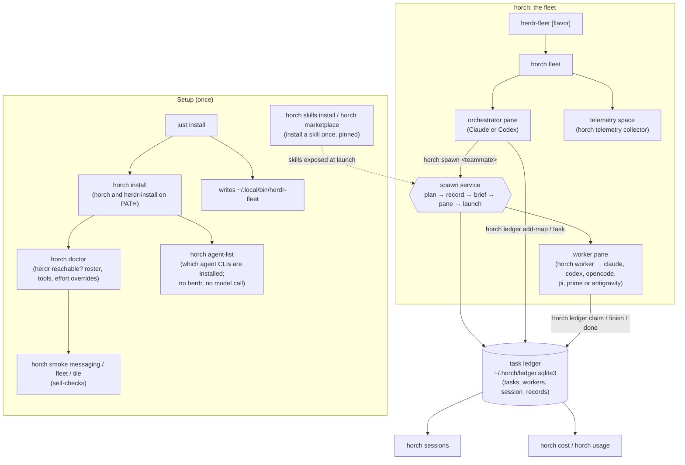

# How the commands fit together

`horch` runs a fleet: one orchestrator that queues work in the task ledger
and spawns the workers that claim it. Every worker starts through the spawn
service, and its session record goes to the `session_records` table of the
task ledger.

A worker runs one of 6 agent CLIs: `claude`, `codex`,
`opencode`, `pi`, `prime` (binary `prime-agent`) or `antigravity` (binary
`agy`). `horch agent-list` shows which of them this machine has.

## 1. The big picture



An old JSON session ledger (`<state dir>/<project>.json`) is read only.
`horch ledger import` copies its records into `session_records` once.
`<project>` is a slug of the project path. The state dir is
`$HORCH_STATE_DIR`, else `${XDG_STATE_HOME:-~/.local/state}/horch`.
The data root (the skill store: marketplace skills and their lock) is
`$HORCH_DATA_DIR`, else `${XDG_DATA_HOME:-~/.local/share}/horch`.
`HORCH_DATA_DIR` names the store itself: horch does not append `horch`.

## 2. The fleet: orchestrator and workers

```mermaid
sequenceDiagram
    actor You
    participant O as Orchestrator pane
    participant H as horch (CLI)
    participant M as Pending mail
    participant L as Ledger
    participant W as Worker pane

    You->>H: herdr-fleet (horch fleet)
    H->>L: insert orchestrator record
    H->>O: open pane, start Claude/Codex

    O->>H: horch sessions
    H-->>O: past workers, summaries, gotchas
    O->>L: horch ledger add-map MAP.md (or horch ledger task)
    O->>H: horch route <teammate> (optional dry run)
    H-->>O: spawn, substitute a fallback, or refuse (exit 3)
    O->>H: horch spawn <teammate> (no task text)
    H->>H: plan: roster + quota/routing + skills (no I/O)
    H->>L: insert record (Planned)
    H->>W: write brief, split pane, run `horch worker`
    H->>L: Starting, pane id recorded
    W->>L: Running; session id recorded (minted or discovered)
    W->>L: horch ledger claim (prints the ticket snapshot)
    W->>W: agent works

    W->>H: horch ledger progress "milestone"
    H->>L: append progress
    W->>H: horch tell orchestrator "QUESTION: ..."
    H->>O: [<role> #<id>] QUESTION: ... arrives in the orchestrator pane
    O->>H: horch tell <role> --answers <id> "..."
    H->>W: [orchestrator re #<id>] ... arrives in the worker pane

    W->>H: horch ledger finish, then horch ledger done "summary"
    H->>M: write pending worker report, start the courier
    H->>L: Done + summary
    H->>O: DONE message (all pushes share 1 20 s budget)
    H->>W: start a detached re-tile, close the pane
```

### When the DONE message does not arrive

`horch done` (and `horch ledger done`, the same command) writes its worker
report to pending mail before it pushes the
DONE message. The report stays pending until the orchestrator runs
`horch inbox` in the orchestrator pane. That command prints the role list first. It then prints each
pending report, oldest first, acknowledges it, and ends with
`N messages acknowledged`. `horch inbox --roles` prints only the role list.
`horch inbox --peek` prints the reports and leaves them pending. An `inbox`
from another pane of the fleet prints the reports and leaves them pending too.

- If the pending-mail write fails, `horch done` fails as a failed report.
  The ledger gets a `report-failed` event. The record stays live, and the
  pane stays open.
- If the courier cannot start, `horch done` takes the report back out of
  pending mail and fails as a failed report. The record stays live, and the
  pane stays open.
- If the write succeeds and the push fails, `horch done` records and closes.
  It prints that the courier will redeliver the report. The ledger gets a
  `report-queued` event with the cause.
- Inside `horch done`, the courier starts before the push. Otherwise it
  starts after each queued report. It checks pending mail every
  5 s. When the orchestrator pane is ready, it resends each due report with
  the same `[<role> #<id>]` tag and
  `(redelivery <n>: not acknowledged; run horch inbox)`.
- The courier waits 30 s, 1 min, 2 min, 4 min, then 5 min between retries.
  It then retries every 5 min until `inbox` acknowledges the mail. A relay
  write is queued delivery, not proof of acknowledgement.
  Retry gaps start at the actual attempt. A busy pane or a login pause skips
  missed slots instead of replaying a backlog on consecutive courier polls.
- The courier exits only when no mail is pending. With no orchestrator pane
  and no live relay, it keeps polling until `horch inbox` acknowledges the
  mail.
- A workspace with no registered orchestrator pane and no live channel relay
  still keeps the report in durable mail. Registering the orchestrator starts
  the courier again. Missing registration never means silent completion.
- A Claude login prompt pauses redelivery and sends one operator notification.
  Delivery resumes when the prompt clears. A question stays open after its
  mail is acknowledged, until the orchestrator runs
  `horch tell <role> --answers <id>`. A plain tell closes no question. A
  horch-raised question closes when the ledger action it names happens.
- An agent that exits without `horch done` ends its record (`Done` on exit
  0, else `Failed`) with an `exited` event. The `horch worker` process,
  which is still alive in the pane, sends the orchestrator
  `[<role>] BLOCKED: My agent exited ... before horch done` with the resume
  command.

### The spawn registration wait

`horch spawn` does not return when the pane opens. It waits up to
`HORCH_SPAWN_WAIT_MS` (default 15000 ms; `0` skips the wait) for the role to
register in the mailbox, or for `<data root>/startup-errors/<role>.txt`. The
worker writes that file when it fails before it registers, because its pane
closes with its stderr. The wait ignores a file older than the spawn.

| what comes first | what `horch spawn` does |
|---|---|
| the role registers on the new pane | prints the `spawned` line on stderr, exits 0 |
| the error file appears | deletes it, ends the record `LaunchFailed{run}` with the worker's error as the reason, closes the pane if it is still open, unregisters the role, prints `worker <role> (pane <id>) failed to start: <error>` and exits 1 |
| the wait ends | warns on stderr that the worker has not registered, exits 0; a worker that registers later still works |

Stdout is the pane id only; every message above goes to stderr. The only
earlier stdout lines are the quota gate line and a refusal line, which print
before the pane opens.

### What a pane command carries

A pane is a fresh shell. It does not inherit the environment of the `horch`
that opened it, so the pane command carries what the pane must see. Every
pane command horch runs (`PaneShell::command_line_with_env` in
`crates/horch-core/src/workspace/paneshell.rs`) does 2 things first:

- It removes `ANTHROPIC_API_KEY`. The way depends on the pane shell
  (`paneshell.rs`):
  - Posix: the line starts with `exec /usr/bin/env -u <NAME>`. The `exec`
    replaces the pane's shell, so no pane process keeps the variable.
  - Posix, a pane that keeps its shell (`PaneShell::command_line_keep_shell`,
    used by smoke, which types more lines): the line starts with
    `unset <NAME>;`, so the shell drops the variable, and then runs
    `/usr/bin/env -u <NAME> ...` without `exec`.
  - PowerShell: the line starts with
    `Remove-Item Env:<NAME> -ErrorAction SilentlyContinue;`.
- It sets `HORCH_DATA_DIR` to the data root of the `horch` that opened the
  pane, so the pane, its agent and every `horch` command the agent runs use
  the same skill store.

The panes that get it:

| Pane | Command | Built in |
|---|---|---|
| orchestrator | `horch pane-launch` | `crates/horch/src/cmd/recipes.rs` |
| worker | `horch worker <role>` | `crates/horch-core/src/execution/service.rs` |
| telemetry collector | `horch telemetry` | `crates/horch/src/cmd/telemetry.rs` |
| smoke checks | `horch register <role>` | `crates/horch/src/cmd/smoke.rs` |

The state dir travels separately: as `--state-dir` on the pane command when
you override it, and in the brief (`state_dir`) for a worker. The brief
carries the roster dir and the binary overrides too. The worker passes all
of them on to its agent as `HORCH_*` variables.

The task ledger travels the same way when you override it: the
orchestrator pane command sets `HORCH_LEDGER_DB`, and a worker's brief
carries `ledger_db`. `HORCH_STATE_DIR` does not move the task ledger, so
`horch fleet`, `horch spawn` and `horch doctor` warn once when it is set
and `HORCH_LEDGER_DB` is not (#199).

Side commands any time: `horch inbox` (live roles), `horch layout` /
`horch tile` / `horch balance` (the pane grid), `horch quota` (the usage
pools: claude, codex, opencode-zen, google, local), `horch agent-list` (the
agent CLIs, their versions and pool state), `horch spawn --resume <id>`
(continue an old worker's session; inside a run it claims the next task).

An `antigravity`, `spec-writer` or `ticket-writer` worker draws on the
`google` pool. Its probe is `agy -p /usage --output-format json`, a slash
command that runs no model turn. Each window is scoped to the model group
`agy` reports it for (`argon`, `gemini`, the `3p` Claude and GPT models), so
an empty Argon bucket moves only the Argon teammates to their fallback.
Without `agy` the probe fails, the pool is `unknown`, and those teammates run
on their fallback. `horch cost` cannot price an Antigravity session: `agy`
writes no local usage file.

## 2b. The task ledger

```mermaid
sequenceDiagram
    participant O as Orchestrator
    participant L as Task ledger (~/.horch/ledger.sqlite3)
    participant W as Worker (horch worker + agent)
    participant D as Watchdog

    O->>L: ledger add-map --dry-run (checks, writes nothing)
    O->>L: ledger run new [--check] / add-map
    O->>L: ledger plan-workers
    O->>W: horch spawn <persona> (no task)
    W->>L: supervisor + agent PIDs, checkin every 30 s
    W->>L: ledger claim (BEGIN IMMEDIATE; prints the ticket snapshot)
    W->>L: ledger progress
    D->>L: every 30 s: reconcile, drain the outbox to durable mail
    D->>L: every 10 min: 1 check row per working worker
    D->>W: dead: ledger stop by recorded PID, requeue
    W->>L: ledger finish: check, code-sweep, complexity-sweep, recheck, land, pr, cleanup
    L->>W: code-sweep: horch spawns the reviewers, 1 NOTE to the orchestrator
    W->>L: ledger done (or ledger handoff <path>)
    L-->>O: wake: startable / reviews-in / held / settled
    O->>L: ledger run gate, then ledger run close
```

Each wake is an outbox row, written in the same transaction as the ledger
change that causes it. The watchdog pass drains undelivered rows into durable
mail every 30 s. A task that stays startable for 2 min with no starting or
claiming worker gets 1 re-wake per board state. A spawned worker that has not
claimed within 3 min is flagged once. When the orchestrator's agent exits in
an active run, the watchdog respawns it (at most 1 time in 10 min and 3 times
in a run), unless `horch fleet stop` or `run close` recorded a stop.

## Together or apart

| Command | Needs a herdr server | Needs a fleet | Spends model money |
|---|---|---|---|
| `horch fleet` / `herdr-fleet` | yes | no (it creates one) | yes, the orchestrator |
| `horch spawn`, `tell`, `inbox`, `tile` | yes | run inside a fleet pane | `spawn` does |
| `horch ledger done` / `horch done` | yes | run by a worker | no |
| `horch ledger progress` / `horch note` | no (it writes the ledger only) | run by a worker | no |
| `horch ledger` board, queue, gate and close commands | no | no | no (`run gate` runs the run check) |
| `horch sessions`, `cost`, `usage`, `quota`, `route` | no | no | no (`quota --refresh` probes) |
| `horch agent-list` | no | no | no (it runs each agent CLI's `--version` unless `--no-probe`) |
