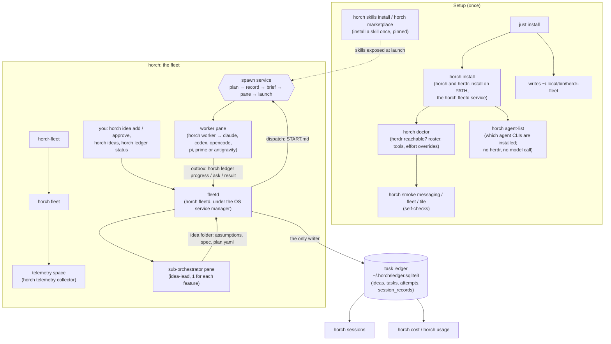
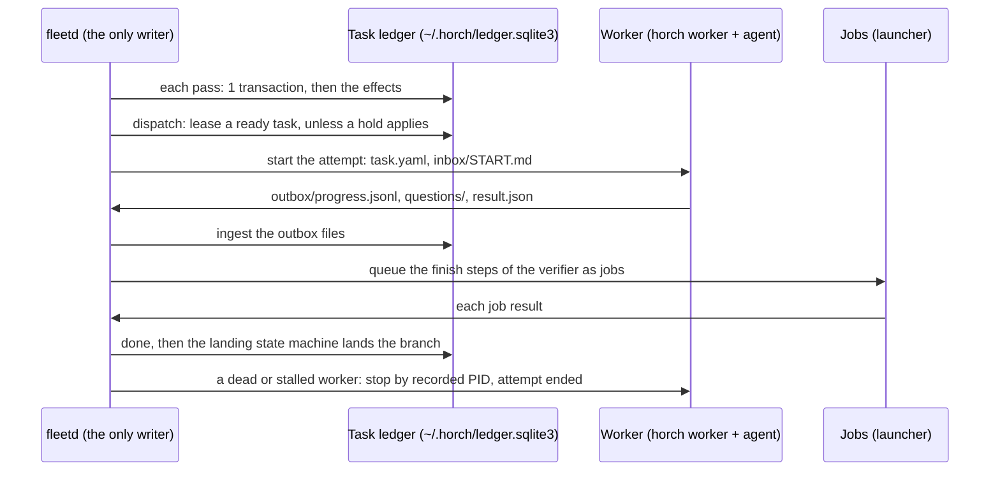

# How the commands fit together

`horch` runs a fleet. You add ideas with `horch idea add`. fleetd, 1
supervised daemon (`horch fleetd`), is the only writer of the task ledger. It
starts 1 sub-orchestrator for each feature, dispatches each ready task to a
worker, runs the finish steps and lands each task branch on its feature
branch. Every worker starts through the spawn service, and its session record
goes to the `session_records` table of the task ledger.

A worker runs one of 6 agent CLIs: `claude`, `codex`,
`opencode`, `pi`, `prime` (binary `prime-agent`) or `antigravity` (binary
`agy`). `horch agent-list` shows which of them this machine has.

## 1. The big picture



An old JSON session ledger (`<state dir>/<project>.json`) is read only.
`horch ledger import` copies its records into `session_records` once.
`<project>` is a slug of the project path. The state dir is
`$HORCH_STATE_DIR`, else `${XDG_STATE_HOME:-~/.local/state}/horch`.
The data root (the skill store: marketplace skills and their lock) is
`$HORCH_DATA_DIR`, else `${XDG_DATA_HOME:-~/.local/share}/horch`.
`HORCH_DATA_DIR` names the store itself: horch does not append `horch`.

## 2. The fleet: ideas, fleetd and workers

```mermaid
sequenceDiagram
    actor You
    participant H as horch (CLI)
    participant F as fleetd
    participant S as Sub-orchestrator pane
    participant L as Ledger
    participant W as Worker pane

    You->>H: horch fleet (herdr-fleet)
    H->>H: horch fleetd check (restart a gone, hung or older fleetd)
    You->>H: horch idea add "<idea>" (or --direct <ticket file>)
    H->>F: write ideas/I-NNNN/idea.md
    F->>L: idea row: captured
    F->>S: start the sub-orchestrator of the feature (1 process per phase)
    S->>You: the interview in its pane
    S->>F: assumptions.md (awaiting approval)
    You->>H: horch idea show <id>, then horch idea approve <id>
    S->>F: spec.md, requirements.yaml, tickets, plan.yaml
    F->>L: plan validated: tasks ready
    F->>F: a hold on dispatch? (horch ledger status names it)
    F->>W: worktree, inbox/START.md, a worker in exec mode
    W->>W: agent works, commits in its worktree
    W->>F: horch ledger progress "milestone" (outbox/progress.jsonl)
    W->>F: horch ask "<question>" (outbox/questions/)
    F->>S: the doorbell: a question of the feature
    S->>F: horch idea note <id> --question <qid> "<answer>"
    W->>F: horch result --status completed --summary "..." (outbox/result.json)
    F->>L: verifier: check, code-sweep, complexity-sweep, recheck
    F->>L: landing: the task branch lands on the feature branch
    F->>F: full gate, push of the feature branch for 1 pull request
    You->>You: merge the pull request; fleetd sees the merge
```

### When the DONE message does not arrive

`horch done` (and `horch ledger done`, the same command) writes its worker
report to pending mail before it pushes the
DONE message. The report stays pending until the orchestrator runs
`horch inbox` in the orchestrator pane. That command prints the role list first. It then prints each
pending report, oldest first, acknowledges it, and ends with
`N messages acknowledged`. `horch inbox --roles` prints only the role list.
`horch inbox --peek` prints the reports and leaves them pending. An `inbox`
from another pane of the fleet prints the reports and leaves them pending too.

- If the pending-mail write fails, `horch done` fails as a failed report.
  The ledger gets a `report-failed` event. The record stays live, and the
  pane stays open.
- If the courier cannot start, `horch done` takes the report back out of
  pending mail and fails as a failed report. The record stays live, and the
  pane stays open.
- If the write succeeds and the push fails, `horch done` records and closes.
  It prints that the courier will redeliver the report. The ledger gets a
  `report-queued` event with the cause.
- Inside `horch done`, the courier starts before the push. Otherwise it
  starts after each queued report. It checks pending mail every
  5 s. When the orchestrator pane is ready, it resends each due report with
  the same `[<role> #<id>]` tag and
  `(redelivery <n>: not acknowledged; run horch inbox)`.
- The courier waits 30 s, 1 min, 2 min, 4 min, then 5 min between retries.
  It then retries every 5 min until `inbox` acknowledges the mail. A relay
  write is queued delivery, not proof of acknowledgement.
  Retry gaps start at the actual attempt. A busy pane or a login pause skips
  missed slots instead of replaying a backlog on consecutive courier polls.
- The courier exits only when no mail is pending. With no orchestrator pane
  and no live relay, it keeps polling until `horch inbox` acknowledges the
  mail.
- A workspace with no registered orchestrator pane and no live channel relay
  still keeps the report in durable mail. Registering the orchestrator starts
  the courier again. Missing registration never means silent completion.
- A Claude login prompt pauses redelivery and sends one operator notification.
  Delivery resumes when the prompt clears. A question stays open after its
  mail is acknowledged, until the orchestrator runs
  `horch tell <role> --answers <id>`. A plain tell closes no question. A
  horch-raised question closes when the ledger action it names happens.
- An agent that exits without `horch done` ends its record (`Done` on exit
  0, else `Failed`) with an `exited` event. The `horch worker` process,
  which is still alive in the pane, sends the orchestrator
  `[<role>] BLOCKED: My agent exited ... before horch done` with the resume
  command.

### The spawn registration wait

This wait belongs to the old flow. fleetd launches each attempt, and
`horch spawn` is retired (section 2c).

`horch spawn` does not return when the pane opens. It waits up to
`HORCH_SPAWN_WAIT_MS` (default 15000 ms; `0` skips the wait) for the role to
register in the mailbox, or for `<data root>/startup-errors/<role>.txt`. The
worker writes that file when it fails before it registers, because its pane
closes with its stderr. The wait ignores a file older than the spawn.

| what comes first | what `horch spawn` does |
|---|---|
| the role registers on the new pane | prints the `spawned` line on stderr, exits 0 |
| the error file appears | deletes it, ends the record `LaunchFailed{run}` with the worker's error as the reason, closes the pane if it is still open, unregisters the role, prints `worker <role> (pane <id>) failed to start: <error>` and exits 1 |
| the wait ends | warns on stderr that the worker has not registered, exits 0; a worker that registers later still works |

Stdout is the pane id only; every message above goes to stderr. The only
earlier stdout lines are the quota gate line and a refusal line, which print
before the pane opens.

### What a pane command carries

A pane is a fresh shell. It does not inherit the environment of the `horch`
that opened it, so the pane command carries what the pane must see. Every
pane command horch runs (`PaneShell::command_line_with_env` in
`crates/horch-core/src/workspace/paneshell.rs`) does 2 things first:

- It removes `ANTHROPIC_API_KEY`. The way depends on the pane shell
  (`paneshell.rs`):
  - Posix: the line starts with `exec /usr/bin/env -u <NAME>`. The `exec`
    replaces the pane's shell, so no pane process keeps the variable.
  - Posix, a pane that keeps its shell (`PaneShell::command_line_keep_shell`,
    used by smoke, which types more lines): the line starts with
    `unset <NAME>;`, so the shell drops the variable, and then runs
    `/usr/bin/env -u <NAME> ...` without `exec`.
  - PowerShell: the line starts with
    `Remove-Item Env:<NAME> -ErrorAction SilentlyContinue;`.
- It sets `HORCH_DATA_DIR` to the data root of the `horch` that opened the
  pane, so the pane, its agent and every `horch` command the agent runs use
  the same skill store.

The panes that get it:

| Pane | Command | Built in |
|---|---|---|
| orchestrator | `horch pane-launch` | `crates/horch/src/cmd/recipes.rs` |
| worker | `horch worker <role>` | `crates/horch-core/src/execution/service.rs` |
| telemetry collector | `horch telemetry` | `crates/horch/src/cmd/telemetry.rs` |
| smoke checks | `horch register <role>` | `crates/horch/src/cmd/smoke.rs` |

The state dir travels separately: as `--state-dir` on the pane command when
you override it, and in the brief (`state_dir`) for a worker. The brief
carries the roster dir and the binary overrides too. The worker passes all
of them on to its agent as `HORCH_*` variables.

The task ledger travels the same way when you override it: the
orchestrator pane command sets `HORCH_LEDGER_DB`, and a worker's brief
carries `ledger_db`. `HORCH_STATE_DIR` does not move the task ledger, so
`horch fleet`, `horch spawn` and `horch doctor` warn once when it is set
and `HORCH_LEDGER_DB` is not (#199).

Side commands any time: `horch inbox` (live roles), `horch layout` /
`horch tile` / `horch balance` (the pane grid), `horch quota` (the usage
pools: claude, codex, opencode-zen, google, local), `horch agent-list` (the
agent CLIs, their versions and pool state), `horch spawn --resume <id>`
(continue an old worker's session; inside a run it claims the next task).

An `antigravity`, `spec-writer` or `ticket-writer` worker draws on the
`google` pool. Its probe is `agy -p /usage --output-format json`, a slash
command that runs no model turn. Each window is scoped to the model group
`agy` reports it for (`argon`, `gemini`, the `3p` Claude and GPT models), so
an empty Argon bucket moves only the Argon teammates to their fallback.
Without `agy` the probe fails, the pool is `unknown`, and those teammates run
on their fallback. `horch cost` cannot price an Antigravity session: `agy`
writes no local usage file.

## 2b. The task ledger



fleetd runs 1 reconcile pass every `pass_period_s`. A pass never waits for a
job. Each effect is a committed row first. A missed event is caught on the
next pass. `horch ledger status` shows each hold on dispatch with its cause:
a health floor, pacing, an unhealthy profile, a git job that holds the
repository, a missing fast gate or a `not_before` time. Anything that needs
you lands in `~/.horch/fleet/needs-you/`, in `horch ideas`, and as a herdr
notification. The retired commands (`horch ledger run new`, `add-map`,
`add`, `task`, `plan-workers`, `run gate`, `run close`, `claim` and
`finish`) print the command that replaces each one. The next section lists
each step of the old flow and what you do now.

## 2c. The old flow and the new

Each command and each skill step of the old orchestrator flow, and what you
do now. A retired command exits 1 and prints its line of this table.

| Old flow | Now |
|---|---|
| `horch ledger run new <slug>` | `horch idea add "<idea>"`: a new feature. fleetd makes its branch and its internal run. |
| `horch ledger add-map <MAP.md>` | The sub-orchestrator writes `plan.yaml` and tickets. fleetd validates and commits the plan after your approval. For 1 ticket that you wrote: `horch idea add --direct <ticket file>`. |
| `horch ledger add-map --dry-run <file>` | Stays. It runs the plan validator on a `MAP.md` or a `plan.yaml`. |
| `horch ledger add`, `horch ledger task` | `horch idea add --direct <ticket file> [--to <feature>]`. |
| `horch ledger plan-workers` | Nothing: fleetd dispatches each ready task. `horch ideas` and `horch status` show each hold. |
| `horch spawn <persona>`, `horch ledger spawn` | Nothing for a task: fleetd launches each attempt. To pair with a persona, plan its task with an interactive persona. |
| `horch ledger worker new`, `worker pid` | Nothing: fleetd records each attempt at its launch. |
| `horch ledger reap` | Nothing: fleetd stops an orphan worker. To stop 1 worker: `horch ledger stop`. |
| `horch ledger stop <worker> "<reason>"` | Stays: it stops 1 worker. |
| `horch ledger unblock` | `horch task requeue <task>`. |
| `horch ledger fallback` | Stays: it gives 1 task to another persona. |
| `horch ledger cancel`, `horch task cancel` | `horch task cancel <task>`. For a whole idea: `horch idea cancel <idea> "<reason>"`. |
| `horch ledger waive` | Stays. |
| `horch ledger run gate` | Nothing: fleetd runs the full gate of a feature as a job when its task branches are landed. |
| `horch ledger run close` | You merge the pull request, and fleetd sees the merge by content. To drop a feature: `horch feature abandon <feature>`. |
| `horch fleet start` (the orchestrator claim and stop) | `horch fleet start` starts fleetd and herdr with no orchestrator. fleetd starts 1 sub-orchestrator for each feature. |
| The orchestrator gets wakes and questions | The sub-orchestrator of the feature gets the questions of its feature. You get the needs-you list, `horch ideas` and herdr notifications. |
| `horch ledger import`, `horch ledger gc` | Stay. |
| `horch ledger worktree scratch`, `horch worktree triage` | Stay. |
| The skill `horch:orchestrate` | Rewritten for you: `horch idea add`, `--direct`, `--to`, `horch ideas`, `horch idea show`, `approve`, `revise`, `amend`, `park`, `cancel`, and the kept commands above. |
| The teammates `spec-writer` and `ticket-writer` | Their steps are the phases of `idea-lead`. |

You keep 4 powers: stop 1 worker (`horch ledger stop`), cancel 1 task
(`horch task cancel`), give a task to another persona (`horch ledger
fallback`), and add 1 task by hand (`horch idea add --direct`).

## Together or apart

| Command | Needs a herdr server | Needs a fleet | Spends model money |
|---|---|---|---|
| `horch fleet` / `herdr-fleet` | yes | no (it creates one) | no |
| `horch idea add`, `idea approve`, `ideas` | no | no | no (fleetd then starts the sub-orchestrator) |
| `horch tell`, `inbox`, `tile` | yes | run inside a fleet pane | no |
| `horch ledger done` / `horch done` | yes | run by a worker | no |
| `horch ledger progress` / `horch note` | no (it writes the ledger only) | run by a worker | no |
| `horch ledger status`, `show`, `events` | no | no | no |
| `horch result`, `horch ask` | no | run by a worker | no |
| `horch sessions`, `cost`, `usage`, `quota`, `route` | no | no | no (`quota --refresh` probes) |
| `horch agent-list` | no | no | no (it runs each agent CLI's `--version` unless `--no-probe`) |
